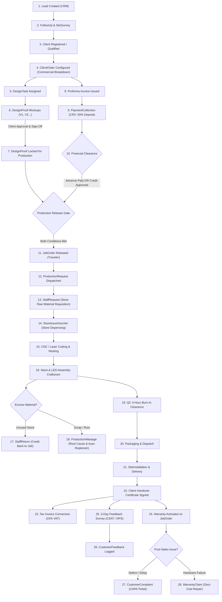

# CRM, Sales, Design, Production & Post-Sales Backend Implementation Plan
## Vector Advert Full ERP — Manufacturing Execution System (MES) & Commercial Operations

**Version:** 1.0.0  
**Target Platform:** Node.js (ES Modules, Express 5, Mongoose 9, MongoDB)  
**Scope:** Backend Architecture, Services, Controllers, Routes, Middlewares, Background Crons, OpenAPI Documentation, and Automated Testing for Models defined in Sections 11 through 18 of `databaseschema.md`.

---

## 1. Executive Architecture & Engineering Standards

### 1.1 Architectural Pattern
The backend follows a layered Service-Oriented Model-View-Controller (MVC) architecture with atomic transaction boundaries:

```
┌────────────────────────────────────────────────────────────────────────┐
│                          HTTP Clients & UI                             │
└───────────────────────────────────┬────────────────────────────────────┘
                                    │
                                    ▼
┌────────────────────────────────────────────────────────────────────────┐
│                        Routes & URL Routing                            │
│           (/api/leads, /api/client-orders, /api/production...)         │
└───────────────────────────────────┬────────────────────────────────────┘
                                    │
                                    ▼
┌────────────────────────────────────────────────────────────────────────┐
│                         Middleware Pipeline                            │
│  - Authentication (protect / optionalProtect)                          │
│  - Authorization & RBAC (authorizeRoles)                               │
│  - Request Validation & Body Sanitization                              │
│  - Business Policy Interlocks (checkCreditHold, verifyClearance)       │
│  - File Uploads & Evidence Attachment (Multer / evidenceHelper)        │
└───────────────────────────────────┬────────────────────────────────────┘
                                    │
                                    ▼
┌────────────────────────────────────────────────────────────────────────┐
│                         Controllers Layer                              │
│  - HTTP Request Parsing & Query Parameter Extraction                   │
│  - Response Formatting ({ success: true, data, message })              │
│  - HTTP Status Code Management (200, 201, 400, 401, 403, 404, 422, 500)│
└───────────────────────────────────┬────────────────────────────────────┘
                                    │
                                    ▼
┌────────────────────────────────────────────────────────────────────────┐
│                          Service Layer                                 │
│  - Core Business Rules & Calculations (VAT, WHT, Nesting Yield)        │
│  - Cross-Model State Transitions & State Machines                      │
│  - Atomic MongoDB Transactions (withTransaction)                       │
│  - Automated Notifications (Telegram, SMS, In-App Alerts)              │
└───────────────────────────────────┬────────────────────────────────────┘
                                    │
                                    ▼
┌────────────────────────────────────────────────────────────────────────┐
│                   Data Access & Mongoose Models                        │
│          23 Schemas, Bi-directional Indexes & Consistency              │
└───────────────────────────────────┬────────────────────────────────────┘
                                    │
                                    ▼
┌────────────────────────────────────────────────────────────────────────┐
│                        MongoDB Database Store                          │
└────────────────────────────────────────────────────────────────────────┘
```

### 1.2 Standards & Technical Conventions
1. **Module System:** Strict ECMAScript Modules (`import` / `export`, `"type": "module"` in `package.json`).
2. **Atomic Transactions:** All state mutations affecting inventory balances, financial ledgers, or multi-model status progressions must use `withTransaction` from `backend/utils/inventoryService.js`.
3. **Response Protocol:**
   - Success: `{ success: true, data: <payload>, message: <string>, meta?: { page, limit, total, totalPages } }`
   - Failure: `{ success: false, message: <error_string>, errors?: <validation_details> }`
4. **Code Generation:** Business codes (`leadNumber`, `clientCode`, `orderNumber`, `jobOrderNumber`, `PRQ-...`, `INV-...`, `CRV-...`, `PST-...`) must be auto-generated with monotonic sequence numbers using `generateCode(prefix, model, field)`.
5. **Data Minimization & Auto-Inheritance:**
   - `ClientOrder` auto-populates billing credentials from `Client`.
   - `DesignProof` inherits deliverables from `DesignTask`.
   - `JobOrder` inherits deliverables and engineering dimensions from `ClientOrder` and approved `DesignProof`.
   - `ProductionRequest` auto-inherits 1:1 DXF cut files and sizing directly from `DesignProof`.
   - `Invoice` auto-inherits line items, TIN, and VAT calculations from `ClientOrder`.
   - `WarrantyClaim` validates coverage directly from `JobOrder.warranty` without a disconnected certificate.
6. **Error Handling:** Unhandled exceptions must be caught in Express async handlers and passed to the central error middleware in `backend/server.js`.

---

## 2. Cross-Subsystem State Machine & Event Flow



---

## 3. Subsystem Implementation Roadmap

The implementation is structured into **8 core phases** followed by an integration and test verification phase:

| Phase | Subsystem Domain | Primary Models Involved | Key Business Outcome |
|---|---|---|---|
| **Phase 1** | CRM & Pre-Sales Engineering | `Lead`, `Client`, `FollowUp`, `SiteSurvey` | Omnichannel lead capture, qualification, client master with credit terms, technical site surveys |
| **Phase 2** | Commercial Orders & Design Pre-Press | `ClientOrder`, `DesignTask`, `DesignProof` | Contractual sales orders, 3D rendering workflows, 1:1 CNC vector toolpath pre-press, proof locking |
| **Phase 3** | Commercial Invoicing, CRV & Credit Control | `Invoice`, `PaymentCollection`, `CustomerCreditLedger` | Proforma & Tax invoices (15% VAT), multi-channel CRV receipts, automated financial clearance & credit-hold lock |
| **Phase 4** | Production Release & Execution Dispatcher | `JobOrder`, `ProductionMachine`, `ProductionRequest` | Traveler release gate, machine registry & queue dispatch, sizing & BOM extraction, 4-hour burn-in QC sign-off |
| **Phase 5** | Closed-Loop Production Materials Flow | `StaffRequest`, `StaffReturn`, `ProductionWastage` | Requisition $\rightarrow$ Issue $\rightarrow$ Return $\rightarrow$ Wastage cost balancing, scrap root causes, auto-replenishment |
| **Phase 6** | Logistics, Field Installation & Handover | `SiteInstallation` (logistics & handover) | Vehicle dispatch, crew deployment, nighttime illumination testing, digital sign-off, automated warranty trigger |
| **Phase 7** | Machinery Maintenance & Repair Work Orders | `MachineMaintenanceSchedule`, `MachineMaintenanceLog`, `MachineRepairOrder` | Routine maintenance checklists, daily pre-shift warmup interlock, breakdown ticketing, calibration certification |
| **Phase 8** | Customer Post-Sales Care & Warranty | `CustomerFeedback`, `CustomerComplaint`, `WarrantyClaim` | 3-day post-install CSAT/NPS surveys, CAPA complaint management, zero-cost warranty validation against `JobOrder.warranty` |
| **Phase 9** | System Integration, Automation Crons & Docs | All 23 Models | Daily credit aging cron, daily maintenance interlock cron, OpenAPI Swagger specs, E2E regression suite |

---

## 4. Granular Phase-by-Phase Execution Plan

---

### Phase 1: CRM & Pre-Sales Engineering Subsystem

#### 1. Objectives & Scope
Enable sales reps and front-desk personnel to capture incoming inquiries, manage follow-up cadences, schedule on-site technical feasibility surveys, and register verified corporate/individual clients with commercial credit limits.

#### 2. Models Involved
- `Lead` (`backend/models/Lead.js`)
- `Client` (`backend/models/Client.js`)
- `FollowUp` (`backend/models/FollowUp.js`)
- `SiteSurvey` (`backend/models/SiteSurvey.js`)

#### 3. Deliverables

##### A. Service Layer (`backend/services/crmService.js`)
- `createLead(leadData, user)`: Auto-generates `leadNumber` (`LEAD-YYYY-XXXX`), verifies duplicates by primary phone, evaluates qualification rating (`hot`, `warm`, `cold`).
- `convertLeadToClient(leadId, clientData, user)`: Atomic transaction converting qualified lead into a `Client` record (`CL-YYYY-XXXX`), copying compliance and contact details, and marking `lead.convertedClient`.
- `recordFollowUp(followUpData, user)`: Logs interaction touchpoint against polymorphic parent (`Lead`, `Client`, `ClientOrder`, `JobOrder`), sets reminder notifications, and triggers Telegram alerts for upcoming tasks.
- `scheduleSiteSurvey(surveyData, user)`: Registers technical survey request, assigns certified surveyor, checks GPS coordinates, and reserves surveying equipment.
- `completeSiteSurvey(surveyId, resultsData, user)`: Captures physical measurements ($W \times H$), wall surface type (`WALL_SURFACE_TYPE_ENUM`), power distance, required access equipment (`scaffolding_tower`, `boom_lift_cherry_picker`), and attaches photo evidence.

##### B. Controllers (`backend/controllers/crmController.js`)
- `getLeads`, `getLeadById`, `createLead`, `updateLead`, `deleteLead`
- `convertLeadToClientHandler`
- `getClients`, `getClientById`, `createClient`, `updateClient`, `updateCreditTerms`
- `getFollowUps`, `createFollowUp`, `completeFollowUpTask`
- `getSiteSurveys`, `getSiteSurveyById`, `createSiteSurvey`, `completeSiteSurvey`, `approveSiteSurvey`

##### C. Routes (`backend/routes/crmRoutes.js`)
- `POST /api/leads` — Create lead (Role: `frontdesk`, `sales_agent`, `manager`)
- `GET /api/leads` — Query leads with filtering (`source`, `status`, `qualificationRating`)
- `GET /api/leads/:id` — Lead details with embedded interaction history
- `PUT /api/leads/:id` — Update lead
- `POST /api/leads/:id/convert` — Convert lead to client
- `GET /api/clients` — Query clients with search and credit status filters
- `GET /api/clients/:id` — Client profile with credit terms and orders
- `POST /api/clients` — Register new client
- `PUT /api/clients/:id` — Update client profile
- `PATCH /api/clients/:id/credit-terms` — Update authorized credit limit and terms (Role: `finance`, `ceo`, `superadmin`)
- `POST /api/follow-ups` — Log interaction or schedule future task
- `GET /api/follow-ups` — Query follow-ups by `entityType` and `entityId`
- `PATCH /api/follow-ups/:id/complete` — Mark task completed
- `POST /api/site-surveys` — Request site survey
- `GET /api/site-surveys` — Query surveys by status and surveyor
- `GET /api/site-surveys/:id` — Full survey report
- `PUT /api/site-surveys/:id/complete` — Submit on-site measurements and evidence
- `PATCH /api/site-surveys/:id/approve` — Supervisor approval of survey feasibility

##### D. Middlewares & Validators
- `validateLeadInput`: Validates phone regex (Ethiopian `+2519...`), required fields.
- `validateSurveyMeasurements`: Asserts `facadeWidthMeters > 0`, `facadeHeightMeters > 0`, `installationHeightFromGround >= 0`.

##### E. Test Specifications (`backend/tests/crmApi.test.js`)
- **Unit/Integration Tests:**
  1. Create lead with valid payload $\rightarrow$ returns 201 with generated `leadNumber`.
  2. Reject lead with duplicate phone number $\rightarrow$ returns 409 Conflict.
  3. Convert hot lead to `Client` $\rightarrow$ verifies atomic creation of Client and update of Lead.
  4. Schedule Site Survey $\rightarrow$ surveyor assigned, state set to `scheduled`.
  5. Complete Site Survey $\rightarrow$ validates required physical measurements and electrical parameters.

---

### Phase 2: Commercial Quotation, Sales Orders & Design Pre-Press Subsystem

#### 1. Objectives & Scope
Manage the transition from qualified customer request to signed commercial agreement and pre-press vector preparation: configure itemized deliverables, compute Ethiopian VAT/Withholding taxes, assign creative design tasks, version 3D mockups ($V_1, V_2$), capture client digital approvals, and lock engineering cut files (`isLockedForProduction`).

#### 2. Models Involved
- `ClientOrder` (`backend/models/ClientOrder.js`)
- `DesignTask` (`backend/models/DesignTask.js`)
- `DesignProof` (`backend/models/DesignProof.js`)

#### 3. Deliverables

##### A. Service Layer (`backend/services/orderDesignService.js`)
- `createClientOrder(orderData, user)`: Auto-generates `orderNumber` (`ORD-YYYY-XXXX`), auto-populates buyer credentials from `Client`, computes commercial subtotal, 15% VAT, 2% Withholding tax, and 50% advance deposit requirement.
- `assignDesignTask(orderId, designerId, briefData, user)`: Creates `DesignTask` linked to `ClientOrder`, extracts survey photos/measurements, sets delivery deadline.
- `submitDesignProofVersion(taskId, proofData, user)`: Generates versioned proof ($V_n$), archives previous versions (`isCurrentVersion: false`), validates daylight mockup, 3D illuminated render, and 1:1 DXF cut vector URL.
- `processClientProofReview(proofId, reviewData, user)`: Records client feedback, revision requests, or digital approval (with signature URL and approver credentials).
- `lockProofForProduction(proofId, user)`: Validates that proof is approved by client, sets `isLockedForProduction = true`, sets `clientOrder.designTask.agreedDesignProofId`, and checks if financial clearance allows immediate `JobOrder` release.

##### B. Controllers (`backend/controllers/orderDesignController.js`)
- `getClientOrders`, `getClientOrderById`, `createClientOrder`, `updateClientOrder`, `cancelClientOrder`
- `getDesignTasks`, `getDesignTaskById`, `createDesignTask`, `updateDesignTaskStatus`
- `getDesignProofsByTask`, `getDesignProofById`, `submitNewProofVersion`, `recordClientProofApproval`, `lockProofHandler`

##### C. Routes (`backend/routes/orderDesignRoutes.js`)
- `POST /api/client-orders` — Create sales order (Role: `sales_agent`, `manager`, `frontdesk`)
- `GET /api/client-orders` — List orders with filters (`status`, `clientId`, `priority`)
- `GET /api/client-orders/:id` — Full order detail including commercial breakdown and design status
- `PUT /api/client-orders/:id` — Update line items or commercial pricing
- `POST /api/design-tasks` — Create and assign design task
- `GET /api/design-tasks` — Query tasks by designer, order, or status
- `GET /api/design-tasks/:id` — Design task brief and version history
- `POST /api/design-tasks/:id/proofs` — Submit new proof version (Role: `designer`, `art_director`)
- `GET /api/design-proofs/:id` — Retrieve specific proof version
- `POST /api/design-proofs/:id/client-review` — Submit client feedback / approval
- `POST /api/design-proofs/:id/lock` — Lock approved proof for production release (Role: `art_director`, `manager`, `sales_agent`)

##### D. Middlewares & Validators
- `verifyProofNotLocked`: Prevents mutating or uploading revisions to a proof that has already been locked for shop-floor cutting.
- `validateOrderCommercials`: Asserts mathematical consistency: $\text{taxableAmount} = \text{subtotal} - \text{discount}$, $\text{vatAmount} = \text{taxableAmount} \times 0.15$, $\text{grandTotal} = \text{taxableAmount} + \text{vatAmount}$.

##### E. Test Specifications (`backend/tests/orderDesignApi.test.js`)
- **Unit/Integration Tests:**
  1. Create `ClientOrder` with 3D channel letters $\rightarrow$ verifies VAT 15% and deposit 50% calculated correctly.
  2. Spawn `DesignTask` from order $\rightarrow$ designer assigned, brief attached.
  3. Upload `DesignProof` $V_1 \rightarrow V_2$ $\rightarrow$ verifies $V_1$ becomes `isCurrentVersion: false` and $V_2$ becomes active.
  4. Submit client approval with signature $\rightarrow$ proof marked approved.
  5. Lock proof $\rightarrow$ prevents further updates, marks order ready for manufacturing release.

---

### Phase 3: Commercial Invoicing, CRV & Receivables Credit Control Subsystem

#### 1. Objectives & Scope
Manage the monetary life-cycle: auto-generate Proforma Invoices for corporate procurement, collect multi-channel payments (CRVs) across bank transfers (CBE/Awash), Telebirr, cheques, and Withholding Tax slips, trigger automated production financial clearance, manage corporate credit accounts, and enforce automated credit-hold locks.

#### 2. Models Involved
- `Invoice` (`backend/models/Invoice.js`)
- `PaymentCollection` (`backend/models/PaymentCollection.js`)
- `CustomerCreditLedger` (`backend/models/CustomerCreditLedger.js`)
- `Client` (embedded `creditTerms`)

#### 3. Deliverables

##### A. Service Layer (`backend/services/billingCreditService.js`)
- `generateInvoiceFromOrder(orderId, invoiceType, user)`: Auto-inherits items, dimensions, and buyer credentials from `ClientOrder`. Assigns `PI-YYYY-XXXX` for proforma or `INV-YYYY-XXXX` for commercial tax invoice.
- `convertProformaToTaxInvoice(proformaId, fiscalRef, user)`: 1-click conversion preserving all line items, archiving proforma code in `proformaReferenceCode`, and generating legal tax invoice number.
- `processPaymentCollection(paymentData, user)`:
  - Creates `PaymentCollection` record (`CRV-YYYY-XXXX`).
  - Increments `invoice.totalPaidAmount` and decrements `invoice.outstandingBalance`.
  - Increments `clientOrder.commercial.advanceDepositAmountPaid`.
  - **Rule 1 Execution:** If total paid $\ge$ required advance deposit, auto-updates `clientOrder.productionClearance.financialClearanceStatus = 'cleared_for_production'`. If design is also locked, sets `isProductionAuthorized = true`!
  - If client is paying an on-credit invoice, logs a credit transaction in `CustomerCreditLedger`.
- `dispatchOnCredit(invoiceId, user)`: Validates that client has credit approval and balance does not exceed credit limit. Marks `invoice.isCreditDispatched = true`, updates `invoice.status = 'credit_settled'`, and posts debit entry in `CustomerCreditLedger`.
- `runDailyCreditAgingAndHoldCheck()`: Batch background job evaluating all open credit ledgers. Sets `daysPastDue`, assigns aging bracket (`0-30`, `31-60`, `61-90`, `90+`), and activates `Client.creditTerms.isCreditHold = true` if grace period (5 days) is exceeded.

##### B. Controllers (`backend/controllers/billingCreditController.js`)
- `getInvoices`, `getInvoiceById`, `createInvoiceFromOrder`, `convertProformaHandler`, `cancelInvoice`
- `getPaymentCollections`, `getPaymentById`, `collectPayment`, `verifyPaymentByFinance`
- `getCustomerCreditLedger`, `getClientCreditProfile`, `updateCreditTerms`

##### C. Routes (`backend/routes/billingCreditRoutes.js`)
- `POST /api/invoices/from-order/:orderId` — Generate Proforma or Tax Invoice
- `GET /api/invoices` — List invoices (`type`, `status`, `clientId`, `overdue`)
- `GET /api/invoices/:id` — Full invoice detail with payment breakdown
- `POST /api/invoices/:id/convert-to-tax` — 1-click convert proforma to VAT invoice (Role: `finance`, `manager`)
- `POST /api/invoices/:id/dispatch-credit` — Dispatch invoice on Net 30/60 credit (Role: `finance`, `manager`)
- `POST /api/payment-collections` — Log Cash Receipt Voucher (CRV) (Role: `frontdesk`, `finance`)
- `GET /api/payment-collections` — Query CRVs by order, invoice, or method
- `PATCH /api/payment-collections/:id/verify` — Finance bank statement verification (Role: `finance`)
- `GET /api/customer-credit/:clientId/ledger` — Full historical credit ledger and statement
- `GET /api/customer-credit/aging-report` — Summary receivables aging report (0-30, 31-60, 61-90, 90+ days)

##### D. Middlewares & Validators
- `checkCreditHold`: Interceptor placed on order authorization routes. Queries `Client.creditTerms.isCreditHold`; if `true`, aborts with HTTP 403: *"Production blocked: Client is on Credit Hold due to overdue invoices or exceeded credit limit."*
- `validatePaymentInstrument`: Ensures bank transaction reference is provided for CBE/Awash transfers, cheque maturity date for cheques, and slip number for WHT vouchers.

##### E. Test Specifications (`backend/tests/billingCreditApi.test.js`)
- **Unit/Integration Tests:**
  1. Auto-generate Proforma from `ClientOrder` $\rightarrow$ verifies line items and pricing match exactly without manual re-typing.
  2. Collect 50% advance deposit via CBE transfer $\rightarrow$ verifies invoice balance decremented and `clientOrder.productionClearance.financialClearanceStatus` automatically flips to `'cleared_for_production'`.
  3. Attempt to release order for client with active credit hold $\rightarrow$ rejected with 403 Forbidden.
  4. 1-click convert proforma to tax invoice $\rightarrow$ creates `INV-` number, archives `proformaReferenceCode`.
  5. Run daily aging evaluation $\rightarrow$ unpaid invoice past 35 days moves to `overdue_31_60_days` and flags `isCreditHold = true`.

---

### Phase 4: Production Release & Shop-Floor Execution Dispatcher Subsystem

#### 1. Objectives & Scope
Enforce the strict manufacturing release gate: spawn the shop-floor `JobOrder` traveler only when both design and financial criteria are satisfied. Register heavy machines (heavy CNC routers, CO2/fiber lasers, letter benders, UV flatbed printers), dispatch itemized `ProductionRequest` travelers with physical dimensions, sheet nesting yield calculations, direct 1:1 DXF cut toolpath presets, bench craftsmanship tasks, and 4-hour burn-in QC sign-offs.

#### 2. Models Involved
- `JobOrder` (`backend/models/JobOrder.js`)
- `ProductionMachine` (`backend/models/ProductionMachine.js`)
- `ProductionRequest` (`backend/models/ProductionRequest.js`)
- `DesignProof`, `ClientOrder`

#### 3. Deliverables

##### A. Service Layer (`backend/services/productionService.js`)
- `releaseJobOrder(clientOrderId, user)`:
  - **Release Gate Validation:** Asserts `clientOrder.designTask.agreedDesignProofId` is approved & locked, AND `clientOrder.productionClearance.isProductionAuthorized === true`.
  - Creates `JobOrder` (`JOB-YYYY-XXXX`).
  - Pre-initializes embedded `JobOrder.warranty` with pending activation status and 4 coverage tiers.
  - Links `JobOrder` back to `ClientOrder.spawnedJobOrderId`.
- `registerProductionMachine(machineData, user)`: Enrolls machine asset (`MCH-CNC-01`), bed dimensions ($W \times L \times Z$), tooling speeds, hourly cost rate, and default operator.
- `createProductionRequest(jobOrderId, requestData, user)`:
  - Generates `PRQ-YYYY-XXXX`.
  - Auto-extracts target physical sizing ($W \times H \times D$, area $\text{m}^2$, acrylic/backer gauge) and 1:1 DXF toolpath cut URL from `DesignProof`.
  - Configures nesting layout ($\text{rawSheetWidth} \times \text{Length}$, sheet count, yield percentage).
  - Itemizes submitted raw material BOM from Store catalog (`StockItem`).
  - Schedules selected machine and tooling specifications.
  - Submits finishing tasks (silicone neon insertion, LED wiring, solvent chemical bonding).
- `recordMachineExecution(requestId, executionData, user)`: Updates machine run hours, linear cut meters, scrap area, and status progression (`machine_in_progress` $\rightarrow$ `machine_completed`).
- `updateFinishingTaskStatus(requestId, taskNumber, statusData, user)`: Updates craftsman benchwork, records bench DC voltage/amperage checks, and attaches verification photo.
- `submitQualityControlClearance(requestId, qcData, user)`: Records 4-hour electrical burn-in results, insulation resistance (Megger test > 2.0 M$\Omega$), illumination uniformity verification, and issues final QC pass.

##### B. Controllers (`backend/controllers/productionController.js`)
- `getJobOrders`, `getJobOrderById`, `releaseJobOrderHandler`, `updateJobOrderStatus`
- `getProductionMachines`, `getProductionMachineById`, `createProductionMachine`, `updateMachineStatus`
- `getProductionRequests`, `getProductionRequestById`, `createProductionRequestHandler`, `updateMachiningExecution`, `updateFinishingTask`, `submitQcClearance`

##### C. Routes (`backend/routes/productionRoutes.js`)
- `POST /api/job-orders/release/:clientOrderId` — Release manufacturing traveler (Role: `manager`, `coo`, `ceo`)
- `GET /api/job-orders` — Query travelers by status, priority, client
- `GET /api/job-orders/:id` — Full traveler detail including routing & warranty
- `GET /api/production-machines` — List all shop-floor cutting and bending machines
- `POST /api/production-machines` — Register machine asset
- `PATCH /api/production-machines/:id/status` — Update machine operational status (`idle`, `in_production`, `breakdown`)
- `POST /api/production-requests` — Dispatch shop-floor production request
- `GET /api/production-requests` — Query requests by machine, craftsman, or status
- `GET /api/production-requests/:id` — Full production request traveler with DXF and wiring links
- `PUT /api/production-requests/:id/machine-execution` — Update CNC/laser cut execution logs
- `PATCH /api/production-requests/:id/finishing-tasks/:taskNumber` — Update bench craftsman progress
- `POST /api/production-requests/:id/qc-clearance` — Submit 4-hour burn-in and insulation clearance (Role: `qc_inspector`, `manager`)

##### D. Middlewares & Validators
- `verifyProductionReleaseGate`: Checks `ClientOrder` to prevent creating a `JobOrder` if design proof is not locked OR advance payment/credit is not cleared.
- `validateDimensionsAndSizing`: Asserts `finishedDimensions.widthCm > 0`, `finishedDimensions.heightCm > 0`, and `totalFabricatedAreaSqM` matches formula.

##### E. Test Specifications (`backend/tests/productionApi.test.js`)
- **Unit/Integration Tests:**
  1. Attempt to release `JobOrder` without financial clearance $\rightarrow$ fails with 422 Unprocessable Entity.
  2. Release `JobOrder` when design proof is locked and deposit paid $\rightarrow$ returns 201 with `JOB-YYYY-XXXX`.
  3. Dispatch `ProductionRequest` $\rightarrow$ verifies 1:1 DXF cut file URL and dimensions inherited from proof.
  4. Update machine execution run time $\rightarrow$ updates operating hours on `ProductionMachine`.
  5. Complete finishing tasks and submit QC clearance with 4-hour burn-in $\rightarrow$ marks request `qc_cleared`.

---

### Phase 5: Closed-Loop Production Materials Flow & Wastage Tracking Subsystem

#### 1. Objectives & Scope
Implement the closed-loop inventory material control system:
$$\underbrace{\text{Materials Issued (SIV)}}_{\text{Store Outflow}} = \underbrace{\text{Consumed in Finished Sign}}_{\text{Capitalized in JobOrder}} + \underbrace{\text{Returned Unused (StaffReturn)}}_{\text{Restored to StockBalance}} + \underbrace{\text{Scrapped / Wasted (ProductionWastage)}}_{\text{Logged & Written-Off}}$$
Support workshop store requisitions, material returns directly crediting job costs, shop-floor scrap registration with root-cause categorization, and auto-generated supplemental requisitions (`isSupplemental`).

#### 2. Models Involved
- `StaffRequest` (`backend/models/StaffRequest.js`)
- `StaffReturn` (`backend/models/StaffReturn.js`)
- `ProductionWastage` (`backend/models/ProductionWastage.js`)
- `JobOrder`, `ProductionRequest`, `StockBalance`, `StockMovement`

#### 3. Deliverables

##### A. Service Layer (`backend/services/materialsCostService.js`)
- `createWorkshopRequisition(requisitionData, user)`: Creates `StaffRequest` of type `'workshop'`, linked to `jobOrderId` and `productionRequestId`. Sets `isSupplemental: true` if generated mid-production.
- `processStaffReturn(returnData, user)`:
  - Verifies storekeeper acceptance of returned uncut sheets, leftover neon flex, or unused transformers.
  - Increments physical stock in `StockBalance`.
  - Emits immutable `StockMovement` of type `'staff_return'`.
  - **Direct Cost Crediting:** Automatically calculates moving-average cost of returned items and decrements `JobOrder.materialRequisition.actualMaterialCostETB`, ensuring accurate job margins!
- `recordProductionWastage(wastageData, user)`:
  - Generates `PST-YYYY-XXXX`.
  - Logs manufacturing stage (`cnc_router_cutting`, `channel_letter_bending`, `led_module_wiring`, `qc_burn_in_testing`), scrap category, and technical root-cause analysis.
  - Calculates financial scrap loss using moving average cost.
  - Tags salvageable offcuts ($> 50 \times 50\text{ cm}$) to the workshop scrap rack.
  - **Rule 2 Auto-Replenishment:** If `requiresMaterialReplenishment === true`, automatically drafts a supplemental `StaffRequest` (`isSupplemental = true`) for the exact replacement quantities and notifies the Storekeeper!

##### B. Controllers (`backend/controllers/productionWastageController.js` & updates to `storeRequestController.js`)
- `getWorkshopRequisitions`, `createWorkshopRequisitionHandler`
- `getStaffReturnsByJobOrder`, `createStaffReturnHandler`, `acceptStaffReturnByStorekeeper`
- `getProductionWastage`, `getWastageById`, `createProductionWastageHandler`, `approveWastageWriteOff`
- `getJobOrderCostAnalysisHandler`: Computes exact net material cost and gross profit margin.

##### C. Routes (`backend/routes/productionWastageRoutes.js` & extensions in `storeRequestRoutes.js`)
- `POST /api/store-requests/workshop` — Create workshop material requisition linked to Job Order
- `POST /api/staff-returns/job-order` — Return unused workshop materials to Store
- `PATCH /api/staff-returns/:id/accept` — Storekeeper accepts returned materials into inventory
- `POST /api/production-wastage` — Log shop-floor scrap/wastage incident
- `GET /api/production-wastage` — Query wastage records by job order, stage, or category
- `GET /api/production-wastage/:id` — Detail scrap incident with root cause and photo evidence
- `PATCH /api/production-wastage/:id/verify` — Supervisor and finance sign-off on scrap write-off
- `GET /api/job-orders/:id/cost-summary` — Real-time material balance, labor, and gross margin report

##### D. Middlewares & Validators
- `validateWastageItems`: Ensures each scrapped item references a valid catalog `StockItem` and unit cost is non-negative.
- `validateStaffReturnJobLink`: Asserts that `jobOrderId` and `sivId` are present and items being returned correspond to the original SIV issuance.

##### E. Test Specifications (`backend/tests/productionWastageApi.test.js`)
- **Unit/Integration Tests:**
  1. Submit workshop `StaffRequest` $\rightarrow$ links `jobOrderId` and `productionRequestId`.
  2. Return 1 unused acrylic sheet via `StaffReturn` $\rightarrow$ store balance incremented, job order actual material cost decremented by exact unit cost.
  3. Log broken tool bit / ruined PVC via `ProductionWastage` with `requiresMaterialReplenishment = true` $\rightarrow$ automatically drafts supplemental `StaffRequest` with `isSupplemental: true`.
  4. Query `/api/job-orders/:id/cost-summary` $\rightarrow$ verifies formula: $\text{Net Material Cost} = \sum \text{SIV Cost} - \sum \text{StaffReturn Cost}$.

---

### Phase 6: Logistics, Field Installation & Handover Subsystem

#### 1. Objectives & Scope
Manage dispatch of manufactured signage from factory to client facade: cargo loading manifest, delivery vehicle dispatch, on-site crew deployment, installation checklist verification (structural anchors, silicone waterproofing, concealed wiring), nighttime illumination test, client digital sign-off, and **automated contractual warranty activation** on `JobOrder`.

#### 2. Models Involved
- `SiteInstallation` (`backend/models/SiteInstallation.js`)
- `JobOrder` (`backend/models/JobOrder.js`)
- `ClientOrder`, `Invoice`

#### 3. Deliverables

##### A. Service Layer (`backend/services/installationService.js`)
- `createSiteInstallation(jobOrderId, installData, user)`: Generates `INS-YYYY-XXXX`, inherits site address, access equipment, and electrical specs from `SiteSurvey`.
- `dispatchInstallationCrew(installationId, crewData, user)`: Logs vehicle gate pass, assigned driver, departure time from workshop, and cargo loading verification.
- `recordInstallationProgress(installationId, progressData, user)`: Records checklist item checks (anchors torqued, transformers IP67 sealed, photocell calibrated) and nighttime illumination reading (uniformity, voltage drop at last letter, total power draw).
- `signHandoverCertificate(installationId, handoverData, user)`:
  - Records client representative name, digital signature, and acceptance condition (`accepted_flawless` or conditional snags).
  - **Rule 1 Warranty Activation:** If `condition === 'accepted_flawless'`, automatically activates `JobOrder.warranty`:
    1. Sets `JobOrder.warranty.status = 'active_under_warranty'`.
    2. Sets `warrantyStartDate = acceptanceDate`.
    3. Computes component expiration dates (Transformers: +12m, Neon Flex: +12m, LEDs: +24m, Structure: +36m).
    4. Generates unique scannable QR code deep link for physical frame plate.
  - Automatically triggers 1-click Tax Invoice generation prompt if delivered on proforma.
  - Schedules 3-day post-installation satisfaction survey task.

##### B. Controllers (`backend/controllers/installationController.js`)
- `getInstallations`, `getInstallationById`, `createInstallation`, `dispatchCrew`, `updateChecklist`, `submitNightTest`, `signHandover`

##### C. Routes (`backend/routes/installationRoutes.js`)
- `POST /api/site-installations` — Schedule installation and delivery
- `GET /api/site-installations` — Query installations by status, date, or lead technician
- `GET /api/site-installations/:id` — Full installation report with cargo manifest and checklist
- `PATCH /api/site-installations/:id/dispatch` — Log workshop departure and driver gate pass
- `PUT /api/site-installations/:id/checklist` — Update mounting and wiring verification checklist
- `POST /api/site-installations/:id/night-test` — Submit nighttime illumination readings and photos
- `POST /api/site-installations/:id/handover` — Submit client signed handover certificate

##### D. Middlewares & Validators
- `validateHandoverSignOff`: Asserts client signature URL and representative phone number are present.
- `verifyJobReadyForDelivery`: Validates that `JobOrder.workstationRouting.electricalAndQC.status === 'passed'`.

##### E. Test Specifications (`backend/tests/installationApi.test.js`)
- **Unit/Integration Tests:**
  1. Schedule `SiteInstallation` $\rightarrow$ verifies logistics and cargo items loaded.
  2. Dispatch vehicle $\rightarrow$ records departure timestamp and driver.
  3. Submit nighttime illumination test $\rightarrow$ logs voltage and uniformity.
  4. Submit signed handover certificate $\rightarrow$ verifies `JobOrder.warranty.status` switches to `'active_under_warranty'` and 4 expiration dates calculated accurately.

---

### Phase 7: Factory Machinery Operations — Maintenance & Repair Work Orders Subsystem

#### 1. Objectives & Scope
Guarantee continuous uptime for high-precision manufacturing equipment: define preventive maintenance checklists (daily pre/post-shift, weekly, monthly), enforce daily pre-shift operator warmup interlocks, log physical sensor readings (chiller temperature, pneumatic air pressure), manage unplanned breakdown tickets, track store spare parts, compute downtime hours, and enforce calibration return-to-service sign-offs.

#### 2. Models Involved
- `MachineMaintenanceSchedule` (`backend/models/MachineMaintenanceSchedule.js`)
- `MachineMaintenanceLog` (`backend/models/MachineMaintenanceLog.js`)
- `MachineRepairOrder` (`backend/models/MachineRepairOrder.js`)
- `ProductionMachine` (`backend/models/ProductionMachine.js`)

#### 3. Deliverables

##### A. Service Layer (`backend/services/machineMaintenanceService.js`)
- `createMaintenanceSchedule(scheduleData, user)`: Creates standard templates for daily, weekly, or monthly intervals tailored by machine type.
- `recordMaintenanceLog(logData, user)`:
  - Generates `MML-YYYY-XXXX`.
  - Captures operator checklist findings and numeric readings (chiller temp, air pressure, spindle warmup).
  - **Rule 1 Interlock Execution:** If `overallResult === 'passed_ready_for_production'` and supervisor certifies, machine operational status automatically updates from `maintenance_hold` to `idle`!
  - Updates `ProductionMachine.maintenanceSchedule.lastMaintenanceDate` and recalculates `nextMaintenanceDueDate`.
- `reportMachineBreakdown(repairData, user)`:
  - Generates `MRO-YYYY-XXXX`.
  - **Rule 2 Breakdown Status:** Immediately switches `ProductionMachine.currentOperationalStatus = 'breakdown'`.
  - Flags interrupted `JobOrder` and `ProductionRequest` on supervisor dashboard for machine re-routing.
- `updateRepairDiagnosis(repairId, diagnosisData, user)`: Records failure category, root-cause summary, and repair strategy.
- `consumeRepairSpareParts(repairId, partsData, user)`: Links spare parts requisitioned from Store (`StockItem`), calculates total parts cost.
- `certifyReturnToService(repairId, testingData, user)`:
  - Records test run results (dimensional variance mm, spindle runout mm).
  - Computes total downtime hours: $(\text{repairCompletedAt} - \text{breakdownTimestamp}) / 3600000$.
  - When certified by supervisor, automatically restores `ProductionMachine.currentOperationalStatus = 'idle'`!

##### B. Controllers (`backend/controllers/machineMaintenanceController.js`)
- `getMaintenanceSchedules`, `createMaintenanceSchedule`, `updateMaintenanceSchedule`
- `getMaintenanceLogs`, `getMaintenanceLogById`, `submitMaintenanceLog`, `certifyMaintenanceLog`
- `getRepairOrders`, `getRepairOrderById`, `createRepairOrder`, `updateRepairDiagnosisHandler`, `addRepairSpareParts`, `certifyReturnToServiceHandler`
- `getMachineOeeAndMetricsHandler`: Computes MTBF and MTTR metrics.

##### C. Routes (`backend/routes/machineMaintenanceRoutes.js`)
- `GET /api/machine-maintenance/schedules` — List maintenance templates
- `POST /api/machine-maintenance/schedules` — Create template (Role: `maintenance_lead`, `coo`)
- `POST /api/machine-maintenance/logs` — Submit daily pre/post-shift or routine execution log
- `GET /api/machine-maintenance/logs` — Query maintenance logs by machine or date
- `PATCH /api/machine-maintenance/logs/:id/certify` — Supervisor verification and machine unlock
- `POST /api/machine-repairs` — Report machine breakdown / create repair work order
- `GET /api/machine-repairs` — Query active repair tickets (`urgency`, `status`, `machineId`)
- `GET /api/machine-repairs/:id` — Full breakdown report with parts and downtime
- `PUT /api/machine-repairs/:id/diagnosis` — Record technical diagnosis
- `POST /api/machine-repairs/:id/spare-parts` — Requisition and log replacement parts from Store
- `POST /api/machine-repairs/:id/certify-return` — Certify calibration and return machine to service

##### D. Middlewares & Validators
- `validateSensorRanges`: Asserts logged chiller temperatures and air pressures conform to template ranges.
- `verifyMachineCanOperate`: Verifies machine is not in `breakdown` or `maintenance_hold` before allowing assignment in `ProductionRequest`.

##### E. Test Specifications (`backend/tests/machineMaintenanceApi.test.js`)
- **Unit/Integration Tests:**
  1. Submit daily pre-shift log with passing warmup $\rightarrow$ unlocks `ProductionMachine` to `'idle'`.
  2. Report spindle screech breakdown $\rightarrow$ immediately sets machine status to `'breakdown'`.
  3. Requisition ceramic spindle bearings from Store $\rightarrow$ computes spare parts cost.
  4. Certify post-repair dial indicator runout $\rightarrow$ restores machine to `'idle'` and computes downtime hours.

---

### Phase 8: Customer Post-Sales Care — Feedback, Complaints & Warranty Claims Subsystem

#### 1. Objectives & Scope
Protect long-term client relationships and brand equity: automate 3-day post-handover satisfaction surveys, compute Net Promoter Score (NPS), escalate detractors ($\le 2$ stars) directly to General Management, handle CAPA complaint tickets with field root-cause diagnosis, and process zero-cost `WarrantyClaim` tickets validated against active coverage windows on `JobOrder.warranty`.

#### 2. Models Involved
- `CustomerFeedback` (`backend/models/CustomerFeedback.js`)
- `CustomerComplaint` (`backend/models/CustomerComplaint.js`)
- `WarrantyClaim` (`backend/models/WarrantyClaim.js`)
- `JobOrder` (`warranty`), `StaffRequest`

#### 3. Deliverables

##### A. Service Layer (`backend/services/postSalesService.js`)
- `recordCustomerFeedback(feedbackData, user)`:
  - Generates `FDB-YYYY-XXXX`.
  - Captures 1–5 star ratings (satisfaction, design fidelity, night illumination, workmanship, delivery speed).
  - Computes NPS score ($0-10$) and category (`promoter`, `passive`, `detractor`).
  - **Rule 3 Detractor Escalation:** If `overallSatisfactionScore <= 2`, sets `requiresManagementFollowUp = true`, auto-generates a high-priority `CustomerComplaint` ticket, and sends urgent Telegram alert to Management!
- `fileCustomerComplaint(complaintData, user)`:
  - Generates `CMP-YYYY-XXXX`.
  - Sets SLA target resolution date based on severity (`critical_brand_emergency`: 4h, `high_safety`: 24h, `medium`: 48h, `low`: 5d).
  - Dispatches field investigator / technician.
  - Records CAPA root cause, replacement parts used, and client resolution sign-off.
- `processWarrantyClaim(claimData, user)`:
  - Generates `CLM-YYYY-XXXX`.
  - **Coverage Validation:** Queries `JobOrder.warranty`:
    - Validates that `JobOrder.warranty.status === 'active_under_warranty'`.
    - Validates that `claimDate <= expirationDeadlines[failedComponentExpiry]`.
    - If valid, sets `isCoveredUnderActiveWarranty = true` and `determination = 'approved_full_parts_and_labor'`.
  - If approved, auto-drafts zero-cost Store `StaffRequest` for replacement components (LED modules / MeanWell power supplies).
  - Dispatches technician to replace components on facade and records client re-acceptance.

##### B. Controllers (`backend/controllers/postSalesController.js`)
- `getCustomerFeedbacks`, `createCustomerFeedback`, `getFeedbackMetricsHandler`
- `getCustomerComplaints`, `getComplaintById`, `createCustomerComplaint`, `updateInvestigation`, `resolveComplaint`
- `getWarrantyClaims`, `getWarrantyClaimById`, `submitWarrantyClaim`, `evaluateWarrantyClaimHandler`, `fulfillWarrantyClaim`

##### C. Routes (`backend/routes/postSalesRoutes.js`)
- `POST /api/customer-feedback` — Submit post-installation customer feedback
- `GET /api/customer-feedback` — Query feedback reviews (`npsCategory`, `rating`, `clientId`)
- `GET /api/customer-feedback/metrics` — Aggregate CSAT and NPS dashboard metrics
- `POST /api/customer-complaints` — Register customer complaint ticket
- `GET /api/customer-complaints` — List complaints (`severity`, `status`, `slaBreached`)
- `GET /api/customer-complaints/:id` — Detail complaint ticket with CAPA investigation
- `PUT /api/customer-complaints/:id/investigation` — Submit root-cause findings
- `POST /api/customer-complaints/:id/resolve` — Submit corrective action and client sign-off
- `POST /api/warranty-claims` — File warranty claim
- `GET /api/warranty-claims` — List warranty claims (`status`, `determination`, `failedComponent`)
- `GET /api/warranty-claims/:id` — Warranty claim details and coverage audit
- `POST /api/warranty-claims/:id/evaluate` — Technical coverage evaluation against `JobOrder.warranty`
- `POST /api/warranty-claims/:id/fulfill` — Requisition zero-cost spare parts and dispatch technician

##### D. Middlewares & Validators
- `validateFeedbackRatings`: Enforces `overallSatisfactionScore` between 1 and 5, and NPS between 0 and 10.
- `verifyWarrantyJobExists`: Ensures referenced `jobOrderId` has a registered `warranty` subdocument.

##### E. Test Specifications (`backend/tests/postSalesApi.test.js`)
- **Unit/Integration Tests:**
  1. Submit 5-star feedback $\rightarrow$ promoter recorded, marketing quote approved for website.
  2. Submit 1-star feedback $\rightarrow$ triggers detractor escalation and auto-generates `CustomerComplaint` ticket.
  3. File warranty claim for failed transformer within 12 months $\rightarrow$ validates against `JobOrder.warranty`, approves claim, auto-generates zero-cost replacement request.
  4. File warranty claim for transformer after 14 months $\rightarrow$ rejected with `rejected_out_of_warranty`.

---

### Phase 9: Cross-Cutting Background Services, Automation Crons & Documentation

#### 1. Objectives & Scope
Implement recurring background automation workers, OpenAPI 3.0 / Swagger documentation for all new endpoints, and end-to-end integration tests.

#### 2. Key Deliverables
1. **Background Cron Service (`backend/scripts/operationsCron.js`):**
   - **Daily 00:00 — Credit Aging & Credit Hold:** Evaluates `CustomerCreditLedger`, sets aging brackets, locks overdue clients (`isCreditHold = true`).
   - **Daily 07:45 — Pre-Shift Maintenance Interlock:** Resets active cutting machines to `maintenance_hold` pending morning inspection log.
   - **Daily 09:00 — Post-Installation Feedback Survey Prompt:** Identifies installations completed 3 days prior and sends automated Telegram/SMS rating prompt.
2. **OpenAPI / Swagger Documentation (`backend/docs/operationsSwagger.js`):**
   - OpenAPI specifications for all 8 subsystems integrated into `/api-docs`.
   - Comprehensive request schemas, query parameters, response examples, and enum definitions.
3. **End-to-End Regression Test Suite (`backend/tests/e2eOperationsWorkflow.test.js`):**
   - Simulates the entire company workflow in a single atomic sequence:
     $$\text{Lead} \rightarrow \text{Survey} \rightarrow \text{Order} \rightarrow \text{Design Proof} \rightarrow \text{Invoice/CRV} \rightarrow \text{JobOrder} \rightarrow \text{PRQ/CNC} \rightarrow \text{Store/Wastage} \rightarrow \text{Installation} \rightarrow \text{Warranty} \rightarrow \text{Feedback}$$

---

## 5. File Structure of New Deliverables

```
backend/
├── constants/
│   └── operationsEnums.js                       [EXISTS - All enums loaded]
├── models/
│   ├── Lead.js                                  [EXISTS]
│   ├── Client.js                                [EXISTS]
│   ├── FollowUp.js                              [EXISTS]
│   ├── SiteSurvey.js                            [EXISTS]
│   ├── SiteInstallation.js                      [EXISTS]
│   ├── ClientOrder.js                           [EXISTS]
│   ├── DesignTask.js                            [EXISTS]
│   ├── DesignProof.js                           [EXISTS]
│   ├── JobOrder.js                              [EXISTS]
│   ├── ProductionMachine.js                     [EXISTS]
│   ├── ProductionRequest.js                     [EXISTS]
│   ├── ProductionWastage.js                     [EXISTS]
│   ├── Invoice.js                               [EXISTS]
│   ├── PaymentCollection.js                     [EXISTS]
│   ├── CustomerCreditLedger.js                  [EXISTS]
│   ├── MachineMaintenanceSchedule.js            [EXISTS]
│   ├── MachineMaintenanceLog.js                 [EXISTS]
│   ├── MachineRepairOrder.js                    [EXISTS]
│   ├── CustomerFeedback.js                      [EXISTS]
│   ├── CustomerComplaint.js                     [EXISTS]
│   ├── WarrantyClaim.js                         [EXISTS]
│   ├── StaffRequest.js                          [EXISTS - Updated]
│   └── StaffReturn.js                           [EXISTS - Updated]
├── services/                                    [NEW DIRECTORY]
│   ├── crmService.js                            [Phase 1]
│   ├── orderDesignService.js                    [Phase 2]
│   ├── billingCreditService.js                  [Phase 3]
│   ├── productionService.js                     [Phase 4]
│   ├── materialsCostService.js                  [Phase 5]
│   ├── installationService.js                   [Phase 6]
│   ├── machineMaintenanceService.js             [Phase 7]
│   └── postSalesService.js                      [Phase 8]
├── controllers/
│   ├── crmController.js                         [Phase 1]
│   ├── orderDesignController.js                 [Phase 2]
│   ├── billingCreditController.js               [Phase 3]
│   ├── productionController.js                  [Phase 4]
│   ├── productionWastageController.js           [Phase 5]
│   ├── installationController.js                [Phase 6]
│   ├── machineMaintenanceController.js          [Phase 7]
│   └── postSalesController.js                   [Phase 8]
├── routes/
│   ├── crmRoutes.js                             [Phase 1]
│   ├── orderDesignRoutes.js                     [Phase 2]
│   ├── billingCreditRoutes.js                   [Phase 3]
│   ├── productionRoutes.js                      [Phase 4]
│   ├── productionWastageRoutes.js               [Phase 5]
│   ├── installationRoutes.js                    [Phase 6]
│   ├── machineMaintenanceRoutes.js              [Phase 7]
│   └── postSalesRoutes.js                       [Phase 8]
├── middleware/
│   ├── operationsValidationMiddleware.js        [Phase 1-8]
│   └── operationsInterlocksMiddleware.js        [Phase 3, 4, 7]
├── scripts/
│   └── operationsCron.js                        [Phase 9]
├── docs/
│   └── operationsSwagger.js                     [Phase 9]
└── tests/
    ├── test_operations_models.js                [EXISTS - Model Tests Pass]
    ├── crmApi.test.js                           [Phase 1 Test]
    ├── orderDesignApi.test.js                   [Phase 2 Test]
    ├── billingCreditApi.test.js                 [Phase 3 Test]
    ├── productionApi.test.js                    [Phase 4 Test]
    ├── productionWastageApi.test.js             [Phase 5 Test]
    ├── installationApi.test.js                  [Phase 6 Test]
    ├── machineMaintenanceApi.test.js            [Phase 7 Test]
    ├── postSalesApi.test.js                     [Phase 8 Test]
    └── e2eOperationsWorkflow.test.js            [Phase 9 Test]
```

---

## 6. Definition of Done (DoD) per Phase

Each phase must meet the following criteria before moving to the next:
1. **Service Logic Verified:** Business rules, auto-codes, and data-inheritance execute with 100% integrity.
2. **Controller & Route Integration:** Handlers connected, mounted in `backend/server.js`, and respond with standardized payload structure.
3. **Role-Based Authorization:** Endpoints guarded with `protect` and appropriate `authorizeRoles`.
4. **Validation Coverage:** Request payloads validated against schema invariants and enums.
5. **Automated Tests Passing:** Dedicated test file in `backend/tests/` passes without errors on a clean test runner.
6. **No Breaking Regressions:** Existing HR, Payroll, and Inventory endpoints continue to operate without interference.

---

## 7. Recommended Implementation Sequence

To ensure frictionless development and avoid circular dependencies:
1. **Phase 1** (CRM & Survey) $\rightarrow$ Establishes customer & technical foundation.
2. **Phase 2** (Order & Design) $\rightarrow$ Establishes commercial items & engineering pre-press files.
3. **Phase 3** (Billing, Payments & Credit) $\rightarrow$ Establishes advance collection and production financial clearance.
4. **Phase 4** (JobOrder & Production) $\rightarrow$ Consumes cleared orders and dispatches factory fabrication.
5. **Phase 5** (Closed-Loop Materials & Scrap) $\rightarrow$ Balances store inventory and calculates real job gross margins.
6. **Phase 6** (Logistics & Installation) $\rightarrow$ Delivers sign, signs handover, and auto-activates warranty.
7. **Phase 7** (Machinery Maintenance & Repairs) $\rightarrow$ Keeps CNC/laser factory assets in service.
8. **Phase 8** (Feedback, Complaints & Warranty) $\rightarrow$ Closes post-sales loop.
9. **Phase 9** (Crons, Swagger & E2E) $\rightarrow$ Locks down system automation and documentation.
