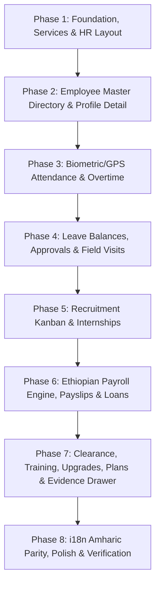

# Vector Advert ERP — HR Module Frontend Implementation Plan

## 1. Executive Summary & Objective

This document outlines the complete architectural blueprint and execution plan for implementing the **Human Resources (HR) Frontend Module** of the **Vector Advert Full ERP** system. 

The backend HR subsystem is fully operational, featuring verified RESTful APIs for employee lifecycle management, GPS-geofenced biometric attendance, overtime tracking, multi-tier leave workflows, recruitment and interview scoring, internships, Ethiopian tax-compliant payroll processing, salary advance loans, departmental clearance, training, professional upgrades, and universal evidence/attachment repositories.

This implementation plan defines the structure, design language, routing, state handling, reusable UI components, and phased rollout strategy for the frontend residing under `frontend/src/pages/hr/` and associated service/component layers.

---

## 2. Technical Stack & Design Foundations

| Area | Technology / Pattern | Specification |
| :--- | :--- | :--- |
| **Framework** | React 19 + Vite 8 | Strict functional components, hooks, lazy route loading |
| **Routing** | React Router v7 | Nested route hierarchy with RBAC route guards |
| **Styling** | Tailwind CSS v4 + Vector Brand Design Tokens | Core brand `#00ced1`, dark mode surfaces (`#070b12`, `#0e1626`, `#152238`), high-contrast `#020617` text on brand fills |
| **Icons** | Lucide React | Contextual icon set with consistent sizing and strokes |
| **Localization** | `react-i18next` + `i18next` | English (`en.json`) and Amharic (`am.json`) parity across all HR views |
| **API Client** | Axios Instance (`api.js`) | Centralized JWT Bearer interception, error boundaries, multipart file upload support |
| **Device Hardware** | Geolocation API + MediaDevices API | HTML5 GPS coordinates acquisition and WebRTC camera stream for attendance selfies |

---

## 3. Directory & File Architecture

```
frontend/src/
├── pages/
│   ├── hr/
│   │   ├── HRLayout.jsx                     # HR Subsystem master layout with sub-navigation & breadcrumbs
│   │   ├── HRDashboard.jsx                  # High-level HR executive metrics, headcount, alerts, quick actions
│   │   ├── employees/
│   │   │   ├── EmployeeList.jsx             # Filterable directory with list & grid view
│   │   │   ├── EmployeeDetail.jsx           # Tabbed profile view (Personal, Job, Fayda ID, Guarantors, Documents, User Account)
│   │   │   ├── EmployeeCreateModal.jsx      # Multi-step wizard to create new employee record
│   │   │   └── components/
│   │   │       ├── NationalIdCard.jsx       # Fayda National ID front/back visual card & approval actions
│   │   │       ├── GuarantorSection.jsx     # Guarantor details with ID review
│   │   │       └── UserAccountLinkModal.jsx # Link or provision user account with temporary password
│   │   ├── attendance/
│   │   │   ├── AttendancePunch.jsx          # Self-service GPS clock-in / clock-out with camera selfie
│   │   │   ├── MyAttendance.jsx             # Employee self attendance calendar & summary
│   │   │   ├── AttendanceManagement.jsx     # HR roster view of daily logs, lateness, overrides
│   │   │   └── AttendanceConfigModal.jsx    # Geofence location lat/long, radius & shift hours configuration
│   │   ├── overtime/
│   │   │   ├── OvertimeList.jsx             # Overtime ledger with filter by status
│   │   │   ├── OvertimeRequestModal.jsx     # Employee submit overtime modal
│   │   │   └── OvertimeReviewModal.jsx      # Manager / HR approval and calculation review
│   │   ├── leave/
│   │   │   ├── LeaveDashboard.jsx           # Balances overview (Annual, Sick, Casual, Maternity) & requests
│   │   │   ├── LeaveRequestModal.jsx        # Submit leave with half-day/full-day & attachment
│   │   │   ├── LeaveApprovalQueue.jsx       # Multi-stage reviewer portal (Manager -> HR -> Executive)
│   │   │   └── LeaveBalanceConfigModal.jsx  # HR annual balance initialization and manual adjustment
│   │   ├── field-visits/
│   │   │   ├── FieldVisitList.jsx           # Planned and active client site visits
│   │   │   ├── FieldVisitCreateModal.jsx    # Schedule visit with purpose, leader, members, client address
│   │   │   └── FieldVisitCheckInModal.jsx   # On-site GPS check-in & selfie capture
│   │   ├── recruitment/
│   │   │   ├── JobPostingsList.jsx          # Job openings table with status badges & public link
│   │   │   ├── JobPostingModal.jsx          # Create/Edit vacancy specifications
│   │   │   ├── ApplicationsKanban.jsx       # Interactive stage pipeline (Applied -> Screen -> Shortlist -> Interview -> Offer -> Hired)
│   │   │   ├── ApplicationDetailModal.jsx   # Candidate resume, portfolio, notes & conversion action
│   │   │   └── InterviewScheduleModal.jsx   # Schedule interviews & scorecard rating feedback
│   │   ├── internships/
│   │   │   ├── InternshipList.jsx           # Intern directory with university, mentor & period
│   │   │   ├── InternshipDetailModal.jsx    # Academic profile, student ID images, evaluations
│   │   │   └── InternshipCreateModal.jsx    # Register new intern
│   │   ├── payroll/
│   │   │   ├── PayrollDashboard.jsx         # Analytics, company costs, net pay breakdown
│   │   │   ├── PayrollRunsList.jsx          # Monthly payroll batches (PR-YYYY-MM) with approval pipeline
│   │   │   ├── PayrollRunDetail.jsx         # Line-by-line employee calculations, gross, tax, pension, net
│   │   │   ├── PayslipViewerModal.jsx       # Printable/Downloadable statutory payslip with official Ethiopian tax layout
│   │   │   ├── SalaryStructureList.jsx      # Employee base salary, allowances & recurring deductions
│   │   │   ├── SalaryStructureModal.jsx     # Create/Update salary structure with tax exemptions
│   │   │   ├── StaffLoansList.jsx           # Salary advances & staff loans with installment schedules
│   │   │   ├── StaffLoanApplyModal.jsx      # Apply for advance / loan
│   │   │   └── PayrollConfigModal.jsx       # Ethiopian tax slabs, pension rates, overtime multipliers
│   │   ├── clearance/
│   │   │   ├── ClearanceList.jsx            # Resignation/termination clearance roster
│   │   │   ├── ClearanceDetailModal.jsx     # Multi-department sign-offs (Dept Head, Store, IT, Finance, HR)
│   │   │   └── ClearanceInitiateModal.jsx   # Initiate offboarding clearance
│   │   ├── training/
│   │   │   ├── TrainingList.jsx             # Training programs, budgets, dates & statuses
│   │   │   ├── TrainingDetailModal.jsx      # Participant attendance, pass/fail grading, certificates
│   │   │   └── TrainingCreateModal.jsx      # Create workshop / training program
│   │   ├── professional-upgrades/
│   │   │   ├── ProfessionalUpgradeList.jsx  # Employee degree / certification sponsorship requests
│   │   │   └── UpgradeRequestModal.jsx      # Submit study sponsorship application
│   │   └── plans/
│   │       ├── PlanList.jsx                 # Strategic & operational plans (Yearly, Quarterly, Monthly)
│   │       ├── PlanDetail.jsx               # Goals, KPIs, assigned tasks checklist, SOP attachments
│   │       └── PlanCreateModal.jsx          # Create operational plan
│   └── ...
├── services/
│   └── hr/
│       ├── employeeService.js               # /api/employees endpoints
│       ├── attendanceService.js             # /api/attendance endpoints
│       ├── leaveService.js                  # /api/leave endpoints
│       ├── overtimeService.js               # /api/overtime endpoints
│       ├── recruitmentService.js            # /api/recruitment endpoints
│       ├── internshipService.js             # /api/internships endpoints
│       ├── payrollService.js                # /api/payroll endpoints
│       ├── fieldVisitService.js             # /api/field-visits endpoints
│       ├── clearanceService.js              # /api/clearances endpoints
│       ├── trainingService.js               # /api/trainings endpoints
│       ├── professionalUpgradeService.js    # /api/professional-upgrades endpoints
│       ├── planService.js                   # /api/plans endpoints
│       └── evidenceService.js               # /api/evidence & /api/upload endpoints
└── components/
    └── hr/
        ├── HRNavHeader.jsx                  # Top navigation pill-bar with submodule links & badge counters
        ├── EvidenceDrawer.jsx               # Universal multi-file attachment drawer with review & notes
        ├── GeoCameraPunch.jsx               # Reusable GPS coords + Camera selfie capture component
        ├── ApprovalTimeline.jsx             # Visual multi-tier approval progress indicator
        ├── StatusBadge.jsx                  # Canonical color-coded badges for all HR statuses
        └── EthiopianTaxTable.jsx            # Formatted table of Ethiopian proclamation tax brackets
```

---

## 4. Submodule Specifications & User Workflows

### 4.1. Employee Master Directory & Profiles
- **Backend Endpoints:**
  - `GET /api/employees` (search, department, status, page, limit)
  - `POST /api/employees` (create record)
  - `GET /api/employees/:id` & `GET /api/employees/me`
  - `PUT /api/employees/:id` (update profile)
  - `POST /api/employees/:id/profile-photo` & `DELETE /api/employees/:id/profile-photo`
  - `POST /api/employees/:id/national-id/photos` (multipart: `frontImage`, `backImage`)
  - `PATCH /api/employees/:id/national-id/approve`
  - `PATCH /api/employees/:id/guarantors/:guarantorId/national-id/approve`
  - `POST /api/employees/:id/documents` & `PATCH /api/employees/:id/documents/:docId/approve`
  - `POST /api/employees/:id/create-user` (provision user account)
  - `POST /api/employees/:id/link-user` / `POST /api/employees/:id/unlink-user`
- **Key UI Capabilities:**
  - Search by employee number, name, phone, department.
  - Multi-tab detail modal: General info, Employment & contract dates, Bank Accounts, Fayda National ID preview with 1-click HR verification badge, Guarantor records with Fayda ID check, and Document repository.
  - User account status banner: shows whether an active login is linked; includes a modal to provision a new user account with temporary credentials and auto-generated roles.

### 4.2. Attendance, GPS Geofencing & Biometrics
- **Backend Endpoints:**
  - `POST /api/attendance/check-in` & `POST /api/attendance/check-out` (`lat`, `long`, `selfie`, `locationRef`)
  - `GET /api/attendance/today`, `GET /api/attendance/me`, `GET /api/attendance/summary`
  - `GET /api/attendance` (management query by date, department, employee)
  - `GET /api/attendance/config` & `PUT /api/attendance/config` (office GPS coordinates, radius, shift times)
  - `PUT /api/attendance/:id` (manual attendance override)
- **Key UI Capabilities:**
  - Real-time GPS calculation: acquires coordinates via HTML5 Geolocation, compares distance against configured office latitude/longitude, displays color-coded proximity indicator (e.g., "Inside Office Perimeter - 18m away").
  - Camera selfie capture: WebRTC stream with a live capture button and client-side image compression before upload.
  - Morning and afternoon shift check-in/out support with status tagging: Present, Late (showing minutes late), Excused, Absent.
  - HR Attendance Management View with date-picker filters, late penalty highlights, and a modal to manually update or excuse records.

### 4.3. Field Visits
- **Backend Endpoints:**
  - `GET /api/field-visits` & `GET /api/field-visits/me`
  - `POST /api/field-visits` (schedule client visit)
  - `POST /api/field-visits/:id/check-in` (GPS coords + selfie)
  - `PATCH /api/field-visits/:id` (report notes, wrap-up)
- **Key UI Capabilities:**
  - Schedule client visit with address, client name, purpose, assigned team members.
  - Mobile-ready check-in button for field agents to capture on-site coordinates and photo.

### 4.4. Overtime Tracking & Approvals
- **Backend Endpoints:**
  - `POST /api/overtime` (submit overtime request)
  - `GET /api/overtime/me` & `GET /api/overtime`
  - `PATCH /api/overtime/:id/decision` (approve/reject with reviewer comment)
- **Key UI Capabilities:**
  - Date & time picker for overtime start and end times; auto-calculates total hours.
  - Approval card displaying department manager and HR review stages.

### 4.5. Leave Management & Balance Tracking
- **Backend Endpoints:**
  - `GET /api/leave/balances/me` & `GET /api/leave/balances`
  - `POST /api/leave/balances/initialize` (annual leave rollover & entitlement init)
  - `PUT /api/leave/balances/:id` (manual adjustment)
  - `POST /api/leave/requests` (request submission)
  - `GET /api/leave/requests/me` & `GET /api/leave/requests`
  - `PATCH /api/leave/requests/:id/review` (multi-tier decision)
  - `POST /api/leave/requests/:id/cancel`
- **Key UI Capabilities:**
  - Balance overview cards: Annual (accrued, used, remaining), Sick, Casual, Maternity/Paternity.
  - Half-day period selector: `full_day`, `morning`, `afternoon`.
  - Multi-tier approval queue with pending counter badge for managers and HR officers.
  - Universal evidence integration for medical sick leave certificates.

### 4.6. Recruitment & Applicant Pipeline
- **Backend Endpoints:**
  - `GET /api/recruitment/jobs` & `POST /api/recruitment/jobs`
  - `GET /api/recruitment/applications` & `POST /api/recruitment/applications`
  - `PATCH /api/recruitment/applications/:id/status`
  - `POST /api/recruitment/applications/:id/convert-to-employee`
  - `POST /api/recruitment/applications/:id/interviews`
  - `PATCH /api/recruitment/applications/:id/interviews/:interviewId/feedback`
- **Key UI Capabilities:**
  - Visual Kanban / Pipeline view for applicants with drag-and-drop or 1-click status transitions.
  - Resume & portfolio preview modal with rating stars (1-5) and interview notes.
  - Interview scheduling modal: date, format (in-person, video, phone), panel members, meeting link.
  - 1-click "Convert to Employee" button that initializes an employee onboarding record from applicant data.

### 4.7. Internship Program
- **Backend Endpoints:**
  - `GET /api/internships` & `POST /api/internships`
  - `GET /api/internships/:id` & `PUT /api/internships/:id`
  - `POST /api/internships/:id/documents`
  - `POST /api/internships/:id/evaluations`
  - `POST /api/internships/:id/convert-to-employee`
- **Key UI Capabilities:**
  - Track student ID front/back photos, university department, internship type (tutorial, paid).
  - Supervisor evaluations and 1-click conversion to permanent employee.

### 4.8. Payroll & Statutory Compensation (Ethiopian Proclamation)
- **Backend Endpoints:**
  - `GET /api/payroll/analytics/summary` (costs, gross, tax, pension, net)
  - `GET /api/payroll/config` & `PUT /api/payroll/config` (tax slabs, pension rates)
  - `GET /api/payroll/structures` & `POST /api/payroll/structures` (base salary, allowances, deductions)
  - `GET /api/payroll/runs` & `POST /api/payroll/runs/generate`
  - `POST /api/payroll/runs/:id/recalculate`
  - `POST /api/payroll/runs/:id/approve` & `POST /api/payroll/runs/:id/disburse`
  - `DELETE /api/payroll/runs/:id`
  - `GET /api/payroll/payslips`, `GET /api/payroll/payslips/my-payslips`, `GET /api/payroll/payslips/:id/html`
  - `GET /api/payroll/loans`, `POST /api/payroll/loans`, `POST /api/payroll/loans/:id/approve`, `POST /api/payroll/loans/:id/disburse`
- **Key UI Capabilities:**
  - Visual summary cards: Gross Pay, Total PAYE Tax, Employee Pension (7%), Employer Pension (11%), Net Disbursed.
  - Payroll Batch Generator (period month/year, cutoff date) with recalculate and approval stepper (`Prepared -> HR -> Finance -> Executive -> Disbursed`).
  - Printable / Downloadable statutory Payslip Viewer rendering the official HTML template with salary breakdown, tax-exempt allowances, loan deductions, and bank account numbers.
  - Staff Loan & Advance Portal with monthly installment repayment tables and balance trackers.

### 4.9. Employee Clearance & Offboarding
- **Backend Endpoints:**
  - `GET /api/clearances` & `GET /api/clearances/me`
  - `POST /api/clearances` (initiate clearance)
  - `PATCH /api/clearances/:id/department/:department` (department sign-off)
  - `POST /api/clearances/:id/finalize` (multipart certificate attachment)
- **Key UI Capabilities:**
  - Department sign-off matrix: Department Head (asset/task handover), Storekeeper (tools returned), IT (credentials revoked), Finance (loans/dues cleared), HR (final benefits).
  - Clearance certificate preview and download.

### 4.10. Training & Professional Upgrades
- **Backend Endpoints:**
  - `GET /api/trainings`, `POST /api/trainings`, `POST /api/trainings/:id/participants`
  - `GET /api/professional-upgrades`, `POST /api/professional-upgrades`, `PATCH /api/professional-upgrades/:id/review`
- **Key UI Capabilities:**
  - Training catalog with participant attendance and score tracking.
  - Sponsorship request form for university degrees or certifications with budget approval workflow.

### 4.11. Operational & Strategic Plans
- **Backend Endpoints:**
  - `GET /api/plans`, `POST /api/plans`, `PATCH /api/plans/:id/approval`
  - `POST /api/plans/:id/tasks`, `PATCH /api/plans/:id/tasks/:taskId`
  - `POST /api/plans/:id/documents`
- **Key UI Capabilities:**
  - Hierarchical plan list (Yearly, Quarterly, Monthly).
  - Interactive task checklist with assignee, completion toggles, and document links.

### 4.12. Universal Evidence & Document Drawer
- **Backend Endpoints:**
  - `GET /api/evidence/:entityType/:entityId`
  - `POST /api/evidence/:entityType/:entityId/attachments`
  - `PATCH /api/evidence/:entityType/:entityId/attachments/:attachmentId/review` (verify/reject)
  - `DELETE /api/evidence/:entityType/:entityId/attachments/:attachmentId`
  - `POST /api/evidence/:entityType/:entityId/notes`
- **Key UI Capabilities:**
  - Reusable slide-out drawer that can be triggered from ANY entity across the entire ERP.
  - Displays thumbnail previews of PDF documents and images, file size, uploader identity, and verification badge.
  - HR verification action (Verify / Reject with reason) and audit notes thread.

---

## 5. Role-Based Navigation & Access Control Matrix

The HR module supports both **Self-Service Mode** (for all authenticated employees) and **Management Mode** (for HR Officers, HR Managers, Department Heads, Finance, Executives, and Super Admins).

| Role | Employee Directory | Attendance | Leave | Recruitment | Payroll Runs | Payslips | Staff Loans | Clearance | Trainings | Plans |
| :--- | :---: | :---: | :---: | :---: | :---: | :---: | :---: | :---: | :---: | :---: |
| **Employee / Intern** | Self Profile | Self Clock-In & History | Self Balances & Request | View Vacancies | - | Self Payslips | Apply & View Self | Self Clearance | Self Trainings | Assigned Tasks |
| **Department Head / Manager** | Dept Staff | Dept Logs | Dept Review | Interviewer | - | Self Payslips | Dept Review | Dept Sign-off | Participant Assign | Create & Review |
| **HR Officer** | Full Edit | Full Manage | Review | Full Pipeline | Structure Edit | View All | Review | HR Sign-off | Manage | Full Access |
| **HR Manager** | Full Access | Full Access | Full Access | Full Access | Generate & Approve | Full Access | Approve | Full Sign-off | Full Access | Full Access |
| **Finance** | View / Bank Info | View | View | - | Approve & Disburse | Full Access | Approve & Disburse | Finance Sign-off | Budget Review | Budget Review |
| **Executive (CEO/CAO/COO)** | Full Access | Full Access | Full Access | Full Access | Executive Sign-off | Full Access | Executive Sign-off | Final Sign-off | Full Access | Plan Approval |
| **Super Admin** | Unrestricted | Unrestricted | Unrestricted | Unrestricted | Unrestricted | Unrestricted | Unrestricted | Unrestricted | Unrestricted | Unrestricted |

---

## 6. Vector Brand & Design System Compliance

All HR views will strictly adhere to the brand guidelines established in `index.css`:
1. **Dominant Color Palette:**
   - Primary Brand: `#00ced1` (Dark Turquoise core).
   - High-contrast text on `#00ced1`: always `#020617` (pure dark navy/black).
   - Light theme surface: `#ffffff`, background: `#f8fafc`.
   - Dark theme surface: `#0e1626`, elevated cards: `#152238`, background: `#070b12`.
2. **Typography & Layout:**
   - Headings: Clear bold sans-serif with subtle brand turquoise glow.
   - Micro-badges: Rounded pill style (`px-2.5 py-0.5 rounded-full text-xs font-bold`).
   - Tables: Clean responsive rows with subtle hover transitions, sticky headers, and pagination controls.
3. **Bilingual Support (i18n):**
   - All labels, buttons, validation alerts, and status badges mapped to both `en.json` and `am.json`.

---

## 7. Phased Implementation Roadmap



### Phase 1: Foundation, Services & HR Layout
- Create all API service modules under `frontend/src/services/hr/` linking to backend endpoints.
- Build `HRLayout.jsx` with responsive sub-navigation pills, role-based tabs, and search.
- Configure nested routing under `/hr` in `frontend/src/App.jsx`.
- Build shared components: `StatusBadge.jsx`, `ApprovalTimeline.jsx`, `EvidenceDrawer.jsx`.

### Phase 2: Employee Master Directory & Profile Detail
- Build `EmployeeList.jsx` with search, department filter, status pill toggles, and grid/table views.
- Build `EmployeeDetail.jsx` tabbed profile viewer (Personal, Job, Fayda ID, Guarantor, Documents, User Account).
- Build `EmployeeCreateModal.jsx` multi-step wizard.
- Build `NationalIdCard.jsx` visual preview with 1-click HR verification.
- Build `UserAccountLinkModal.jsx` for creating/linking user logins with temporary passwords.

### Phase 3: Biometric/GPS Attendance & Overtime
- Build `GeoCameraPunch.jsx` with HTML5 geolocation distance calculation and WebRTC camera stream.
- Build `AttendancePunch.jsx` self-service clock-in/out page with live perimeter check.
- Build `MyAttendance.jsx` calendar and log history.
- Build `AttendanceManagement.jsx` HR management table with date picker and manual correction modal.
- Build `OvertimeList.jsx`, `OvertimeRequestModal.jsx`, and `OvertimeReviewModal.jsx`.

### Phase 4: Leave Balances, Approvals & Field Visits
- Build `LeaveDashboard.jsx` with balance cards (Annual, Sick, Casual, Maternity/Paternity).
- Build `LeaveRequestModal.jsx` supporting half-day periods and medical attachments.
- Build `LeaveApprovalQueue.jsx` multi-tier review workflow for managers and HR officers.
- Build `FieldVisitList.jsx`, `FieldVisitCreateModal.jsx`, and `FieldVisitCheckInModal.jsx`.

### Phase 5: Recruitment Pipeline & Internships
- Build `JobPostingsList.jsx` and `JobPostingModal.jsx`.
- Build `ApplicationsKanban.jsx` interactive stage board.
- Build `ApplicationDetailModal.jsx` with 1-click "Convert to Employee" integration.
- Build `InterviewScheduleModal.jsx` with scorecard ratings.
- Build `InternshipList.jsx`, `InternshipDetailModal.jsx`, and 1-click convert intern to employee.

### Phase 6: Ethiopian Payroll Engine, Payslips & Loans
- Build `PayrollDashboard.jsx` with financial analytics charts.
- Build `SalaryStructureList.jsx` and `SalaryStructureModal.jsx`.
- Build `PayrollRunsList.jsx` and `PayrollRunDetail.jsx` with recalculate, review, and disburse actions.
- Build `PayslipViewerModal.jsx` displaying the official Ethiopian proclamation payslip format with print/download.
- Build `StaffLoansList.jsx` and `StaffLoanApplyModal.jsx`.

### Phase 7: Clearance, Training, Upgrades, Plans & Universal Evidence
- Build `ClearanceList.jsx` and `ClearanceDetailModal.jsx` multi-department sign-off matrix.
- Build `TrainingList.jsx` and `TrainingDetailModal.jsx`.
- Build `ProfessionalUpgradeList.jsx` and `UpgradeRequestModal.jsx`.
- Build `PlanList.jsx` and `PlanDetail.jsx` with task checklist.
- Integrate `EvidenceDrawer.jsx` across all HR modules.

### Phase 8: Amharic i18n Parity, Mobile Polish & End-to-End Verification
- Expand `frontend/src/i18n/en.json` and `frontend/src/i18n/am.json` with all HR translation keys.
- Test responsive mobile views across all forms, tables, and modals.
- Verify end-to-end API integration with the backend server.
