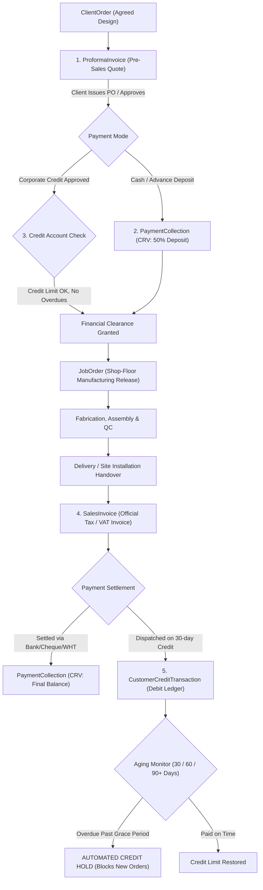
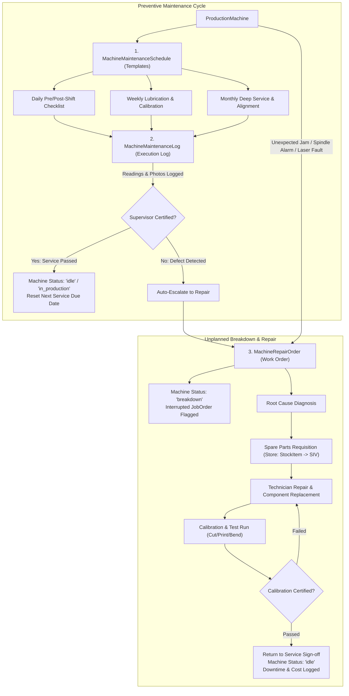
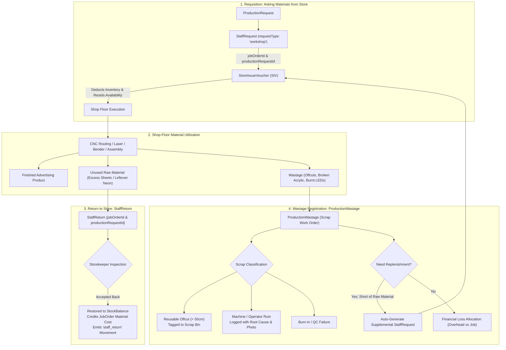
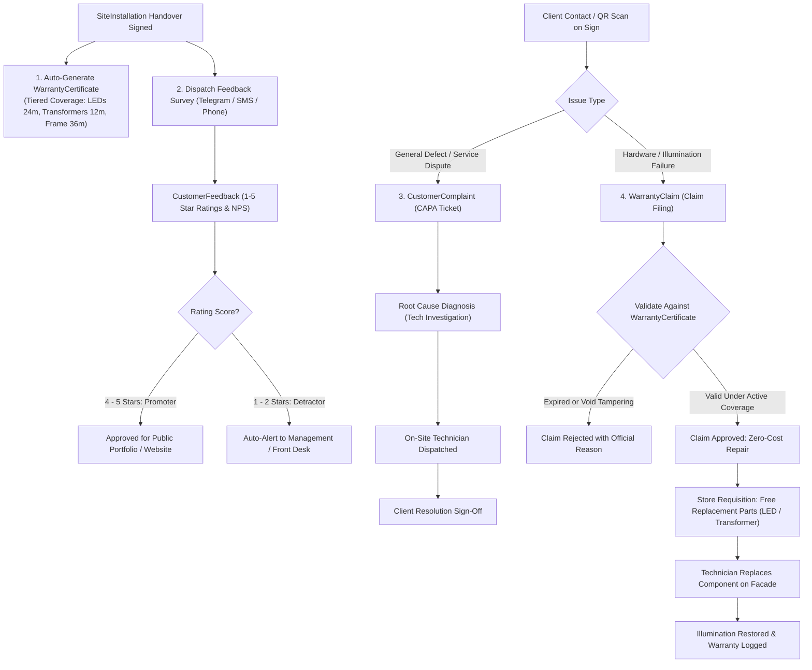

# MongoDB Data Model Architecture

This section explains, in plain language, what information the HR system stores and how its main records are organized in MongoDB.

---

## 1. Data Models

The lists below show the information stored in each part of the system.

### Users

- Email
- Password hash
- Role: [string]
- Account status
- Password reset code
- Password reset code expiry
- Last login time

### Employees

- Employee number
- Linked user account
- Name
    - First
    - Middle
    - Last
- Date of birth
- Email
- Primary phone number
- Alternative phone number
- Profile photo
- National ID:
    - FAN number
    - FIN number
    - Front image url
    - Back image url
    - Approved By
    - Approved at
- Date of birth
- Gender
- Marital status
- Nationality
- Home address
- Emergency Contact: []
    - Name
    - Phone
    - Relationship
- Guarantor: []
    - Name
    - Phone
    - National ID:
        - FAN number
        - FIN number
        - Front image url
        - Back image url
        - Approved By
        - Approved at
- Bank Account: []
    - Band name
    - Holder name
    - Account number
    - Is primary
- Basic salary
- Department
- Job title
- Manager
- Employment status
- Hire date
- Contract end date
- Probation end date
- Work location
- Branch
- Employment type
- Employee document: []
    - Title
    - Type
    - File url
    - Uploaded at
    - Approved By
    - Approved at

### **Leave Balances**

- Employee
- Year
- **Annual Leave**
    - `annualTotalEntitlement`: Number (Default: 16, Max: 16)
    - `annualAccruedDays`: Number (Default: 0, Min: 0, Max: 16)
    - `annualUsedDays`: Number (Default: 0, Min: 0)
    - `annualRemainingDays`: Number (Default: 0, Min: 0)
- **Sick Leave**
    - `sickEntitlement`: Number (Default: 15, Min: 0)
    - `sickUsedDays`: Number (Default: 0, Min: 0)
    - `sickRemainingDays`: Number (Default: 15, Min: 0)
- **Casual Leave**
    - `casualEntitlement`: Number (Default: 5, Min: 0)
    - `casualUsedDays`: Number (Default: 0, Min: 0)
    - `casualRemainingDays`: Number (Default: 5, Min: 0)
- **Maternity Leave**
    - `maternityEntitlement`: Number (Default: 120, Min: 0)
    - `maternityUsedDays`: Number (Default: 0, Min: 0)
    - `maternityRemainingDays`: Number (Default: 120, Min: 0)
- **Paternity Leave**
    - `paternityEntitlement`: Number (Default: 10, Min: 0)
    - `paternityUsedDays`: Number (Default: 0, Min: 0)
    - `paternityRemainingDays`: Number (Default: 10, Min: 0)
- `carriedForwardDays`: Number (Default: 0, Min: 0)
- `lastRecalculatedAt`: Date
- `createdAt`: Date
- `updatedAt`: Date

### Leave Requests

- Employee: ObjectId (ref to Employee)
- Associated leave balance: ObjectId (ref to LeaveBalance)
- Leave type: String ('annual', 'sick', 'casual', 'maternity', 'paternity', 'unpaid', 'other')
- Start date: Date
- Start day period: String ('morning', 'afternoon', 'full_day')
- End date: Date
- End day period: String ('morning', 'afternoon', 'full_day')
- Total leave days: Number
- Request reason: String
- Supporting attachments: [String, urls]
- Request status: String ('pending_manager', 'pending_hr', 'approved', 'rejected', 'cancelled')
- Manager approval:
    - Status: String ('pending', 'approved', 'rejected')
    - Approved by: ObjectId (ref to User)
    - Approved at: Date
    - Comments: String
- HR approval:
    - Status: String ('pending', 'approved', 'rejected')
    - Approved by: ObjectId (ref to User)
    - Approved at: Date
    - Comments: String
- Reviewer: ObjectId (ref to User)
- Review comments: String
- Review date: Date
- Approval history: []
    - Reviewer: ObjectId (ref to User)
    - Stage: String ('manager', 'hr', 'executive', 'general')
    - Action: String ('approved', 'rejected', 'escalated')
    - Comments: String
    - Decided at: Date

### Professional Upgrades

- Employee
- Upgrade type
- Upgrade title
- Institution
- Field of study
- Start date
- Expected completion date
- Completion date
- Estimated cost
- Whether company sponsorship is requested
- Supporting documents
- Request status
- Reviewer
- Review notes

### Job Postings

- Job title
- Department
- Location
- Employment type
- Experience level
- Job description
- Job requirements: [string]
- Posting status
- Number of openings
- Application deadline
- Person who created the posting

### Job Applications

- Related job posting
- Applicant name
- Applicant Contact
    - Email
    - Phone number
    - Telegram username
- Resume
- Portfolio link
- LinkedIn link
- Cover letter
- Years of experience
- Application status
- Applicant rating
- Application notes
- Interviews:
    - Interview format
    - Scheduled date and time
    - Interview location
    - Online meeting link
    - Meeting link sending status
    - Interviewer
    - Interview status
    - Interview feedback
    - Hiring decision
    - Interview score

### Attendance Config

- Location references: []
    - Office name
    - Address
    - Location: lat, long
- Morning time:
    - start time
    - end time
- Afternoon time:
    - start time
    - end time
- is selfie required
- is location required
- auto overtime allow
- late allowed minutes

### Attendance

- Employee
- Internship
- Attendance date
- Morning Check
    - Location Ref
    - Check-in
        - Time
        - Selfie
        - Location: lat, long
        - Status
    - Check-out
        - Time
        - Selfie
        - Location: lat, long
- Afternoon Check
    - Location Ref
    - Check-in
        - Time
        - Selfie
        - Location: lat, long
        - Status
    - Check-out
        - Time
        - Selfie
        - Location: lat, long
- Attendance status
- Late:
    - Is late
    - Minutes late
- Overtime
    - Has overtime
    - Number of hour

### Overtime Requests

- Employee: ObjectId (ref to Employee)
- Attendance: ObjectId (ref to Attendance, nullable)
- Request date: Date
- Start time: String (HH:mm)
- End time: String (HH:mm)
- Total hours: Number
- Request reason: String
- Advance approval required: Boolean
- Request status: String ('pending_manager', 'pending_hr', 'approved', 'rejected', 'cancelled')
- Manager approval:
    - Status: String ('pending', 'approved', 'rejected')
    - Approved by: ObjectId (ref to User)
    - Approved at: Date
    - Comments: String
- HR approval:
    - Status: String ('pending', 'approved', 'rejected')
    - Approved by: ObjectId (ref to User)
    - Approved at: Date
    - Comments: String
- Approve decisions: []
    - Approver type: String ('Manager', 'HR Officer', 'HR Manager', 'Executive')
    - Approver: ObjectId (ref to User)
    - Decision: String ('approved', 'rejected')
    - Comments: String
    - Decided at: Date

### Employee Clearances

- Employee
- Resignation date
- Last working day
- Reason for leaving
- Clearance
    - Type: Department-head, Store, IT, Finance, HR
    - Status
    - Approved by
    - Approved at
    - Note
- Overall clearance status
- Clearance certificate file url

### Field Visits

- Visit purpose
- Visit date
- Visit start time
- Visit end time
- Visit address
- Location: lat, long
- Employees: [ObjectId]
- Leader
- Visit report notes
- Visit status

### Internships

- Internship number
- Linked user account
- Name:
    - First
    - Middle
    - Last
- Gender
- Phone
- Email
- Address
- Emergency contact
- Type: tutorial, paid
- Academic Profile
    - University
    - Faculty
    - Department of study
    - Year of study
    - Student ID
        - ID number
        - Front image url
        - Back image url
    - Placement
        - Internship position
        - Assigned department
        - Supervisor ID
        - Start date
        - End date
        - Status
    - Documents
        - Application letter url
        - Recommendation letter url
        - Cv url
    - Note

### Training’s

- Title
- Description
- Training type
- Trainer name
- Provider
- Department: [string]
- Location
- Start date
- End date
- Duration
- Budget
- Status
- Attachments
- Note
- Participants: []
    - Employee
    - Attendance:
        - date
        - status
    - Completion status
    - Certificate url
    - Score
    - Remarks
    - Joined at
    - Completed at

### Plans

- Name
- Parent plan: null
- Type: yearly, half yearly, quarterly, monthly, weekly, daily
- Department
- Key goal
- Expected output
- Priority
- Description
- KPIs: Mixed
- Target
- Budget
- Leader
- Teams: []
    - Employee
    - Role
    - Performance
- Tasks: []
    - Title
    - Description
    - Checklist:
        - Name
        - Description
        - is Checked
    - Assigned employee
    - Done by
- Plan Date
- Start Date
- End date
- Approved by
- Approved at
- Support teams:
    - Employee
    - Role
    - Performance
- Note
- Documents: []
    - Title
    - Type: SOP, Milestone
    - Url
    - Uploaded by
    - Uploaded at

### Evidences (Universal Multi-File Attachment System)

The `Evidence` model serves as the unified, polymorphic attachment store for **every table/entity in the ERP** (e.g. `PayrollRun`, `Payslip`, `SalaryAdvanceLoan`, `SalaryStructure`, `Employee`, `LeaveRequest`, `OvertimeRequest`, `Clearance`, `Training`, `Plan`, `JobPosting`, `JobApplication`, `Internship`, `FieldVisit`). Whenever a user clicks **"Add Attachment"** on any record, files are dynamically appended into the `attachments` array.

- `entityType`: String (registered model name, e.g. 'PayrollRun', 'Payslip', 'SalaryAdvanceLoan', 'SalaryStructure', 'Employee', 'LeaveRequest', etc.)
- `entityId`: ObjectId (refPath to entityType)
- `entityOwner`: ObjectId (ref to User, auto-inferred or explicitly specified)
- `attachments`: [] (Dynamic array of multiple file attachments added via "Add Attachment" button)
    - `title`: String
    - `description`: String
    - `fileUrl`: String
    - `fileName`: String
    - `mimeType`: String
    - `fileSize`: Number (in bytes)
    - `uploadedBy`: ObjectId (ref to User)
    - `status`: String ('pending', 'verified', 'rejected')
    - `reviewedBy`: ObjectId (ref to User)
    - `reviewedAt`: Date
    - `rejectionReason`: String
    - `createdAt`: Date
    - `updatedAt`: Date
- `notes`: [] (Audit trail and commentary notes for the entity's files)
    - `content`: String
    - `author`: ObjectId (ref to User)
    - `createdAt`: Date
    - `updatedAt`: Date
- `createdAt`: Date
- `updatedAt`: Date

### Payroll Config

- `companyName`: String
- `currency`: String (Default: 'ETB')
- `payFrequency`: String ('monthly', 'bi_weekly', 'weekly', Default: 'monthly')
- `standardWorkingDaysPerMonth`: Number (Default: 22)
- `standardWorkingHoursPerDay`: Number (Default: 8)
- `payrollCutoffDay`: Number (Day of month, e.g. 25)
- `pensionContribution`:
    - `employeePensionRate`: Number (Percentage, e.g. 7%)
    - `employerPensionRate`: Number (Percentage, e.g. 11%)
    - `isPensionMandatory`: Boolean (Default: true)
- `incomeTaxSlabs`: []
    - `slabName`: String
    - `minIncome`: Number
    - `maxIncome`: Number (Nullable for highest bracket)
    - `taxRate`: Number (Percentage, e.g. 0%, 10%, 15%, 20%, 25%, 30%, 35%)
    - `deductibleAmount`: Number
- `overtimeMultipliers`:
    - `normalDayMultiplier`: Number (Default: 1.5)
    - `nightShiftMultiplier`: Number (Default: 1.75)
    - `weekendMultiplier`: Number (Default: 2.0)
    - `publicHolidayMultiplier`: Number (Default: 2.5)
- `taxExemptAllowanceLimits`:
    - `transportAllowanceLimit`: Number
    - `foodAllowanceLimit`: Number
    - `mobileAllowanceLimit`: Number
- `isActive`: Boolean (Default: true)
- `updatedBy`: ObjectId (ref to User)
- `createdAt`: Date
- `updatedAt`: Date

### Salary Structures

- `employee`: ObjectId (ref to Employee)
- `effectiveFrom`: Date
- `effectiveTo`: Date (Nullable if currently active)
- `status`: String ('active', 'inactive', 'draft', 'superseded')
- `baseSalary`: Number (Basic Monthly Salary)
- `paymentMethod`: String ('bank_transfer', 'cash', 'cheque')
- `bankAccount`:
    - `bankName`: String
    - `holderName`: String
    - `accountNumber`: String
    - `branch`: String
- `isOvertimeEligible`: Boolean (Default: true)
- `isPensionEligible`: Boolean (Default: true)
- `isTaxExempt`: Boolean (Default: false)
- `earnings`: []
    - `title`: String ('Transport Allowance', 'Housing Allowance', 'Position Allowance', 'Communication Allowance', 'Hardship Allowance', 'Other Allowance')
    - `amount`: Number
    - `isTaxable`: Boolean
    - `taxExemptLimit`: Number
    - `isRecurring`: Boolean (Default: true)
- `deductions`: []
    - `title`: String ('Cost Sharing', 'Union Dues', 'Provident Fund', 'Health Insurance', 'Other')
    - `amount`: Number
    - `deductionType`: String ('fixed', 'percentage')
    - `percentageRate`: Number
    - `isPreTax`: Boolean (Default: false)
    - `isRecurring`: Boolean (Default: true)
- `approvedBy`: ObjectId (ref to User)
- `approvedAt`: Date
- `notes`: String
- `createdAt`: Date
- `updatedAt`: Date

### Payroll Runs

- `payrollCode`: String (Unique, e.g. 'PR-2026-11')
- `title`: String (e.g. 'November 2026 Monthly Payroll')
- `periodMonth`: Number (1 - 12)
- `periodYear`: Number
- `startDate`: Date
- `endDate`: Date
- `paymentDate`: Date
- `payrollStatus`: String ('draft', 'calculating', 'pending_manager_approval', 'pending_finance_approval', 'pending_executive_approval', 'approved', 'disbursed', 'cancelled')
- `totalEmployees`: Number
- `financialSummary`:
    - `totalBasicSalary`: Number
    - `totalAllowances`: Number
    - `totalOvertimePay`: Number
    - `totalGrossPay`: Number
    - `totalTaxableIncome`: Number
    - `totalIncomeTax`: Number (Total PAYE)
    - `totalEmployeePension`: Number (e.g. 7%)
    - `totalEmployerPension`: Number (e.g. 11%)
    - `totalLoanDeductions`: Number
    - `totalOtherDeductions`: Number
    - `totalDeductions`: Number
    - `totalNetPay`: Number
    - `totalCompanyCost`: Number (Gross Pay + Employer Pension + Employer Benefits)
- `approvals`:
    - `preparedBy`:
        - `user`: ObjectId (ref to User)
        - `at`: Date
        - `comments`: String
    - `hrApproval`:
        - `status`: String ('pending', 'approved', 'rejected')
        - `approvedBy`: ObjectId (ref to User)
        - `approvedAt`: Date
        - `comments`: String
    - `financeApproval`:
        - `status`: String ('pending', 'approved', 'rejected')
        - `approvedBy`: ObjectId (ref to User)
        - `approvedAt`: Date
        - `comments`: String
    - `executiveApproval`:
        - `status`: String ('pending', 'approved', 'rejected')
        - `approvedBy`: ObjectId (ref to User)
        - `approvedAt`: Date
        - `comments`: String
- `disbursementDetails`:
    - `disbursedBy`: ObjectId (ref to User)
    - `disbursedAt`: Date
    - `sourceBankAccount`: String
    - `paymentReference`: String
    - `proofDocumentUrl`: String
- `notes`: String
- `createdAt`: Date
- `updatedAt`: Date

### Payslips

- `payslipNumber`: String (Unique, e.g. 'PS-2026-11-001')
- `payrollRun`: ObjectId (ref to PayrollRun)
- `employee`: ObjectId (ref to Employee)
- `employeeSnapshot`:
    - `employeeNumber`: String
    - `fullName`: String
    - `department`: String
    - `jobTitle`: String
    - `employmentType`: String ('full-time', 'part-time', 'contract', 'internship')
    - `bankAccount`:
        - `bankName`: String
        - `holderName`: String
        - `accountNumber`: String
- `attendanceSummary`:
    - `calendarDays`: Number
    - `expectedWorkingDays`: Number
    - `daysWorked`: Number
    - `paidLeaveDays`: Number
    - `unpaidLeaveDays`: Number
    - `absentDays`: Number
    - `lateArrivalPenaltyHours`: Number
- `overtimeSummary`:
    - `normalOvertimeHours`: Number
    - `normalOvertimeAmount`: Number
    - `nightOvertimeHours`: Number
    - `nightOvertimeAmount`: Number
    - `weekendOvertimeHours`: Number
    - `weekendOvertimeAmount`: Number
    - `holidayOvertimeHours`: Number
    - `holidayOvertimeAmount`: Number
    - `totalOvertimeHours`: Number
    - `totalOvertimeAmount`: Number
- `earnings`:
    - `basicSalary`: Number (Contracted)
    - `earnedBasicSalary`: Number (Pro-rated for absent/unpaid days)
    - `allowances`: []
        - `title`: String
        - `amount`: Number
        - `isTaxable`: Boolean
        - `taxableAmount`: Number
        - `exemptAmount`: Number
    - `overtimePay`: Number
    - `bonuses`: Number
    - `commissions`: Number
    - `grossEarnings`: Number
    - `taxableIncome`: Number
- `deductions`:
    - `statutoryDeductions`:
        - `incomeTax`: Number (PAYE)
        - `employeePension`: Number (e.g. 7%)
        - `employerPension`: Number (e.g. 11%)
    - `nonStatutoryDeductions`:
        - `loanRepayment`: Number
        - `salaryAdvanceDeduction`: Number
        - `attendancePenaltyDeduction`: Number
        - `costSharing`: Number
        - `unionDues`: Number
        - `disciplinaryDeductions`: Number
        - `customDeductions`: []
            - `title`: String
            - `amount`: Number
            - `reason`: String
    - `totalEmployeeDeductions`: Number
    - `totalEmployerContributions`: Number
- `netSalary`: Number (Gross Earnings - Total Employee Deductions)
- `paymentStatus`: String ('pending', 'ready', 'paid', 'hold', 'failed')
- `paymentMethod`: String ('bank_transfer', 'cash', 'cheque')
- `disbursement`:
    - `paymentDate`: Date
    - `transactionReference`: String
    - `disbursedBy`: ObjectId (ref to User)
    - `notes`: String
- `pdfUrl`: String (Link to generated payslip document)
- `sentToEmployeeAt`: Date
- `createdAt`: Date
- `updatedAt`: Date

### Salary Advances & Loans

- `loanCode`: String (Unique, e.g. 'LN-2026-001')
- `employee`: ObjectId (ref to Employee)
- `requestType`: String ('salary_advance', 'staff_loan', 'emergency_loan', 'education_loan')
- `amountRequested`: Number
- `amountApproved`: Number
- `disbursementDate`: Date
- `reason`: String
- `totalInstallments`: Number (Number of months)
- `monthlyDeductionAmount`: Number
- `deductionStartMonth`: Number (1 - 12)
- `deductionStartYear`: Number
- `remainingBalance`: Number
- `repaymentStatus`: String ('pending_approval', 'approved', 'active', 'repaid', 'suspended', 'rejected', 'written_off')
- `repaymentHistory`: []
    - `payrollRun`: ObjectId (ref to PayrollRun)
    - `payslip`: ObjectId (ref to Payslip)
    - `installmentNumber`: Number
    - `amountPaid`: Number
    - `paymentDate`: Date
    - `balanceAfterPayment`: Number
- `approvals`:
    - `managerApproval`:
        - `status`: String ('pending', 'approved', 'rejected')
        - `approvedBy`: ObjectId (ref to User)
        - `approvedAt`: Date
        - `comments`: String
    - `hrApproval`:
        - `status`: String ('pending', 'approved', 'rejected')
        - `approvedBy`: ObjectId (ref to User)
        - `approvedAt`: Date
        - `comments`: String
    - `financeApproval`:
        - `status`: String ('pending', 'approved', 'rejected')
        - `approvedBy`: ObjectId (ref to User)
        - `approvedAt`: Date
        - `comments`: String
- `disbursementReference`: String
- `createdAt`: Date
- `updatedAt`: Date

# VECTOR ADVERT ERP SYSTEM
## Unified Store & Purchaser Database Schema
**Version:** 3.1 (Production-Ready Mongoose Architecture)

---

# 1. SHARED ENUMS & SYSTEM TYPES

## 1.1 Measurement Units (`UnitEnum`)
`['pcs', 'meter_square', 'roll', 'meter', 'gram', 'liter', 'set', 'pack', 'cm', 'gallon', 'box', 'sheet']`

## 1.2 Request Type (`RequestTypeEnum`)
`['office', 'workshop', 'store_replenishment']`

## 1.3 Item Type (`ItemTypeEnum`)
`['inventory', 'non_inventory', 'service']`
- `inventory`: Physical items tracked in stock balances with dual-quantity conversion and stock movements.
- `non_inventory`: Direct-expense materials (e.g. ad-hoc consumables, single-use office supplies) purchased and expensed immediately without stock balance tracking.
- `service`: Maintenance, repair, outsourced printing, or labor services.

## 1.4 General Document Status (`GeneralStatusEnum`)
`['draft', 'pending', 'approved', 'rejected', 'partially_approved', 'completed', 'cancelled']`

## 1.5 GRV Status (`GRVStatusEnum`)
`['draft', 'pending_store_acceptance', 'partially_accepted', 'accepted', 'rejected', 'cancelled']`
- When Purchaser generates GRV: status is `'pending_store_acceptance'`.
- When Storekeeper reviews:
  - If all items accepted: `'accepted'`.
  - If some items accepted and some rejected: `'partially_accepted'`.
  - If completely refused (damaged/wrong delivery): `'rejected'`.

## 1.6 Delivery Status (`DeliveryStatusEnum`)
`['fully_delivered', 'partially_delivered', 'over_delivered', 'not_delivered']`
- Accompanied by `deliveryStatusRemarks` with placeholder text: *"e.g. Delivered 8 of 10 rolls; vendor promised remaining 2 rolls by Thursday"*.

## 1.7 Stock Item Status (`StockStatusEnum`)
`['in_stock', 'low_stock', 'out_of_stock', 'overstock', 'discontinued']`

## 1.8 Approval Status (`ApprovalStatusEnum`)
`['pending', 'approved', 'rejected', 'returned_for_revision']`

## 1.9 Payment & Credit Status (`PaymentStatusEnum`)
`['unpaid', 'partially_paid', 'paid', 'overdue']`

## 1.10 Item Physical Condition (`ItemConditionEnum`)
`['new', 'good', 'damaged', 'defective', 'expired']`

## 1.11 Stock Movement Type (`StockMovementTypeEnum`)
`['grv_receipt', 'siv_issue', 'staff_return', 'supplier_return', 'transfer_in', 'transfer_out', 'adjustment_plus', 'adjustment_minus', 'waste', 'initial_balance']`

## 1.12 Stock Adjustment Type (`AdjustmentTypeEnum`)
`['damage', 'expiration', 'theft_loss', 'count_discrepancy', 'data_correction', 'revaluation']`

---

# 2. UNIT AND QUANTITY MANAGEMENT (RATIONAL ARITHMETIC)

Every physical inventory transaction operates under a strict **Dual-Quantity Tracking Architecture** using rational arithmetic:

### Mathematical Relationship:
$$\\text{multiplier} = \\frac{\\text{multiplierNumerator}}{\\text{multiplierDenominator}}$$
$$\\text{totalQuantity} = \\text{quantity} \\times \\text{multiplier}$$

### Precision & Safety Rules:
1. `multiplierNumerator` (Number, default 1) and `multiplierDenominator` (Number, default 1) store the exact rational proportion, preventing IEEE-754 binary floating-point rounding errors on fractional conversions (e.g. 1/3 roll or 0.3333...).
2. Quantities and currency amounts are stored with decimal-safe precision (using `Decimal128` or fixed-scale integer cents/thousandths in backend controllers).
3. `multiplier` and `totalQuantity` are **derived and strictly recalculated server-side**. Client-submitted totals must never be trusted without server verification.
4. **Historical Conversion Snapshot:** Every transaction line item (`GRVItem`, `StoreIssueItem`, `StaffRequestItem`, `PurchaseOrderItem`, `StockMovement`) captures a snapshot of `unit`, `baseUnit`, `multiplierNumerator`, `multiplierDenominator`, and `multiplier` at the moment of transaction. Subsequent changes to a master catalog item's default conversion ratio will never corrupt historical records.

---

# 3. SHARED & MASTER COLLECTIONS

## 3.1 Supplier
- `code`: String (unique, indexed, e.g. 'SUP-001')
- `name`: String (required, indexed)
- `contactPerson`: String
- `email`: String (lowercase, trim)
- `phone`: String (required)
- `address`:
    - `street`: String
    - `city`: String
    - `country`: String
- `tin`: String (Tax Identification Number)
- `bankName`: String
- `bankAccountName`: String
- `bankAccountNumber`: String
- `rating`: Number (1.0 to 5.0, default: 5.0)
- `totalOrders`: Number (default: 0)
- `totalValue`: Number (default: 0)
- `onTimeDeliveryRate`: Number (0-100%, default: 100)
- `qualityScore`: Number (0-100%, default: 100)
- `status`: String (enum: ['active', 'inactive', 'blacklisted'], default: 'active')
- `specialties`: [String] (e.g. ['Large Format Vinyl', 'Acrylic Sheets', 'LED Modules'])
- `paymentTerms`: String (e.g. 'Net 30', 'Cash on Delivery', '50% Advance')
- `notes`: String
- `createdAt`: Date
- `updatedAt`: Date

## 3.2 UnitOfMeasure
- `name`: String (required, unique, e.g. 'Meter Square')
- `code`: String (required, unique, enum from UnitEnum, e.g. 'meter_square')
- `symbol`: String (e.g. 'm²')
- `description`: String
- `status`: String (enum: ['active', 'inactive'], default: 'active')
- `createdAt`: Date
- `updatedAt`: Date

## 3.3 Warehouse
- `code`: String (unique, required, indexed, e.g. 'WH-MAIN')
- `name`: String (required, e.g. 'Main Central Warehouse', 'Workshop Floor Store')
- `description`: String
- `warehouseType`: String (enum: ['central', 'workshop', 'office', 'transit'], default: 'central')
- `address`: String
- `managerId`: ObjectId (ref: 'Employee')
- `status`: String (enum: ['active', 'inactive'], default: 'active')
- `createdAt`: Date
- `updatedAt`: Date

## 3.4 WarehouseLocation (Aisles / Racks / Bins)
- `warehouseId`: ObjectId (ref: 'Warehouse', required, indexed)
- `code`: String (required, indexed, e.g. 'RACK-A1', 'SHELF-03')
- `name`: String
- `description`: String
- `locationType`: String (enum: ['aisle', 'rack', 'shelf', 'bin', 'floor_area'], default: 'shelf')
- `status`: String (enum: ['active', 'inactive'], default: 'active')
- `createdAt`: Date
- `updatedAt`: Date

## 3.5 Universal Evidence & Attachment Integration
All file attachments across Store and Purchaser modules utilize the ERP's unified polymorphic **`Evidence`** model (see Section 1 `Evidences`):
- `entityType`: String (e.g. `'StockItem'`, `'GoodsReceivedVoucher'`, `'StoreIssueVoucher'`, `'StaffRequest'`, `'PurchaseRequest'`, `'PurchaseOrder'`, `'Supplier'`, `'AssetRegister'`)
- `entityId`: ObjectId (references the specific document)
- `entityOwner`: ObjectId (ref: 'User')
- `attachments`: Array of uploaded file objects (`title`, `fileUrl`, `fileName`, `mimeType`, `fileSize`, `uploadedBy`, `uploadedAt`, `status`)
- `notes`: Array of audit comments

## 3.6 ApprovalHistory (Audit Trail)
- `documentType`: String (enum: ['StaffRequest', 'PurchaseRequest', 'PurchaseOrder', 'GoodsReceivedVoucher', 'StoreIssueVoucher', 'StockTransfer', 'StockAdjustment', 'CreditPayment'], required, indexed)
- `documentId`: ObjectId (required, indexed)
- `action`: String (enum: ['submitted', 'approved', 'rejected', 'partially_approved', 'returned_for_revision', 'cancelled'], required)
- `previousStatus`: String
- `newStatus`: String (required)
- `performedBy`: ObjectId (ref: 'User', required)
- `role`: String
- `comment`: String
- `timestamp`: Date (default: Date.now)

---

# 4. STORE & INVENTORY MODULE

## 4.1 StockItem (Catalog Master Item)
The single source of truth for item definitions, SKU codes, and default conversion factors. Does not tie stock to a single warehouse.

- `code`: String (required, unique, indexed, e.g. 'STK-VIN-001')
- `name`: String (required, indexed, e.g. 'Glossy White Vinyl Roll 50m')
- `description`: String
- `category`: String (required, indexed, e.g. 'Printing Media', 'Hardware', 'Ink', 'Stationery')
- `itemType`: String (enum: ['inventory', 'non_inventory', 'service'], default: 'inventory', required)
- `unit`: String (enum from UnitEnum, required, transaction unit, e.g. 'roll')
- `baseUnit`: String (enum from UnitEnum, required, storage base unit, e.g. 'meter')
- `multiplierNumerator`: Number (required, default: 1)
- `multiplierDenominator`: Number (required, default: 1)
- `multiplier`: Number (required, default: 1)
- `reorderLevelQuantity`: Number (default: 0, in transaction units)
- `reorderLevelTotalQuantity`: Number (default: 0, in base units)
- `minimumStockQuantity`: Number (default: 0)
- `minimumStockTotalQuantity`: Number (default: 0)
- `maximumStockQuantity`: Number (default: 0)
- `maximumStockTotalQuantity`: Number (default: 0)
- `unitCost`: Number (latest purchase cost per transaction unit, default: 0)
- `averageUnitCost`: Number (moving weighted average cost per base unit, default: 0)
- `defaultWarehouseId`: ObjectId (ref: 'Warehouse')
- `supplierId`: ObjectId (ref: 'Supplier', primary/preferred vendor)
- `stockStatus`: String (enum: ['in_stock', 'low_stock', 'out_of_stock', 'overstock', 'discontinued'], default: 'out_of_stock')
- `autoRegisteredFromGRV`: Boolean (default: false, tracks if item was automatically registered by Storekeeper GRV acceptance)
- `status`: String (enum: ['active', 'inactive'], default: 'active')
- `createdAt`: Date
- `updatedAt`: Date

## 4.2 StockBalance (Per-Warehouse Real-Time Inventory Balance)
Separates warehouse location balances from the item catalog master. Supports multi-warehouse setups, branch stores, and stock transfers.

- `stockItemId`: ObjectId (ref: 'StockItem', required, indexed)
- `warehouseId`: ObjectId (ref: 'Warehouse', required, indexed)
- `locationId`: ObjectId (ref: 'WarehouseLocation', optional, indexed)
- `binLocation`: String (e.g. 'Shelf B-3, Bin 12')
- `balanceQuantity`: Number (default: 0, physical on-hand quantity in transaction unit)
- `balanceTotalQuantity`: Number (default: 0, physical on-hand quantity in base unit)
- `reservedQuantity`: Number (default: 0, allocated to approved Staff Requests awaiting SIV issue)
- `reservedTotalQuantity`: Number (default: 0, allocated in base unit)
- `availableQuantity`: Number (default: 0, calculated as balanceQuantity - reservedQuantity)
- `availableTotalQuantity`: Number (default: 0, calculated as balanceTotalQuantity - reservedTotalQuantity)
- `batchNumber`: String (optional, for lot-controlled goods)
- `lotNumber`: String (optional)
- `expiryDate`: Date (optional)
- `lastMovementDate`: Date
- `updatedAt`: Date

*(Compound unique index on `[stockItemId, warehouseId, locationId, batchNumber]`)*

## 4.3 GoodsReceivedVoucher (GRV) — Unified Purchaser & Storekeeper Lifecycle
This model resolves the dual-GRV conflict. The GRV is **generated by the Purchaser** when goods arrive from the vendor, placing it in `pending_store_acceptance` status. The **Storekeeper then inspects, accepts or rejects quantities, adds comments, and upon acceptance, the system updates stock or registers new stock items automatically**.

- `grvCode`: String (required, unique, indexed, e.g. 'GRV-2026-0001')
- `storeGrvNumber`: String (store acceptance sequence code, generated upon storekeeper confirmation, e.g. 'SGRV-2026-0001')
- `purchaseOrderId`: ObjectId (ref: 'PurchaseOrder', optional for direct un-ordered receipts)
- `supplierId`: ObjectId (ref: 'Supplier', required, indexed)
- `warehouseId`: ObjectId (ref: 'Warehouse', required, destination warehouse where goods are delivered)
- `purchaserId`: ObjectId (ref: 'User', required, purchaser who generated the GRV)
- `purchaserGeneratedDate`: Date (default: Date.now)
- `supplierInvoiceNumber`: String (required)
- `deliveryNoteNumber`: String
- `status`: String (enum: ['draft', 'pending_store_acceptance', 'partially_accepted', 'accepted', 'rejected', 'cancelled'], default: 'pending_store_acceptance', indexed)
- `deliveryStatus`: String (enum: ['fully_delivered', 'partially_delivered', 'over_delivered', 'not_delivered'], default: 'fully_delivered', required)
- `deliveryStatusRemarks`: String (Placeholder: "e.g. Delivered 8 of 10 rolls; vendor promised remaining 2 rolls by Thursday")
- `storeKeeperId`: ObjectId (ref: 'User', assigned when storekeeper inspects and accepts)
- `storeAcceptedAt`: Date
- `storeKeeperComment`: String (Placeholder: "Write store keeper inspection remarks, condition assessment, or storage instructions...")
- `items`: Array of `GRVItem`:
    - `purchaseOrderItemId`: ObjectId (links back to specific PO item)
    - `stockItemId`: ObjectId (ref: 'StockItem', optional/nullable if newly purchased item not yet in catalog)
    - `isNewItem`: Boolean (default: false, indicates item needs auto-registration into StockItem upon store acceptance)
    - `itemCode`: String (SKU code, provided or auto-generated)
    - `itemName`: String (required, e.g. 'Glossy White Vinyl Roll 50m')
    - `description`: String
    - `category`: String (required for new item registration, e.g. 'Printing Media')
    - `orderedQuantity`: Number (from PO, default: 0)
    - `orderedTotalQuantity`: Number
    - `receivedQuantity`: Number (quantity brought in by purchaser/vendor, required)
    - `receivedTotalQuantity`: Number (calculated as receivedQuantity * multiplier)
    - `acceptedQuantity`: Number (quantity accepted by storekeeper into inventory, default: 0)
    - `acceptedTotalQuantity`: Number (acceptedQuantity * multiplier)
    - `rejectedQuantity`: Number (quantity rejected by storekeeper due to defect/damage, default: 0)
    - `rejectedTotalQuantity`: Number (rejectedQuantity * multiplier)
    - `unit`: String (enum from UnitEnum, required)
    - `baseUnit`: String (enum from UnitEnum, required)
    - `multiplierNumerator`: Number (default: 1)
    - `multiplierDenominator`: Number (default: 1)
    - `multiplier`: Number (default: 1)
    - `unitCost`: Number (purchase price per transaction unit, required)
    - `totalCost`: Number (acceptedQuantity * unitCost)
    - `condition`: String (enum: ['new', 'good', 'damaged', 'defective', 'expired'], default: 'good')
    - `batchNumber`: String
    - `lotNumber`: String
    - `expiryDate`: Date
    - `targetLocationId`: ObjectId (ref: 'WarehouseLocation', shelf/rack assigned by storekeeper)
    - `binLocation`: String
    - `storeRemarks`: String (item-specific remarks by storekeeper)
- `totalItems`: Number (default: 0)
- `totalReceivedQuantity`: Number (sum of receivedQuantity)
- `totalAcceptedQuantity`: Number (sum of acceptedQuantity)
- `totalRejectedQuantity`: Number (sum of rejectedQuantity)
- `totalAmount`: Number (total monetary value of accepted items)
- `notes`: String
- `createdAt`: Date
- `updatedAt`: Date

## 4.4 StoreIssueVoucher (SIV)
Issued when storekeeper physically dispenses items against an approved `StaffRequest`.

- `sivCode`: String (required, unique, indexed, e.g. 'SIV-2026-0001')
- `staffRequestId`: ObjectId (ref: 'StaffRequest', required, indexed)
- `warehouseId`: ObjectId (ref: 'Warehouse', required, issuing warehouse)
- `issuedBy`: ObjectId (ref: 'User', storekeeper who dispenses stock)
- `receivedBy`: ObjectId (ref: 'User', employee who collects the goods)
- `issueDate`: Date (default: Date.now)
- `items`: Array of `StoreIssueItem`:
    - `staffRequestItemId`: ObjectId (required)
    - `stockItemId`: ObjectId (ref: 'StockItem', required)
    - `stockBalanceId`: ObjectId (ref: 'StockBalance')
    - `itemCode`: String
    - `itemName`: String
    - `requestedQuantity`: Number
    - `requestedTotalQuantity`: Number
    - `approvedQuantity`: Number
    - `approvedTotalQuantity`: Number
    - `issuedQuantity`: Number (required, actual quantity handed over)
    - `issuedTotalQuantity`: Number (calculated as issuedQuantity * multiplier)
    - `returnedQuantity`: Number (default: 0, tracks later returns)
    - `returnedTotalQuantity`: Number (default: 0)
    - `unit`: String (enum from UnitEnum)
    - `baseUnit`: String (enum from UnitEnum)
    - `multiplierNumerator`: Number (default: 1)
    - `multiplierDenominator`: Number (default: 1)
    - `multiplier`: Number (default: 1)
    - `unitCost`: Number (historical moving average cost at time of issuance)
    - `totalCost`: Number (issuedTotalQuantity * unitCost)
    - `batchNumber`: String
    - `notes`: String
- `totalItems`: Number
- `totalQuantity`: Number
- `totalTotalQuantity`: Number
- `status`: String (enum: ['issued', 'partially_returned', 'fully_returned', 'cancelled'], default: 'issued')
- `notes`: String
- `createdAt`: Date
- `updatedAt`: Date

## 4.5 StaffRequest (Unified Internal Requisition)
Supports both Office and Workshop material requisitions with item-level approval.

- `requestCode`: String (required, unique, indexed, e.g. 'REQ-2026-0001')
- `requestType`: String (enum: ['office', 'workshop'], required, indexed)
- `jobOrderId`: ObjectId (ref: 'JobOrder', mandatory if requestType === 'workshop'; absent/null for 'office', indexed)
- `jobOrderNumber`: String (cached for display & search when requestType === 'workshop')
- `productionRequestId`: ObjectId (ref: 'ProductionRequest', optional — links to specific CNC/assembly run, indexed)
- `isSupplemental`: Boolean (default: false — true if additional/replenishment materials requested mid-production)
- `requestedBy`: ObjectId (ref: 'User', required, indexed)
- `departmentId`: ObjectId (ref: 'Department', required)
- `workshopId`: ObjectId (ref: 'Workshop', optional)
- `warehouseId`: ObjectId (ref: 'Warehouse', target source warehouse)
- `requestDate`: Date (default: Date.now)
- `requiredDate`: Date
- `purpose`: String (required)
- `items`: Array of `StaffRequestItem`:
    - `stockItemId`: ObjectId (ref: 'StockItem', required)
    - `itemCode`: String
    - `itemName`: String
    - `requestedQuantity`: Number (required)
    - `requestedTotalQuantity`: Number
    - `approvedQuantity`: Number (default: 0)
    - `approvedTotalQuantity`: Number (default: 0)
    - `issuedQuantity`: Number (default: 0)
    - `issuedTotalQuantity`: Number (default: 0)
    - `unit`: String (enum from UnitEnum)
    - `baseUnit`: String (enum from UnitEnum)
    - `multiplierNumerator`: Number (default: 1)
    - `multiplierDenominator`: Number (default: 1)
    - `multiplier`: Number (default: 1)
    - `purpose`: String
    - `approvalStatus`: String (enum: ['pending', 'approved', 'rejected'], default: 'pending')
    - `rejectionReason`: String
    - `notes`: String
- `totalItems`: Number
- `totalRequestedQuantity`: Number
- `totalRequestedTotalQuantity`: Number
- `totalApprovedQuantity`: Number
- `totalApprovedTotalQuantity`: Number
- `approvalStatus`: String (enum: ['pending', 'approved', 'partially_approved', 'rejected'], default: 'pending', indexed)
- `approvedBy`: ObjectId (ref: 'User')
- `approvedAt`: Date
- `issuedStatus`: String (enum: ['unissued', 'partially_issued', 'fully_issued'], default: 'unissued')
- `rejectionReason`: String
- `notes`: String
- `createdAt`: Date
- `updatedAt`: Date

## 4.6 StaffReturn (Unused Material Returned from Staff to Store)
- `returnCode`: String (unique, required, indexed, e.g. 'RET-2026-0001')
- `sivId`: ObjectId (ref: 'StoreIssueVoucher', required, indexed)
- `staffRequestId`: ObjectId (ref: 'StaffRequest', required, indexed)
- `jobOrderId`: ObjectId (ref: 'JobOrder', indexed — required if returning workshop materials to credit back job cost)
- `jobOrderNumber`: String (cached for display & search)
- `productionRequestId`: ObjectId (ref: 'ProductionRequest', optional, indexed)
- `returnedBy`: ObjectId (ref: 'User', required)
- `receivedBy`: ObjectId (ref: 'User', storekeeper who receives returned stock)
- `warehouseId`: ObjectId (ref: 'Warehouse', required)
- `returnDate`: Date (default: Date.now)
- `items`: Array of `StaffReturnItem`:
    - `stockItemId`: ObjectId (ref: 'StockItem', required)
    - `sivItemId`: ObjectId (required)
    - `returnedQuantity`: Number (required)
    - `returnedTotalQuantity`: Number
    - `acceptedQuantity`: Number (accepted back into stock, increases inventory)
    - `acceptedTotalQuantity`: Number
    - `rejectedQuantity`: Number (e.g. damaged/unusable, does not increase inventory)
    - `rejectedTotalQuantity`: Number
    - `unit`: String
    - `baseUnit`: String
    - `multiplierNumerator`: Number
    - `multiplierDenominator`: Number
    - `multiplier`: Number
    - `condition`: String (enum: ['good', 'damaged', 'defective'], default: 'good')
    - `reason`: String (e.g. 'Job completed with excess vinyl')
    - `notes`: String
- `totalQuantity`: Number
- `totalTotalQuantity`: Number
- `status`: String (enum: ['pending_review', 'accepted', 'partially_accepted', 'rejected'], default: 'accepted')
- `notes`: String
- `createdAt`: Date
- `updatedAt`: Date

## 4.7 GRVReturn (Return Defective/Excess Stock to Supplier)
- `returnCode`: String (unique, required, e.g. 'VRET-2026-0001')
- `originalGrvId`: ObjectId (ref: 'GoodsReceivedVoucher', required, indexed)
- `supplierId`: ObjectId (ref: 'Supplier', required)
- `warehouseId`: ObjectId (ref: 'Warehouse', required)
- `returnedBy`: ObjectId (ref: 'User', storekeeper/purchaser)
- `returnDate`: Date (default: Date.now)
- `reason`: String (required)
- `items`: Array of `GRVReturnItem`:
    - `stockItemId`: ObjectId (ref: 'StockItem', required)
    - `originalGrvItemId`: ObjectId (required)
    - `quantity`: Number (required)
    - `totalQuantity`: Number
    - `unit`: String
    - `baseUnit`: String
    - `multiplier`: Number
    - `unitCost`: Number
    - `totalCost`: Number
    - `reason`: String
    - `condition`: String (enum: ['damaged', 'defective', 'expired', 'wrong_specification'])
- `totalQuantity`: Number
- `totalTotalQuantity`: Number
- `totalAmount`: Number
- `status`: String (enum: ['draft', 'approved', 'dispatched', 'refund_credited'], default: 'draft')
- `approvedBy`: ObjectId (ref: 'User')
- `notes`: String
- `createdAt`: Date
- `updatedAt`: Date

## 4.8 SIVWaste (Damaged, Expired, or Scrap Stock Write-Off)
- `wasteCode`: String (unique, required, e.g. 'WST-2026-0001')
- `warehouseId`: ObjectId (ref: 'Warehouse', required)
- `reportedBy`: ObjectId (ref: 'User', required)
- `approvedBy`: ObjectId (ref: 'User')
- `wasteDate`: Date (default: Date.now)
- `reason`: String (required, e.g. 'Water leak on vinyl roll shelf')
- `items`: Array of `SIVWasteItem`:
    - `stockItemId`: ObjectId (ref: 'StockItem', required)
    - `quantity`: Number (required)
    - `totalQuantity`: Number
    - `unit`: String
    - `baseUnit`: String
    - `multiplier`: Number
    - `unitCost`: Number
    - `totalCost`: Number
    - `condition`: String (enum: ['damaged', 'expired', 'defective'])
    - `reason`: String
- `totalQuantity`: Number
- `totalTotalQuantity`: Number
- `totalCost`: Number
- `status`: String (enum: ['draft', 'approved', 'written_off'], default: 'draft')
- `createdAt`: Date
- `updatedAt`: Date

## 4.9 StockMovement (Universal Immutable Stock Audit Ledger)
Every inventory increase or decrease must record an atomic, immutable entry in this collection. Never updated or deleted.

- `movementCode`: String (required, unique, indexed, e.g. 'MOV-2026-0001')
- `stockItemId`: ObjectId (ref: 'StockItem', required, indexed)
- `warehouseId`: ObjectId (ref: 'Warehouse', required, indexed)
- `locationId`: ObjectId (ref: 'WarehouseLocation', optional, indexed)
- `movementType`: String (enum: ['grv_receipt', 'siv_issue', 'staff_return', 'supplier_return', 'transfer_in', 'transfer_out', 'adjustment_plus', 'adjustment_minus', 'waste', 'initial_balance'], required, indexed)
- `referenceType`: String (enum: ['GoodsReceivedVoucher', 'StoreIssueVoucher', 'StaffReturn', 'GRVReturn', 'StockTransfer', 'StockAdjustment', 'SIVWaste'], required, indexed)
- `referenceId`: ObjectId (refPath: 'referenceType', required, indexed)
- `quantityIn`: Number (default: 0, transaction unit)
- `quantityOut`: Number (default: 0, transaction unit)
- `totalQuantityIn`: Number (default: 0, base unit)
- `totalQuantityOut`: Number (default: 0, base unit)
- `balanceQuantityAfter`: Number (snapshot of post-movement balance in transaction unit)
- `balanceTotalQuantityAfter`: Number (snapshot of post-movement balance in base unit)
- `unit`: String (enum from UnitEnum, required)
- `baseUnit`: String (enum from UnitEnum, required)
- `multiplierNumerator`: Number (default: 1)
- `multiplierDenominator`: Number (default: 1)
- `multiplier`: Number (default: 1)
- `unitCost`: Number (cost per base unit at time of movement)
- `totalCost`: Number
- `batchNumber`: String
- `lotNumber`: String
- `expiryDate`: Date
- `performedBy`: ObjectId (ref: 'User', required)
- `movementDate`: Date (default: Date.now, indexed)
- `notes`: String
- `createdAt`: Date (default: Date.now)

## 4.10 StockTransfer (Inter-Warehouse Transfers)
- `transferCode`: String (unique, required, indexed, e.g. 'TRF-2026-0001')
- `sourceWarehouseId`: ObjectId (ref: 'Warehouse', required, indexed)
- `destinationWarehouseId`: ObjectId (ref: 'Warehouse', required, indexed)
- `requestedBy`: ObjectId (ref: 'User', required)
- `transferredBy`: ObjectId (ref: 'User')
- `receivedBy`: ObjectId (ref: 'User')
- `transferDate`: Date (default: Date.now)
- `receivedDate`: Date
- `items`: Array of `StockTransferItem`:
    - `stockItemId`: ObjectId (ref: 'StockItem', required)
    - `sentQuantity`: Number (required)
    - `sentTotalQuantity`: Number
    - `receivedQuantity`: Number (default: 0)
    - `receivedTotalQuantity`: Number (default: 0)
    - `damagedQuantity`: Number (default: 0)
    - `damagedTotalQuantity`: Number (default: 0)
    - `unit`: String
    - `baseUnit`: String
    - `multiplierNumerator`: Number
    - `multiplierDenominator`: Number
    - `multiplier`: Number
    - `notes`: String
- `totalItems`: Number
- `totalQuantity`: Number
- `totalTotalQuantity`: Number
- `status`: String (enum: ['draft', 'pending_approval', 'in_transit', 'received', 'partially_received', 'cancelled'], default: 'draft')
- `approvedBy`: ObjectId (ref: 'User')
- `notes`: String
- `createdAt`: Date
- `updatedAt`: Date

## 4.11 StockAdjustment (Discrepancy Corrections)
- `adjustmentCode`: String (unique, required, indexed, e.g. 'ADJ-2026-0001')
- `warehouseId`: ObjectId (ref: 'Warehouse', required)
- `adjustmentType`: String (enum from AdjustmentTypeEnum, required)
- `adjustmentDate`: Date (default: Date.now)
- `reason`: String (required)
- `items`: Array of `StockAdjustmentItem`:
    - `stockItemId`: ObjectId (ref: 'StockItem', required)
    - `previousQuantity`: Number (system snapshot before adjustment)
    - `previousTotalQuantity`: Number
    - `adjustedQuantity`: Number (new actual quantity in transaction unit)
    - `adjustedTotalQuantity`: Number
    - `differenceQuantity`: Number (adjustedQuantity - previousQuantity)
    - `differenceTotalQuantity`: Number
    - `unit`: String
    - `baseUnit`: String
    - `multiplier`: Number
    - `reason`: String
- `totalQuantity`: Number
- `totalTotalQuantity`: Number
- `requestedBy`: ObjectId (ref: 'User', required)
- `approvedBy`: ObjectId (ref: 'User')
- `status`: String (enum: ['draft', 'pending_approval', 'approved', 'rejected'], default: 'draft')
- `notes`: String
- `createdAt`: Date
- `updatedAt`: Date

## 4.12 StockCount (Physical Inventory Count / Audit Cycle)
- `countCode`: String (unique, required, indexed, e.g. 'CNT-2026-0001')
- `warehouseId`: ObjectId (ref: 'Warehouse', required)
- `countDate`: Date (default: Date.now)
- `countedBy`: ObjectId (ref: 'User', required)
- `approvedBy`: ObjectId (ref: 'User')
- `items`: Array of `StockCountItem`:
    - `stockItemId`: ObjectId (ref: 'StockItem', required)
    - `systemQuantity`: Number
    - `systemTotalQuantity`: Number
    - `physicalQuantity`: Number (physically counted)
    - `physicalTotalQuantity`: Number
    - `differenceQuantity`: Number (physicalQuantity - systemQuantity)
    - `differenceTotalQuantity`: Number
    - `unit`: String
    - `baseUnit`: String
    - `multiplier`: Number
    - `notes`: String
- `totalItems`: Number
- `status`: String (enum: ['in_progress', 'completed', 'reconciled', 'cancelled'], default: 'in_progress')
- `notes`: String
- `createdAt`: Date
- `updatedAt`: Date

## 4.13 AssetRegister (Fixed Assets & Machinery)
- `assetCode`: String (unique, required, indexed, e.g. 'AST-CNC-001')
- `name`: String (required, e.g. 'Roland VersaCAMM Vinyl Printer')
- `description`: String
- `category`: String (required, e.g. 'Machinery', 'Vehicles', 'IT Equipment', 'Office Furniture')
- `serialNumber`: String
- `purchaseDate`: Date
- `purchaseCost`: Number
- `supplierId`: ObjectId (ref: 'Supplier')
- `warehouseId`: ObjectId (ref: 'Warehouse')
- `locationId`: ObjectId (ref: 'WarehouseLocation')
- `assignedTo`: ObjectId (ref: 'Employee')
- `condition`: String (enum: ['new', 'good', 'fair', 'needs_repair', 'scrapped'], default: 'good')
- `status`: String (enum: ['in_use', 'maintenance', 'idle', 'disposed'], default: 'in_use')
- `warrantyExpiry`: Date
- `notes`: String
- `createdAt`: Date
- `updatedAt`: Date

## 4.14 AssetMaintenance
- `maintenanceCode`: String (unique, required, e.g. 'MNT-2026-0001')
- `assetId`: ObjectId (ref: 'AssetRegister', required, indexed)
- `maintenanceType`: String (enum: ['preventive', 'corrective', 'emergency', 'inspection'], default: 'preventive')
- `description`: String (required)
- `maintenanceDate`: Date (default: Date.now)
- `performedBy`: ObjectId (ref: 'User')
- `serviceProvider`: String (external vendor name if outsourced)
- `cost`: Number (default: 0)
- `nextMaintenanceDate`: Date
- `status`: String (enum: ['scheduled', 'in_progress', 'completed', 'cancelled'], default: 'completed')
- `notes`: String
- `createdAt`: Date
- `updatedAt`: Date

## 4.15 EndOfDayReport (Store Daily Closing Summary)
- `reportCode`: String (unique, required, e.g. 'EOD-2026-03-24')
- `warehouseId`: ObjectId (ref: 'Warehouse', required, indexed)
- `reportDate`: Date (required, indexed)
- `openingTotalQuantity`: Number
- `receivedTotalQuantity`: Number
- `issuedTotalQuantity`: Number
- `returnedTotalQuantity`: Number
- `wasteTotalQuantity`: Number
- `closingTotalQuantity`: Number
- `preparedBy`: ObjectId (ref: 'User', required)
- `approvedBy`: ObjectId (ref: 'User')
- `notes`: String
- `createdAt`: Date
- `updatedAt`: Date

---

# 5. PURCHASER & PROCUREMENT MODULE

## 5.1 PurchaseRequest (PR)
Internal requisition requesting procurement of materials, goods, or external services. Supports requesting items not yet cataloged.

- `requestCode`: String (required, unique, indexed, e.g. 'PR-2026-0001')
- `requestedBy`: ObjectId (ref: 'User', required, indexed)
- `departmentId`: ObjectId (ref: 'Department', required)
- `requestType`: String (enum: ['office', 'workshop', 'store_replenishment'], default: 'office')
- `jobOrderId`: ObjectId (if requested for a specific workshop job)
- `requestDate`: Date (default: Date.now)
- `requiredDate`: Date (required)
- `purpose`: String (required)
- `items`: Array of `PurchaseRequestItem`:
    - `stockItemId`: ObjectId (ref: 'StockItem', optional/nullable — allows ordering items not yet in catalog)
    - `isNewItem`: Boolean (default: false — true when requesting goods not currently registered in inventory)
    - `itemType`: String (enum: ['inventory', 'non_inventory', 'service'], default: 'inventory', required)
    - `itemName`: String (required, e.g. 'Reflective Honeycomb Vinyl 1.24m x 45.7m')
    - `itemDescription`: String (detailed technical specifications)
    - `category`: String (e.g. 'Printing Media', 'Electrical', 'Hardware')
    - `quantity`: Number (required)
    - `unit`: String (enum from UnitEnum, required)
    - `baseUnit`: String (enum from UnitEnum, required)
    - `multiplierNumerator`: Number (default: 1)
    - `multiplierDenominator`: Number (default: 1)
    - `multiplier`: Number (default: 1)
    - `totalQuantity`: Number (calculated as quantity * multiplier)
    - `estimatedUnitCost`: Number (default: 0)
    - `estimatedTotalCost`: Number (default: 0)
    - `preferredSupplierId`: ObjectId (ref: 'Supplier')
    - `notes`: String
- `totalItems`: Number
- `totalQuantity`: Number
- `totalTotalQuantity`: Number
- `estimatedTotalCost`: Number
- `approvalStatus`: String (enum: ['pending', 'approved', 'rejected'], default: 'pending', indexed)
- `approvedBy`: ObjectId (ref: 'User')
- `approvedAt`: Date
- `procurementStatus`: String (enum: ['unassigned', 'assigned', 'in_comparison', 'po_created', 'completed', 'cancelled'], default: 'unassigned')
- `notes`: String
- `createdAt`: Date
- `updatedAt`: Date

## 5.2 ProcurementAssignment (Task Assignment for Purchaser)
Replaces the ambiguously named `PurchaserRequest`. Represents the task dispatch to a specific Procurement Officer.

- `assignmentCode`: String (required, unique, indexed, e.g. 'ASN-2026-0001')
- `purchaseRequestId`: ObjectId (ref: 'PurchaseRequest', required, indexed)
- `assignedTo`: ObjectId (ref: 'User', required, indexed, the assigned Purchaser/Procurement Officer)
- `assignedBy`: ObjectId (ref: 'User', required, Head of Procurement / Department Head)
- `assignedDate`: Date (default: Date.now)
- `priority`: String (enum: ['low', 'medium', 'high', 'urgent'], default: 'medium')
- `status`: String (enum: ['assigned', 'in_progress', 'quoted', 'completed', 'cancelled'], default: 'assigned')
- `dueDate`: Date
- `notes`: String
- `createdAt`: Date
- `updatedAt`: Date

## 5.3 VendorPriceComparison (Quotation Comparison & Analysis)
- `comparisonCode`: String (required, unique, indexed, e.g. 'VPC-2026-0001')
- `purchaseRequestId`: ObjectId (ref: 'PurchaseRequest', required, indexed)
- `comparisonDate`: Date (default: Date.now)
- `suppliers`: [ObjectId] (ref: 'Supplier', list of compared suppliers)
- `quotes`: Array of `VendorQuote`:
    - `supplierId`: ObjectId (ref: 'Supplier', required)
    - `quoteNumber`: String (vendor quote/proforma invoice number)
    - `quoteDate`: Date
    - `validUntil`: Date
    - `subtotal`: Number
    - `taxAmount`: Number
    - `deliveryCost`: Number (default: 0)
    - `totalAmount`: Number (required)
    - `paymentTerms`: String
    - `deliveryTime`: String (e.g. '3 working days')
    - `items`: Array of `VendorQuoteItem`:
        - `purchaseRequestItemId`: ObjectId (required, links to PR item)
        - `stockItemId`: ObjectId (ref: 'StockItem', optional)
        - `itemName`: String (required)
        - `quantity`: Number (required)
        - `unit`: String
        - `baseUnit`: String
        - `multiplier`: Number
        - `totalQuantity`: Number
        - `unitPrice`: Number (required)
        - `taxRate`: Number (default: 0)
        - `taxAmount`: Number (default: 0)
        - `totalWithTax`: Number (required)
        - `availability`: String (enum: ['in_stock', 'requires_order', 'unavailable'], default: 'in_stock')
        - `deliveryTime`: String
        - `notes`: String
    - `notes`: String
- `selectedSupplierId`: ObjectId (ref: 'Supplier')
- `selectedBy`: ObjectId (ref: 'User')
- `selectionReason`: String (e.g. 'Lowest price and immediate delivery')
- `approvalStatus`: String (enum: ['pending', 'approved', 'rejected'], default: 'pending')
- `approvedBy`: ObjectId (ref: 'User')
- `notes`: String
- `createdAt`: Date
- `updatedAt`: Date

## 5.4 PurchaseOrder (PO)
Official legally binding order sent to the chosen vendor.

- `purchaseOrderCode`: String (required, unique, indexed, e.g. 'PO-2026-0001')
- `purchaseRequestId`: ObjectId (ref: 'PurchaseRequest', required, indexed)
- `comparisonId`: ObjectId (ref: 'VendorPriceComparison', optional)
- `supplierId`: ObjectId (ref: 'Supplier', required, indexed)
- `warehouseId`: ObjectId (ref: 'Warehouse', required, receiving warehouse store for the items)
- `orderDate`: Date (default: Date.now)
- `expectedDeliveryDate`: Date (required)
- `items`: Array of `PurchaseOrderItem`:
    - `purchaseRequestItemId`: ObjectId (required, links to PR item to track partial/full fulfillment)
    - `stockItemId`: ObjectId (ref: 'StockItem', optional/nullable if newly cataloged item)
    - `isNewItem`: Boolean (default: false)
    - `itemCode`: String
    - `itemName`: String (required)
    - `description`: String
    - `category`: String
    - `quantity`: Number (required, ordered quantity)
    - `unit`: String (enum from UnitEnum, required)
    - `baseUnit`: String (enum from UnitEnum, required)
    - `multiplierNumerator`: Number (default: 1)
    - `multiplierDenominator`: Number (default: 1)
    - `multiplier`: Number (default: 1)
    - `totalQuantity`: Number (quantity * multiplier)
    - `unitPrice`: Number (required)
    - `subtotal`: Number (quantity * unitPrice)
    - `taxRate`: Number (default: 0)
    - `taxAmount`: Number (default: 0)
    - `totalPrice`: Number (subtotal + taxAmount)
    - `receivedQuantity`: Number (default: 0, updated atomically when store accepts GRV)
    - `receivedTotalQuantity`: Number (default: 0)
    - `remainingQuantity`: Number (calculated as quantity - receivedQuantity)
    - `remainingTotalQuantity`: Number
    - `fulfillmentStatus`: String (enum: ['unfulfilled', 'partially_fulfilled', 'fulfilled', 'over_fulfilled'], default: 'unfulfilled')
    - `notes`: String
- `subtotal`: Number (required)
- `taxAmount`: Number (default: 0)
- `deliveryCost`: Number (default: 0)
- `discount`: Number (default: 0)
- `totalAmount`: Number (required, subtotal + taxAmount + deliveryCost - discount)
- `paymentTerms`: String (e.g. 'Credit - 30 days after GRV')
- `status`: String (enum: ['draft', 'pending_approval', 'approved', 'sent_to_supplier', 'partially_received', 'completed', 'cancelled'], default: 'draft', indexed)
- `approvalStatus`: String (enum: ['pending', 'approved', 'rejected'], default: 'pending')
- `approvedBy`: ObjectId (ref: 'User')
- `approvedAt`: Date
- `createdBy`: ObjectId (ref: 'User', required)
- `notes`: String
- `createdAt`: Date
- `updatedAt`: Date

## 5.5 PurchaserAuction & Bids (Tender / Reverse Auction)
- `auctionCode`: String (unique, required, indexed, e.g. 'AUC-2026-0001')
- `purchaseRequestId`: ObjectId (ref: 'PurchaseRequest', required)
- `auctionTitle`: String (required)
- `description`: String
- `startDate`: Date (required)
- `endDate`: Date (required)
- `items`: Array of `AuctionItem`:
    - `stockItemId`: ObjectId (ref: 'StockItem', optional)
    - `itemName`: String (required)
    - `description`: String
    - `quantity`: Number (required)
    - `unit`: String
    - `baseUnit`: String
    - `multiplier`: Number
    - `totalQuantity`: Number
    - `estimatedUnitPrice`: Number
    - `estimatedTotalPrice`: Number
    - `notes`: String
- `invitedSuppliers`: [ObjectId] (ref: 'Supplier')
- `bids`: Array of `Bid`:
    - `supplierId`: ObjectId (ref: 'Supplier', required)
    - `bidNumber`: String
    - `submissionDate`: Date (default: Date.now)
    - `subtotal`: Number
    - `taxAmount`: Number
    - `deliveryCost`: Number
    - `totalAmount`: Number (required)
    - `deliveryTime`: String
    - `paymentTerms`: String
    - `status`: String (enum: ['submitted', 'shortlisted', 'accepted', 'rejected'], default: 'submitted')
    - `items`: Array of `BidItem`:
        - `auctionItemId`: ObjectId (required)
        - `quantity`: Number
        - `unitPrice`: Number
        - `totalPrice`: Number
        - `taxRate`: Number
        - `taxAmount`: Number
        - `notes`: String
- `status`: String (enum: ['draft', 'open', 'closed', 'awarded', 'cancelled'], default: 'draft')
- `createdBy`: ObjectId (ref: 'User')
- `approvedBy`: ObjectId (ref: 'User')
- `notes`: String
- `createdAt`: Date
- `updatedAt`: Date

---

# 6. CREDIT AND PAYMENT MANAGEMENT (FINANCE INTEGRATION)

## 6.1 CreditTransaction (Vendor Payable Ledger)
Created upon Storekeeper acceptance of `GoodsReceivedVoucher` when purchasing on credit terms.

- `transactionCode`: String (required, unique, indexed, e.g. 'CTX-2026-0001')
- `supplierId`: ObjectId (ref: 'Supplier', required, indexed)
- `purchaseOrderId`: ObjectId (ref: 'PurchaseOrder', required, indexed)
- `grvId`: ObjectId (ref: 'GoodsReceivedVoucher', required, indexed)
- `transactionType`: String (enum: ['invoice_credit', 'payment_debit', 'credit_note_debit', 'debit_note_credit'], required)
- `transactionDate`: Date (default: Date.now)
- `dueDate`: Date (credit maturity date)
- `description`: String
- `debitAmount`: Number (default: 0, payments or returns reducing balance)
- `creditAmount`: Number (default: 0, new bill from accepted GRV)
- `balance`: Number (remaining payable balance on this invoice)
- `paymentStatus`: String (enum: ['unpaid', 'partially_paid', 'paid', 'overdue'], default: 'unpaid', indexed)
- `createdBy`: ObjectId (ref: 'User', required)
- `notes`: String
- `createdAt`: Date
- `updatedAt`: Date

## 6.2 CreditPayment (Payment Execution to Supplier)
- `paymentCode`: String (required, unique, indexed, e.g. 'PAY-2026-0001')
- `creditTransactionId`: ObjectId (ref: 'CreditTransaction', required, indexed)
- `supplierId`: ObjectId (ref: 'Supplier', required, indexed)
- `paymentDate`: Date (default: Date.now)
- `amount`: Number (required, payment amount)
- `paymentMethod`: String (enum: ['bank_transfer', 'cheque', 'cash', 'credit_card'], required)
- `referenceNumber`: String (e.g. Bank transfer transaction ID or cheque number)
- `bankName`: String
- `recordedBy`: ObjectId (ref: 'User', required)
- `approvedBy`: ObjectId (ref: 'User')
- `status`: String (enum: ['pending_clearance', 'completed', 'bounced', 'void'], default: 'completed')
- `notes`: String
- `createdAt`: Date
- `updatedAt`: Date

---

# 7. TAX CONFIGURATION

## 7.1 TaxConfiguration
- `name`: String (required, e.g. 'Standard VAT')
- `code`: String (required, unique, e.g. 'VAT-15')
- `rate`: Number (required, percentage, e.g. 15.0)
- `description`: String
- `effectiveFrom`: Date (required)
- `effectiveUntil`: Date
- `isDefault`: Boolean (default: false)
- `status`: String (enum: ['active', 'inactive'], default: 'active')
- `createdAt`: Date
- `updatedAt`: Date

---

# 8. CORE RELATIONSHIPS & DATA FLOW

```
[PurchaseRequest (PR)] 
       │ (1 to 1)
       ▼
[ProcurementAssignment] (Assigned to Purchaser)
       │ (1 to 1)
       ▼
[VendorPriceComparison] (Compares multiple Vendor Quotes)
       │ (1 to 1)
       ▼
[PurchaseOrder (PO)] (Approved & Sent to Vendor)
       │ (1 to N)
       ▼
[GoodsReceivedVoucher (GRV)]
       ├── (Step 1: Purchaser generates upon delivery, status: 'pending_store_acceptance')
       └── (Step 2: Storekeeper inspects, writes comment, accepts/rejects, status: 'accepted')
             │
             ├── If New Item: Auto-registers new [StockItem] in catalog
             ├── Updates [StockBalance] for target Warehouse/Location
             ├── Updates Moving Weighted Average Cost (MAC) on [StockItem]
             ├── Emits immutable audit log in [StockMovement]
             ├── Updates PO Item received & remaining quantities
             └── Automatically generates [CreditTransaction] payable in Finance
```

---

# 9. CRITICAL BUSINESS RULES FOR THE BACKEND

## 9.1 The GRV Two-Phase Lifecycle: Purchaser Generation $\\rightarrow$ Storekeeper Acceptance
1. **Purchaser Step (Draft to Pending Acceptance):**
   - When goods arrive from the vendor against a PO, the Purchaser creates the `GoodsReceivedVoucher` (GRV).
   - The purchaser inputs `receivedQuantity`, `supplierInvoiceNumber`, `deliveryNoteNumber`, and initial `deliveryStatus` (`'fully_delivered'` or `'partially_delivered'`).
   - The GRV is saved with `status = 'pending_store_acceptance'`.
   - **Crucial Rule:** At this stage, **no stock balances are touched**, and **no StockMovement records are created**. Physical stock remains uncommitted.
2. **Storekeeper Step (Inspection, Acceptance & Stock Upsert):**
   - The Storekeeper receives the GRV in their dashboard under "Pending Incoming Goods".
   - Storekeeper physically inspects items and records:
     - `acceptedQuantity` (quantities meeting quality standards)
     - `rejectedQuantity` (damaged, expired, or defective items)
     - `condition` (`new`, `good`, `damaged`, `defective`, `expired`)
     - `storeKeeperComment`: **Mandatory or encouraged inspection notes / comments** (Placeholder: *"Write store keeper inspection remarks, condition assessment, or storage instructions..."*).
     - `deliveryStatus`: Verified final status (`'fully_delivered'`, `'partially_delivered'`, `'over_delivered'`, `'not_delivered'`) with placeholder: *"e.g. Delivered 8 of 10 rolls; vendor promised remaining 2 rolls by Thursday"*.
     - `storeGrvNumber`: An official Store Acceptance sequence number generated for store records.
3. **Automated Stock Upsert Logic Upon Acceptance:**
   Inside an atomic database transaction:
   - For each accepted item in the GRV:
     - **If item exists in `StockItem` catalog:** 
       - Update existing `StockBalance` for the target `warehouseId` (or create a `StockBalance` record for this warehouse if it's the item's first time in this specific warehouse):
         $$\\text{balanceQuantity} += \\text{item.acceptedQuantity}$$
         $$\\text{balanceTotalQuantity} += \\text{item.acceptedTotalQuantity}$$
         $$\\text{availableQuantity} += \\text{item.acceptedQuantity}$$
         $$\\text{availableTotalQuantity} += \\text{item.acceptedTotalQuantity}$$
       - Recalculate `StockItem.averageUnitCost` using the Moving Weighted Average formula.
     - **If item does NOT exist (`isNewItem === true` or non-existent SKU):**
       - Automatically register a new `StockItem` catalog master record:
         - `code`: Item SKU/Code
         - `name`: `item.itemName`
         - `category`: `item.category`
         - `unit`: `item.unit`
         - `baseUnit`: `item.baseUnit`
         - `multiplierNumerator`: `item.multiplierNumerator`
         - `multiplierDenominator`: `item.multiplierDenominator`
         - `multiplier`: `item.multiplier`
         - `unitCost`: `item.unitCost`
         - `averageUnitCost`: `item.unitCost / item.multiplier`
         - `autoRegisteredFromGRV`: `true`
       - Create the initial `StockBalance` record for the target warehouse.
     - Create an immutable `StockMovement` ledger entry:
       - `movementType = 'grv_receipt'`
       - `referenceType = 'GoodsReceivedVoucher'`, `referenceId = grv._id`
       - `quantityIn = item.acceptedQuantity`, `totalQuantityIn = item.acceptedTotalQuantity`
   - Update `PurchaseOrder.items`:
     - Increment `receivedQuantity` and `receivedTotalQuantity`.
     - Recalculate `remainingQuantity` and `fulfillmentStatus`.
   - If payment terms are on credit, create a `CreditTransaction` record for Finance.

## 9.2 Inventory Costing: Moving Weighted Average Cost (MAC)
When a GRV item is accepted, the inventory service must update the item's moving weighted average cost per base unit:

$$\\text{New Average Cost} = \\frac{(\\text{Current Total Base Qty} \\times \\text{Current Avg Cost}) + (\\text{Accepted Base Qty} \\times \\text{Incoming Unit Cost per Base Unit})}{\\text{Current Total Base Qty} + \\text{Accepted Base Qty}}$$

When issuing stock on a `StoreIssueVoucher`, the system **freezes** the current `averageUnitCost` on the issue line item. Historical issues are never retroactively recalculated.

## 9.3 Stock Reservation vs Physical Issuance
To avoid stockouts and double-allocation:
1. When a `StaffRequest` is **Approved**:
   - Do **NOT** decrease physical `balanceQuantity`.
   - Increase `reservedQuantity`:
     $$\\text{reservedQuantity} += \\text{approvedQuantity}$$
     $$\\text{availableQuantity} = \\text{balanceQuantity} - \\text{reservedQuantity}$$
2. When the Storekeeper generates and issues the **StoreIssueVoucher (SIV)**:
   - Decrease `reservedQuantity`:
     $$\\text{reservedQuantity} -= \\text{issuedQuantity}$$
   - Decrease physical `balanceQuantity`:
     $$\\text{balanceQuantity} -= \\text{issuedQuantity}$$
   - Recalculate `availableQuantity`.
   - Emit `StockMovement` with `movementType = 'siv_issue'`.
3. If an approved request is **Cancelled**:
   - Release the reservation:
     $$\\text{reservedQuantity} -= \\text{approvedQuantity}$$
     $$\\text{availableQuantity} = \\text{balanceQuantity} - \\text{reservedQuantity}$$

## 9.4 Office vs Workshop Requisition Workflow
1. **Office Requisition (`requestType = 'office'`):**
   - Used for stationery, office consumables, general cleaning supplies.
   - `jobOrderId` is not required and must remain `null` or omitted.
2. **Workshop Requisition (`requestType = 'workshop'`):**
   - Used for raw materials (vinyl, acrylic, metal frames, LED drivers) for client advertising jobs.
   - `jobOrderId` is **mandatory**.
   - Enables exact job-costing and margin tracking by tying all issued material costs directly to the job order.

## 9.5 Universal Evidence Polymorphic Attachment Integration
Instead of isolated attachment tables, all documents across Store and Purchaser (`StockItem`, `GoodsReceivedVoucher`, `StoreIssueVoucher`, `StaffRequest`, `PurchaseRequest`, `PurchaseOrder`, `Supplier`, `AssetRegister`) utilize the unified `Evidence` model:
- `entityType`: Document model name (e.g. `'GoodsReceivedVoucher'`)
- `entityId`: Document `_id`
- File uploads directly append to the `attachments` array.

## 9.6 Concurrency and Database Transactions
All stock balance modifications, movement recordings, and PO status updates must execute inside a MongoDB session transaction (`session.startTransaction()`). If any item update fails (e.g. insufficient available stock during SIV issue), the entire operation rolls back.

---

# 10. INDEXING & PERFORMANCE ARCHITECTURE

### Unique Indexes:
- `StockItem.code`
- `Supplier.code`
- `Warehouse.code`
- `GoodsReceivedVoucher.grvCode`
- `GoodsReceivedVoucher.storeGrvNumber` (sparse)
- `StoreIssueVoucher.sivCode`
- `StaffRequest.requestCode`
- `PurchaseRequest.requestCode`
- `ProcurementAssignment.assignmentCode`
- `PurchaseOrder.purchaseOrderCode`
- `StockMovement.movementCode`
- `StockTransfer.transferCode`
- `StockAdjustment.adjustmentCode`
- `StockCount.countCode`
- `CreditTransaction.transactionCode`
- `CreditPayment.paymentCode`

### Performance Compound Indexes:
- `StockBalance`: `[stockItemId, warehouseId]` (unique), `[warehouseId, availableQuantity]`
- `StockMovement`: `[stockItemId, warehouseId, movementDate]`, `[referenceType, referenceId]`
- `GoodsReceivedVoucher`: `[status, warehouseId]`, `[purchaseOrderId, status]`
- `StoreIssueVoucher`: `[staffRequestId, warehouseId]`
- `StaffRequest`: `[requestType, jobOrderId]`, `[requestedBy, approvalStatus]`
- `PurchaseRequest`: `[requestedBy, approvalStatus]`, `[procurementStatus]`
- `PurchaseOrder`: `[supplierId, status]`, `[warehouseId, status]`
- `CreditTransaction`: `[supplierId, paymentStatus]`, `[dueDate, paymentStatus]`
- `ApprovalHistory`: `[documentType, documentId, timestamp]`

---

# 11. PHYSICAL ADVERTISING & SIGNAGE MANUFACTURING — FRONT DESK & CRM SUBSYSTEM

This subsystem is tailored specifically for physical advertising manufacturing: custom neon lighting, backlit lightboxes, 3D channel letters (acrylic & stainless steel), architectural signage, pylons, and large-format outdoor media. It manages the customer journey from initial discovery/walk-in through technical qualification, detailed corporate profiling, site surveying, and scheduled follow-ups.

---

## 11.1 Shared Enums & System Types

### 11.1.1 Manufactured Product Interest (`AdvertisingProductCategoryEnum`)
- `neon_light_custom` — Custom silicone LED neon flex / glass neon on clear acrylic backing
- `backlit_lightbox` — Aluminum profile edge-lit / backlit LED fabric & acrylic lightboxes
- `3d_channel_letters_acrylic` — Front-lit 3D acrylic letters with internal LED modules
- `3d_metal_halo_lit` — Stainless steel / titanium / brass reverse halo-lit 3D signage
- `pylon_totem_signage` — Heavy outdoor structural steel & aluminum monoliths/totems
- `wayfinding_directional` — Indoor/outdoor directional signs, room plaques, directory boards
- `billboard_large_format` — Unipole, rooftop steel billboards, mega-flex banners
- `vehicle_fleet_branding` — Cast vinyl full-wrap and contour-cut vehicle branding
- `acrylic_custom_displays` — POS stands, podiums, brochure holders, reception logos
- `custom_architectural_fabrication` — Custom laser/CNC metal cut screens, illuminated facades

### 11.1.2 Lead Ingestion Source (`LeadSourceEnum`)
- `walk_in` — Walk-in visitor to front desk / showroom
- `direct_phone_call` — Incoming direct phone call
- `referral` — Client or business partner referral
- `website_inquiry` — Web contact form / landing page
- `social_media_telegram` — Telegram direct inquiry / bot
- `social_media_facebook` — Facebook page message / lead form
- `social_media_tiktok` — TikTok ad / direct inquiry
- `outdoor_advert_ad` — Inquiry generated by Vector Advert's own billboard/street signs
- `tender_bidding` — Public or private tender / RFQ invitation
- `exhibition_trade_fair` — Trade expo or industrial exhibition contact
- `cold_outreach` — Direct sales representative outreach
- `repeat_client` — Existing client initiating new line of work

### 11.1.3 Lead Lifecycle Status (`LeadStatusEnum`)
- `new` — Fresh lead captured, awaiting initial contact
- `contacted` — Initial discovery call or chat conducted
- `site_survey_scheduled` — Site visit booked for dimension and power survey
- `measurement_taken` — Technical site specs and photos gathered
- `estimation_in_progress` — Design & Workshop estimating material and fabrication costs
- `quotation_sent` — Formal quotation and technical proposal submitted
- `negotiating` — Client reviewing pricing, scope, and technical specs
- `won_converted` — Converted into registered Client & Job Order
- `lost` — Client rejected quote or chose competitor
- `disqualified` — Invalid inquiry, out of manufacturing scope, or spam

### 11.1.4 Client Types & Industries
- **Client Type (`ClientTypeEnum`):** `corporate`, `individual`, `ngo`, `government`, `advertising_agency`, `retailer_chain`, `hospitality`, `franchise`
- **Client Industry (`IndustryEnum`):** `banking_finance`, `hospitality_hotel_restaurant`, `real_estate_construction`, `telecommunications`, `fmcg_beverage`, `retail_supermarket`, `healthcare_pharma`, `automotive_dealership`, `entertainment_nightlife`, `education`, `technology`, `public_sector`, `other`

### 11.1.5 Follow-Up Interaction & Task Types
- **Follow-up Interaction Channel (`FollowUpChannelEnum`):** `phone_call`, `in_person_meeting`, `site_survey_visit`, `telegram_whatsapp`, `email`, `quotation_presentation`, `workshop_tour`, `payment_collection_visit`
- **Follow-up Task Action (`FollowUpActionTypeEnum`):** `call_back`, `schedule_site_survey`, `send_revised_quote`, `send_material_samples`, `send_3d_render_mockup`, `follow_up_deposit`, `collect_withholding_tax_receipt`, `contract_signing`, `post_installation_check`
- **Follow-up Task Status (`FollowUpStatusEnum`):** `scheduled`, `in_progress`, `completed`, `rescheduled`, `cancelled`, `missed`

---

## 11.2 The `Lead` Model

The `Lead` model captures inquiries from potential clients inquiring about neon lights, lightboxes, 3D letters, or branding before they commit to an active commercial contract.

### Fields:
- `leadNumber`: String (Unique business identifier, e.g. `LED-2026-0001`, auto-generated, indexed)
- `name`: String (Individual name or working title of the prospective client, required)
- `companyName`: String (Registered or trading company name if corporate, optional)
- `pointOfContact`:
  - `name`: String (Full name of contact person, required)
  - `jobTitle`: String (e.g. "Marketing Manager", "Shop Owner")
  - `isDecisionMaker`: Boolean (Default: `false`)
- `phone`:
  - `primary`: String (Required, indexed, international Ethiopian format, e.g. `+251911223344`)
  - `alternative`: String
  - `hasTelegram`: Boolean (Default: `false`)
  - `hasWhatsApp`: Boolean (Default: `false`)
- `email`: String (Optional, lowercase, trimmed)
- `address`:
  - `city`: String (Default: `'Addis Ababa'`)
  - `subcity`: String (e.g. `'Bole'`, `'Kirkos'`, `'Yeka'`)
  - `woreda`: String
  - `specificLocation`: String (Building, street, shopping mall name, or landmark)
  - `coordinates`:
    - `latitude`: Number
    - `longitude`: Number
- `source`: String (Enum: `LeadSourceEnum`, required, default: `'walk_in'`, indexed)
- `status`: String (Enum: `LeadStatusEnum`, required, default: `'new'`, indexed)
- `manufacturingInterests`: Array of Objects:
  - `productCategory`: String (Enum: `AdvertisingProductCategoryEnum`, required)
  - `estimatedDimensions`:
    - `width`: Number
    - `height`: Number
    - `depth`: Number (Critical for 3D channel letters and lightbox profile depth, in cm)
    - `unit`: String (Enum: `['cm', 'meter', 'inch']`, default: `'meter'`)
  - `illuminationType`: String (Enum: `['front_lit', 'back_halo_lit', 'front_and_back_lit', 'edge_lit', 'non_illuminated', 'rgb_color_changing']`)
  - `specificationsSummary`: String (e.g., "12mm silicone neon flex in cyan blue on 8mm acrylic router-cut backing")
- `estimatedValue`:
  - `amount`: Number (Estimated project value in ETB)
  - `currency`: String (Default: `'ETB'`)
  - `isFlexibleBudget`: Boolean (Default: `true`)
- `qualificationRating`: String (Enum: `['hot', 'warm', 'cold']`, default: `'warm'`, indexed)
- `assignedTo`: ObjectId (Ref: `Employee` — assigned sales representative or front desk agent, indexed)
- `siteSurveyRequired`: Boolean (Default: `false`)
- `siteSurveyDetails`:
  - `scheduledDate`: Date
  - `surveyorEmployeeId`: ObjectId (Ref: `Employee`)
  - `surveyStatus`: String (Enum: `['not_scheduled', 'pending', 'completed']`, default: `'not_scheduled'`)
  - `surveyNotes`: String
  - `evidenceId`: ObjectId (Ref: `Evidence` — photos of installation facade, power outlets)
- `lostReason`:
  - `reason`: String (Enum: `['price_too_high', 'competitor_chosen', 'project_cancelled', 'timeline_too_long', 'unresponsive', 'other']`)
  - `notes`: String
- `convertedClient`:
  - `isConverted`: Boolean (Default: `false`, indexed)
  - `convertedAt`: Date
  - `clientId`: ObjectId (Ref: `Client`)
  - `initialJobOrderId`: ObjectId (Ref: `JobOrder`)
- `createdBy`: ObjectId (Ref: `User`, required)
- `timestamps`: Standard Mongoose `createdAt` and `updatedAt`

---

## 11.3 The `Client` Model

The `Client` model contains comprehensive profiling for corporate organizations, advertising agencies, retail chains, and individual buyers who place manufacturing orders for physical signage.

### Fields:

#### 1. Basic Information:
- `clientCode`: String (Unique business ID, e.g. `CLT-2026-0001`, required, unique index)
- `displayName`: String (Trade/Brand name commonly used, e.g. "Awash Wine", required, indexed)
- `legalName`: String (Full legal corporate name as registered in trade license, e.g. "Awash Winery Share Company", required)
- `clientType`: String (Enum: `ClientTypeEnum`, required, default: `'corporate'`, indexed)
- `industry`: String (Enum: `IndustryEnum`, required, indexed)
- `companyScale`: String (Enum: `['startup_sme', 'mid_market', 'large_enterprise', 'multinational', 'government_institution']`)
- `brandGuidelinesSummary`: String (Notes on strict brand colors, Pantone codes, typography constraints)
- `website`: String (URL)

#### 2. Corporate Contact Information:
- `officialEmail`: String (General billing or company inquiry email)
- `primaryPhone`: String (Required, company master switchboard or primary contact, indexed)
- `alternativePhone`: String
- `hotline`: String

#### 3. Key Contact Persons (Array of authorized representatives):
- `contactPersons`: Array of Subdocuments:
  - `fullName`: String (Required)
  - `jobTitle`: String (e.g. "Head of Brand & Marketing", "Procurement Specialist")
  - `department`: String (e.g. "Marketing", "Supply Chain", "Executive")
  - `phone`: String (Required)
  - `alternativePhone`: String
  - `email`: String (Direct email)
  - `telegramUsername`: String
  - `whatsappNumber`: String
  - `isPrimaryDecisionMaker`: Boolean (Default: `false`)
  - `hasFinancialSignOffAuthority`: Boolean (Default: `false` — authorized to sign POs / acknowledge invoices)
  - `preferredContactMethod`: String (Enum: `['phone', 'telegram', 'whatsapp', 'email', 'in_person']`, default: `'phone'`)
  - `notes`: String

#### 4. Detailed Address Information:
- `address`:
  - `country`: String (Default: `'Ethiopia'`)
  - `city`: String (Default: `'Addis Ababa'`)
  - `subcity`: String (Required, e.g. `'Bole'`, `'Lideta'`, `'Kirkos'`)
  - `woreda`: String (e.g. `'Woreda 03'`)
  - `kebele`: String
  - `buildingName`: String (e.g. `'Getu Commercial Center'`)
  - `floorNumber`: String (e.g. `'5th Floor'`)
  - `officeNumber`: String (e.g. `'Office 502'`)
  - `landmark`: String (e.g. `'Behind Edna Mall, near Medhanialem Church'`, required for site surveys)
  - `gpsCoordinates`:
    - `latitude`: Number
    - `longitude`: Number
  - `deliveryInstructions`: String (e.g. "Use basement cargo elevator for 3D signage frames")

#### 5. Business & Tax Compliance Information:
- `businessCompliance`:
  - `tin`: String (Ethiopian Tax Identification Number, 10 digits, indexed, required for corporate/retail)
  - `vatRegistrationNumber`: String (VAT certificate number)
  - `isVatRegistered`: Boolean (Default: `true`)
  - `businessLicenseNumber`: String (Trade license ID registered at Ministry of Trade & Regional Integration)
  - `licenseExpiryDate`: Date
  - `isWithholdingExempt`: Boolean (Default: `false`)
  - `withholdingExemptionCertificateNumber`: String
  - `complianceDocumentsEvidenceId`: ObjectId (Ref: `Evidence` — scanned TIN, VAT, and business licenses)

#### 6. Credit & Financial Assessment:
- `creditTerms`:
  - `allowCredit`: Boolean (Default: `false`, indexed)
  - `creditLimit`: Number (Maximum allowable outstanding balance in ETB, default: `0`)
  - `creditPeriodDays`: Number (Payment terms in calendar days, e.g. `15`, `30`, `60`, default: `0`)
  - `gracePeriodDays`: Number (Default: `5`)
  - `securityGuaranteeType`: String (Enum: `['none', 'bank_guarantee', 'post_dated_cheque', 'corporate_letter_of_commitment', 'personal_guarantor']`, default: `'none'`)
  - `securityGuaranteeReference`: String (Cheque number, bank guarantee code, or guarantee document ID)
  - `approvedBy`: ObjectId (Ref: `User` — CEO, CAO, or Finance Director who authorized credit)
  - `approvalDate`: Date
  - `creditReviewDate`: Date (Annual or semi-annual review date)
  - `creditStatus`: String (Enum: `['good_standing', 'near_limit', 'overdue_hold', 'suspended']`, default: `'good_standing'`, indexed)

#### 7. Financial & Order Metrics (Aggregated / Updated via background hooks):
- `financialMetrics`:
  - `currentOutstandingBalance`: Number (Default: `0`, sum of unpaid completed job orders)
  - `totalLifetimeInvoiced`: Number (Default: `0`)
  - `totalLifetimePaid`: Number (Default: `0`)
  - `totalJobsCompleted`: Number (Default: `0`)
  - `averageJobValue`: Number (Default: `0`)

#### 8. Relationship Management & Lifecycle:
- `accountTier`: String (Enum: `['vip_platinum', 'gold', 'silver', 'standard']`, default: `'standard'`, indexed)
- `accountManager`: ObjectId (Ref: `Employee` — Dedicated account manager or sales executive)
- `relationshipStatus`: String (Enum: `['active', 'on_hold', 'suspended', 'blacklisted', 'dormant']`, default: `'active'`, indexed)
- `statusReason`: String (e.g. Reason for blacklisting or putting credit on hold)
- `sourceLeadId`: ObjectId (Ref: `Lead` — if client originated from a lead)
- `createdBy`: ObjectId (Ref: `User`, required)
- `updatedBy`: ObjectId (Ref: `User`)
- `timestamps`: Standard Mongoose `createdAt` and `updatedAt`

---

## 11.4 The `FollowUp` Model (Activity Log, Task Scheduling & Reminders)

The `FollowUp` model serves a dual purpose:
1. **Activity Log:** An immutable audit log of what previously occurred (phone calls, site surveys, showroom visits, sample demonstrations, negotiations).
2. **Scheduled Tasks & Reminders:** A forward-looking action scheduler for upcoming client appointments, quotation revisions, deposit collections, or site measurements.

### Fields:

#### 1. Polymorphic Association:
- `followUpCode`: String (Unique ID, e.g. `FLP-2026-0001`, required, unique index)
- `targetEntity`:
  - `entityType`: String (Enum: `['Lead', 'Client', 'JobOrder']`, required, indexed)
  - `entityId`: ObjectId (Required, indexed)
  - `referenceNumber`: String (Cached lead number, client code, or job order number for rapid listing)
  - `clientOrLeadName`: String (Cached for search speed)

#### 2. Interaction Log (What Happened):
- `interaction`:
  - `channel`: String (Enum: `FollowUpChannelEnum`, required)
  - `occurredAt`: Date (Timestamp when the interaction took place, default: `Date.now`)
  - `conductedBy`: ObjectId (Ref: `Employee`, required — the agent who spoke with the client)
  - `clientContactPerson`: String (Name of the client's representative who participated)
  - `summary`: String (Concise 1-sentence title, e.g. "Discussed 3D acrylic signage quotation and transformer warranty", required)
  - `detailedNotes`: String (Full notes, client feedback, objections, or design adjustments requested)
  - `clientSentiment`: String (Enum: `['very_positive', 'positive', 'neutral', 'hesitant', 'unhappy_negative']`, default: `'neutral'`)
  - `discussedProductCategories`: Array of Strings (Enum: `AdvertisingProductCategoryEnum`)
  - `technicalSpecificationsDiscussed`:
    - `neonColor`: String (e.g. "Ice Blue + Warm White")
    - `acrylicThickness`: String (e.g. "5mm cast acrylic front, 10mm PVC foam backer")
    - `ledSpecs`: String (e.g. "Samsung 1.2W 6500K waterproof injection modules")
    - `powerSupplyRequirements`: String (e.g. "MeanWell 12V 400W IP67 rainproof power supply")
  - `attachmentEvidenceId`: ObjectId (Ref: `Evidence` — audio recordings, site photos, handwritten client sketches)

#### 3. Scheduled Action / Reminder (What Must Be Done Next):
- `hasScheduledTask`: Boolean (Default: `false`, indexed)
- `task`:
  - `actionType`: String (Enum: `FollowUpActionTypeEnum`)
  - `scheduledDateTime`: Date (When the action is due to happen, indexed)
  - `dueDateTime`: Date (Strict SLA / deadline for the task)
  - `priority`: String (Enum: `['low', 'medium', 'high', 'urgent']`, default: `'medium'`)
  - `assignedTo`: ObjectId (Ref: `Employee`, indexed — assignee responsible for execution)
  - `title`: String (e.g. "Bring 3D letter sample with gold mirror titanium face to Awash Winery HQ")
  - `instructions`: String
  - `status`: String (Enum: `FollowUpStatusEnum`, default: `'scheduled'`, indexed)
  - `completedAt`: Date
  - `completionNotes`: String
  - `completedBy`: ObjectId (Ref: `Employee`)

#### 4. Notification & Alerting Configuration:
- `reminderSettings`:
  - `sendSystemNotification`: Boolean (Default: `true`)
  - `sendTelegramNotification`: Boolean (Default: `true`)
  - `sendEmailNotification`: Boolean (Default: `false`)
  - `notifyMinutesBefore`: Number (Default: `60` — alert 1 hour prior to scheduled task)
  - `notificationDispatched`: Boolean (Default: `false`)
  - `dispatchedAt`: Date

#### 5. Audit:
- `createdBy`: ObjectId (Ref: `User`, required)
- `updatedBy`: ObjectId (Ref: `User`)
- `timestamps`: Standard Mongoose `createdAt` and `updatedAt`

---

## 11.5 Indexing Architecture for Front Desk & CRM

### Unique Indexes:
- `Lead.leadNumber`
- `Client.clientCode`
- `Client.businessCompliance.tin` (sparse: allows individuals without TIN)
- `FollowUp.followUpCode`

### Performance & Filter Compound Indexes:
- `Lead`: `[status, assignedTo]`, `[source, createdAt]`, `[phone.primary, status]`, `[qualificationRating, status]`
- `Client`: `[relationshipStatus, accountTier]`, `[industry, clientType]`, `['creditTerms.allowCredit', 'creditTerms.creditStatus']`, `[displayName, 'address.city']`
- `FollowUp`: `['targetEntity.entityType', 'targetEntity.entityId']`, `['task.status', 'task.scheduledDateTime']`, `['task.assignedTo', 'task.status']`, `['reminderSettings.notificationDispatched', 'task.scheduledDateTime']`

---

# 12. SITE SERVICES: SITE SURVEY (MEASUREMENT) & UNIFIED SITE INSTALLATION / DELIVERY

In the physical advertising industry (neon lights, backlit lightboxes, 3D channel letters, pylon signs, building wraps), custom manufacturing cannot proceed without precise on-site physical measurement, and products cannot be considered complete without safe transport and certified on-site structural/electrical mounting.

### Architecture Optimization & Model Minimization:
To eliminate duplicate data entry and administrative overhead, **transport dispatch (`SiteDelivery`) has been consolidated into the unified `SiteInstallation` model**. Because delivery and mounting are carried out concurrently by the same field crew and vehicle, managing separate delivery and installation tickets creates unnecessary friction. For delivery-only orders (where the client mounts the sign themselves), `SiteInstallation` operates in `'delivery_only'` mode.

---

## 12.1 Shared Enums & System Types

### 12.1.1 Site Service Type (`SiteServiceTypeEnum`)
- `delivery_and_installation` — Full turnkey deployment: transport, mechanical anchoring, electrical wiring, illumination testing, and customer sign-off (Default)
- `delivery_only` — Transport finished goods to client site, unload, and collect delivery receipt (installation by client)
- `on_site_maintenance_or_warranty` — Post-installation service call or warranty repair on client building

### 12.1.2 Survey Status (`SurveyStatusEnum`)
- `draft` — Survey requested, awaiting technician assignment
- `scheduled` — Appointment confirmed with client, surveyor assigned
- `in_progress` — Surveyor on-site conducting measurements and photos
- `completed` — Measurements taken, photos uploaded, technical report approved
- `rescheduled` — Appointment moved to a new date/time
- `cancelled` — Client cancelled site visit

### 12.1.3 Wall & Substrate Material (`WallSurfaceTypeEnum`)
- `reinforced_concrete` — Heavy structural concrete (requires wedge anchors)
- `hollow_concrete_block_hcb` — Standard Ethiopian HCB wall (requires chemical anchors or through-bolts)
- `brick_masonry` — Solid red clay brick wall
- `glass_curtain_wall` — Glass facade / storefront window (requires suction/silicone or internal suspension)
- `acp_aluminum_composite_cladding` — Alucobond / ACP panels (requires sub-frame mounting)
- `steel_i_beam_truss` — Structural steel columns/trusses (welded or clamped)
- `gypsum_drywall` — Interior partitioned wall (requires toggle bolts or backing plywood)
- `wood_composite` — Timber or composite architectural panels

### 12.1.4 Installation Access Equipment (`InstallationAccessTypeEnum`)
- `ground_level` — Workable from ground (height < 2.5m)
- `standard_ladder` — Single or extension ladder (height 2.5m - 5m)
- `scaffolding_tower` — Multi-tier mobile/stationary scaffolding (height 4m - 12m)
- `boom_lift_cherry_picker` — Hydraulic boom lift / bucket truck (high facade or uneven ground)
- `mobile_crane` — Heavy crane required for pylon monoliths or massive rooftop steel frames
- `rope_access_abseiling` — Certified industrial rope technicians for high-rise glass towers

### 12.1.5 Site Operation Lifecycle Status (`SiteInstallationStatusEnum`)
- `scheduled` — Crew, vehicle, and equipment scheduled for field dispatch
- `cargo_loaded_in_transit` — Goods verified against manifest, vehicle departed workshop for site
- `on_site_arrived_and_prep` — Team arrived on site; staging area, safety perimeter, and scaffolding erected
- `mounting_and_wiring_in_progress` — Physical mounting, anchor drilling, and electrical connections underway
- `testing_illumination` — Night illumination testing, voltage drop check, timer/sensor calibration
- `handover_signed` — Client inspected, signed acceptance certificate (Warranty automatically activated)
- `rework_required` — Snags or defects identified; follow-up crew needed
- `cancelled` — Site operation aborted

### 12.1.6 Handover Acceptance Condition (`HandoverConditionEnum`)
- `accepted_flawless` — Client fully satisfied, zero defects, perfect illumination (Activates full warranty)
- `conditional_acceptance_minor_snags` — Client accepted sign with minor punch-list items (e.g. slight silicone touch-up)
- `rejected_defective` — Major flaw (wrong color, non-working LEDs, damaged acrylic); rework required

---

## 12.2 The `SiteSurvey` Model (Size Measurement & Site Inspection)

The `SiteSurvey` model provides designers and workshop fabricators with technical ground-truth data before quoting or cutting materials on CNC/Laser.

### Fields:

#### 1. Identification & Polymorphic Linkage:
- `surveyCode`: String (Unique business ID, e.g. `SRV-2026-0001`, required, unique index)
- `targetEntity`:
  - `entityType`: String (Enum: `['Lead', 'Client', 'JobOrder']`, required, indexed)
  - `entityId`: ObjectId (Required, indexed)
  - `referenceNumber`: String (Lead code or Job Order number)
  - `clientName`: String (Cached for display speed)
- `surveyTitle`: String (e.g. "Main Facade & Entrance 3D Signage Site Survey", required)

#### 2. Schedule & Surveyor Assignment:
- `assignedSurveyor`: ObjectId (Ref: `Employee`, required — signage technician or technical sales engineer, indexed)
- `assistingCrew`: [ObjectId] (Ref: `Employee` — junior assistants holding measuring tapes/laser)
- `scheduledDate`: Date (Required, indexed)
- `actualSurveyDate`: Date
- `status`: String (Enum: `SurveyStatusEnum`, default: `'scheduled'`, indexed)

#### 3. Exact Physical Site Location & Access:
- `siteAddress`:
  - `city`: String (Default: `'Addis Ababa'`)
  - `subcity`: String (Required)
  - `woreda`: String
  - `specificLocation`: String (Building name, commercial plaza, street)
  - `gpsCoordinates`:
    - `latitude`: Number (Required for field mapping)
    - `longitude`: Number (Required for field mapping)
- `siteContactPerson`:
  - `name`: String (On-site engineer, security chief, or client representative)
  - `phone`: String (Required)
- `workingHourRestrictions`: String (e.g. "Only night work allowed between 9:00 PM and 5:00 AM due to mall traffic")

#### 4. Dimensional Measurements (Laser-Verified):
- `measurements`:
  - `facadeWidthMeters`: Number (Total available wall/fascia width, required)
  - `facadeHeightMeters`: Number (Total available wall/fascia height, required)
  - `installationHeightFromGround`: Number (Ground clearance to bottom of sign in meters, required)
  - `maximumSignWidthAllowed`: Number (Recommended sign width respecting architectural margins)
  - `maximumSignHeightAllowed`: Number
  - `fasciaDepthCm`: Number (Depth of fascia/soffit overhang)
  - `viewingDistanceMeters`: Number (Distance from street/pedestrians, determines optimal letter height)

#### 5. Structural & Substrate Inspection:
- `wallSurfaceType`: String (Enum: `WallSurfaceTypeEnum`, required)
- `wallConditionRating`: String (Enum: `['sound_solid', 'moderate_weathered', 'crumbling_weak', 'requires_reinforcement']`, default: `'sound_solid'`)
- `existingSignagePresent`: Boolean (Default: `false`)
- `dismantlingRequired`: Boolean (Default: `false` — if old sign must be removed first)
- `dismantlingDetails`:
  - `oldSignType`: String (e.g. "Old rusted lightbox 4x1m")
  - `disposalMethod`: String (Enum: `['client_keeps', 'vector_disposal_scrap']`)
  - `dismantlingFeeEstimate`: Number (ETB)

#### 6. Electrical Power Source Audit (Crucial for Neon & Backlights):
- `electricalInspection`:
  - `powerSourceAvailable`: Boolean (Default: `true`)
  - `powerSourceDistanceMeters`: Number (Distance from sign position to nearest power distribution point, required)
  - `supplyVoltage`: String (Enum: `['220V_single_phase', '380V_three_phase', 'none_needs_line_extension']`, default: `'220V_single_phase'`)
  - `cableRoutingPath`: String (Enum: `['concealed_behind_facade', 'surface_mounted_pvc_conduit', 'through_suspended_ceiling', 'exposed']`, default: `'surface_mounted_pvc_conduit'`)
  - `breakerDedicated`: Boolean (Default: `false`)
  - `transformerMountingLocation`: String (e.g. "Inside ceiling void above main entrance door" or "Weatherproof IP67 box behind sign")
  - `photocellOrTimerNeeded`: Boolean (Default: `true` — automatic dusk-to-dawn on/off)

#### 7. Logistics, Rigging & Safety Equipment Needed:
- `accessEquipmentRequired`: String (Enum: `InstallationAccessTypeEnum`, required)
- `scaffoldingHeightMeters`: Number (If scaffolding required)
- `boomLiftRoadPermitRequired`: Boolean (Default: `false` — municipal road block permit)
- `safetyPrecautions`: [String] (e.g. ["Sidewalk pedestrian barricade", "Full body safety harnesses", "High-visibility vests"])

#### 8. Documentation & Technical Sign-off:
- `photosEvidenceId`: ObjectId (Ref: `Evidence` — comprehensive photo collection: wide facade view, close-up wall texture, power breaker, cable path, laser measurement readings)
- `sketchesAndNotes`: String (Technician's hand notes, obstacle notes like AC units, pipes)
- `approvedBySupervisor`: ObjectId (Ref: `Employee` — Production or Design manager review)
- `approvalDate`: Date
- `createdBy`: ObjectId (Ref: `User`, required)
- `timestamps`: Standard Mongoose `createdAt` and `updatedAt`

---

## 12.3 The `SiteInstallation` Model (Unified Delivery, Mounting, Wiring & Handover)

The `SiteInstallation` model unifies transport dispatch, on-site mechanical mounting, electrical wiring, night illumination testing, and customer acceptance handover certification into a single streamlined operational document.

### Minimal Data Entry & Auto-Inheritance Rules:
1. **Auto-Inherited Location:** `siteAddress`, `gpsCoordinates`, and `siteContactPerson` are **automatically copied from the linked `SiteSurvey` or `ClientOrder`**. The user never re-types them.
2. **Auto-Inherited Technical Specs:** Power distance and access equipment auto-populate from `SiteSurvey.electricalInspection`.
3. **One-Click Warranty Trigger:** When `handoverCertificate.condition` is signed off as `'accepted_flawless'`, the system **automatically activates `JobOrder.warranty`**.

### Fields:

#### 1. Identification & Linkages:
- `installationCode`: String (Unique ID, e.g. `INS-2026-0001`, required, unique index)
- `jobOrderId`: ObjectId (Ref: `JobOrder`, required, indexed)
- `jobOrderNumber`: String (Required, indexed — cached for field team visibility)
- `clientId`: ObjectId (Ref: `Client`, required, indexed)
- `siteSurveyId`: ObjectId (Ref: `SiteSurvey` — reference back to laser measurements and power audit)
- `serviceType`: String (Enum: `SiteServiceTypeEnum`, default: `'delivery_and_installation'`, indexed)
- `status`: String (Enum: `SiteInstallationStatusEnum`, default: `'scheduled'`, indexed)

#### 2. Logistics, Vehicle & Workshop Gate Pass (Embedded Transport):
- `logistics`:
  - `vehicleType`: String (Enum: `['pickup_truck', 'flatbed_truck', 'delivery_van', 'closed_box_truck', 'external_freight']`, default: `'pickup_truck'`)
  - `plateNumber`: String (e.g. "AA 3-B12345")
  - `assignedDriver`: ObjectId (Ref: `Employee`, required)
  - `workshopGatePassNumber`: String (Store / Security exit pass)
  - `departureFromWorkshopTime`: Date
  - `arrivalAtSiteTime`: Date
  - `cargoManifest`: [{
      `itemDescription`: String (e.g. "Main 3D Letters 'AWASH'", "1:1 Stencil Template", "MeanWell 150W Box"),
      `quantity`: Number,
      `packagingType`: String (Enum: `['wooden_crate', 'bubble_wrap_corrugated', 'steel_frame_cradle', 'carton_box']`),
      `verifiedLoaded`: Boolean (Default: `true`)
    }]

#### 3. Site Contact & Address (Auto-Inherited):
- `destination`:
  - `address`: String (Auto-copied from `SiteSurvey` or `ClientOrder`, required)
  - `gpsCoordinates`: { `latitude`: Number, `longitude`: Number }
  - `siteContactPerson`: { `name`: String, `phone`: String }

#### 4. Installation Crew & Supervision:
- `leadTechnician`: ObjectId (Ref: `Employee`, required — Senior Signage Technician / Master Installer, indexed)
- `electricianEmployeeId`: ObjectId (Ref: `Employee` — Certified electrician for AC/DC connection)
- `crewMembers`: [ObjectId] (Ref: `Employee` — Mount technicians, riggers, assistants)
- `fieldVisitId`: ObjectId (Ref: `FieldVisit` — connects with HR GPS check-in/out and labor tracking)

#### 5. Heavy Equipment & Tools Deployed:
- `accessEquipmentUsed`: String (Enum: `InstallationAccessTypeEnum`, default: `'ground_level'`)
- `equipmentRentalDetails`: String (e.g. "3-tier scaffolding rented from Sunshine Construction")
- `generatorDeployed`: Boolean (Default: `false` — portable generator if building power unavailable)

#### 6. Installation Technical Quality Checklist (Verified On-Site):
- `checklist`:
  - `templateAlignedLevel`: Boolean (Default: `false` — 1:1 paper stencil leveled with laser level)
  - `anchorsSecureTorqued`: Boolean (Default: `false` — heavy-duty mechanical/chemical anchors secure)
  - `wiringConcealedProtected`: Boolean (Default: `false` — cables enclosed in conduits, no pinch points)
  - `transformersGroundedIP67`: Boolean (Default: `false` — power supplies properly grounded and weatherproofed)
  - `siliconeSealingComplete`: Boolean (Default: `false` — backer sealed against rain/water seepage)
  - `polarityAndVoltageVerified`: Boolean (Default: `false` — DC 12V/24V polarity confirmed, zero short-circuit)
  - `timerPhotocellCalibrated`: Boolean (Default: `false` — dusk-to-dawn activation verified)
  - `siteCleanedDebrisRemoved`: Boolean (Default: `false` — scaffolding dismantled, drill dust vacuumed)

#### 7. Illumination & Electrical Test Results:
- `illuminationTest`:
  - `testedAtNight`: Boolean (Default: `true`)
  - `illuminationUniformity`: String (Enum: `['perfect_no_hotspots', 'minor_shadow', 'uneven']`, default: `'perfect_no_hotspots'`)
  - `voltageMeasuredAtEndLetter`: Number (e.g. 11.8V on a 12V line — verifies minimal voltage drop)
  - `currentDrawAmperes`: Number (Total measured current draw)
  - `totalPowerWatts`: Number (e.g. 360W)

#### 8. Customer Handover & Acceptance Certification:
- `handoverCertificate`:
  - `clientRepresentativeName`: String (Name of client witness, required)
  - `clientRepresentativeTitle`: String (e.g. "Branch Manager", "Marketing Officer")
  - `clientRepresentativePhone`: String
  - `acceptanceDate`: Date (Required — triggers warranty activation)
  - `condition`: String (Enum: `HandoverConditionEnum`, required, default: `'accepted_flawless'`, indexed)
  - `clientComments`: String
  - `snagList`: [String] (Minor touch-ups agreed to be resolved within 48 hours)
  - `snagResolutionDeadline`: Date
  - `clientDigitalSignatureUrl`: String (Digital signature captured on field tablet or signed paper handover scan)
  - `leadTechnicianSignatureUrl`: String

#### 9. Visual Evidence & Audit:
- `evidenceId`: ObjectId (Ref: `Evidence` — comprehensive documentation: daytime completed sign, nighttime illuminated sign, close-up letter mounting, transformer breaker box, and signed handover document)
- `completedBy`: ObjectId (Ref: `User`, required)
- `timestamps`: Standard Mongoose `createdAt` and `updatedAt`

---

## 12.4 Indexing Architecture for Site Services

### Unique Indexes:
- `SiteSurvey.surveyCode`
- `SiteInstallation.installationCode`

### Performance & Filtering Compound Indexes:
- `SiteSurvey`: `['targetEntity.entityType', 'targetEntity.entityId']`, `[status, scheduledDate]`, `[assignedSurveyor, status]`
- `SiteInstallation`: `[jobOrderId, status]`, `[clientId, status]`, `[leadTechnician, status]`, `['handoverCertificate.condition', 'handoverCertificate.acceptanceDate']`

---

# 13. CLIENT ORDER, DESIGN PROOFING & PRODUCTION JOB ORDER SUBSYSTEM

In physical advertising manufacturing (custom neon lighting, backlit lightboxes, 3D channel letters, and architectural signage), there is a strict operational distinction between the commercial sales order and the shop-floor manufacturing work order:

```mermaid
flowchart TD
    Client["Client / Front Desk"] -->|1. Ingest Request & Specs| CO["ClientOrder (Sales Order)"]
    CO -->|2. Attach Design Task| DT["DesignTask (CAD / 3D Brief)"]
    DT -->|3. Generate Versions & Mockups| DP["DesignProof (v1, v2, v3...)"]
    
    DP -->|4. Client Reviews & Revises| ClientDecision{"Client Approves Design?"}
    ClientDecision -->|No: Revision Notes| DT
    ClientDecision -->|Yes: Agreed & Signed| Signoff["Design Approved & Locked"]
    
    Signoff --> FinCheck{"5. Production Readiness & Financial Gate"}
    CO -->|Commercial Invoicing| FinCheck
    
    FinCheck -->|Checks:| GateRules["a. Client confirmed proceed to production\nb. Advance deposit paid OR credit approved\nc. Invoicing / tax requirement fulfilled"]
    
    GateRules -->|Conditions Met| JO["6. JobOrder (Shop-Floor Production Traveler)"]
    
    JO -->|Material Requisition (jobOrderId)| Store["06. Store: StaffRequest -> SIV"]
    JO -->|1:1 CNC / Laser Cut Paths| Machine["04. Machine: CNC Router / Laser / Bender"]
    JO -->|1:1 Stencil & LED Wiring Layout| Assembly["08. Assembly: Neon / LED / Finishing"]
    JO -->|Testing Sign-off| QC["Quality Inspection & Handover"]
```

---

## 13.1 Shared Enums & System Types

### 13.1.1 Client Order Lifecycle Status (`ClientOrderStatusEnum`)
- `draft` — Order being drafted with customer deliverables and preliminary pricing
- `in_design` — Design task attached; creative team drafting 3D mockups and technical elevations
- `proof_under_client_review` — Latest design proof submitted to client for feedback
- `design_revision_requested` — Client requested changes; designer updating proof
- `design_agreed` — Client officially signed off on a design version proof
- `pending_financial_clearance` — Design agreed; awaiting invoicing, advance deposit, or credit approval
- `production_authorized` — Design agreed + financials cleared; shop-floor `JobOrder` spawned
- `in_production` — Manufacturing currently underway on shop floor (monitored via `JobOrder`)
- `completed` — Manufacturing, delivery/installation, and final settlement finished
- `cancelled` — Order cancelled before production; any reservations released

### 13.1.2 Financial & Invoicing Clearance Status (`FinancialClearanceStatusEnum`)
- `pending_setup` — Quotation accepted, but no deposit or credit profile verified
- `invoice_issued_pending_payment` — Commercial/tax invoice generated, awaiting cash/bank transfer
- `advance_deposit_cleared` — Required upfront deposit (e.g. 50%) received and verified
- `corporate_credit_approved` — Corporate client authorized to start production on credit terms
- `fully_prepaid` — 100% of order total paid prior to manufacturing
- `cleared_for_production` — Formally cleared by Finance/Front Desk to release `JobOrder`

### 13.1.3 Job Order (Production Traveler) Status (`JobOrderStatusEnum`)
- `queued_for_materials` — `JobOrder` created; awaiting raw material issue from Store
- `materials_allocated` — `StaffRequest` approved and materials reserved/issued via `SIV`
- `in_machine_cutting` — CNC routing acrylic/metal, laser cutting, channel bending in progress
- `in_assembly_and_wiring` — Neon silicone insertion, LED module injection, frame welding
- `in_electrical_and_qc_testing` — High/low voltage insulation test, night illumination check
- `ready_for_dispatch` — Packaged in workshop; ready for counter pickup or delivery loading
- `out_for_delivery_or_installation` — Loaded on delivery vehicle or field crew mounting on site
- `installation_completed` — Mounted and client handover acceptance certificate signed
- `closed` — Actual costs reconciled and archived

### 13.1.4 Design Task Status (`DesignTaskStatusEnum`)
- `assigned` — Designer assigned, brief awaiting review
- `in_progress` — Designer drafting visual mockups and CAD vector paths
- `internal_review` — Creative Director or Art Director reviewing proof before client submission
- `proof_submitted` — Proof delivered to client for formal review
- `revision_requested` — Client requested changes; new version required
- `client_approved` — Client signed off; design frozen for production
- `production_files_exported` — 1:1 DXF/AI/PDF vector cut paths exported to shop floor

### 13.1.5 Proof Review Status (`ProofStatusEnum`)
- `draft_internal` — Working draft by designer
- `submitted_to_client` — Live for client inspection
- `revision_requested` — Changes demanded by client
- `approved_by_client` — Legally binding client sign-off
- `superseded` — Replaced by a newer version iteration
- `rejected` — Proof rejected; major conceptual redesign requested

---

## 13.2 The `ClientOrder` Model (Customer Intake, Deliverables, Pricing & Design Attachment)

The `ClientOrder` captures the initial commercial agreement between the client and Vector Advert. All creative work (`DesignTask` and `DesignProof`) is attached to this order.

### Fields:

#### 1. Identification & Customer Linkage:
- `orderNumber`: String (Unique business ID, e.g. `ORD-2026-0001`, required, unique index)
- `clientId`: ObjectId (Ref: `Client`, required, indexed)
- `sourceLeadId`: ObjectId (Ref: `Lead` — if converted from a sales lead)
- `siteSurveyId`: ObjectId (Ref: `SiteSurvey` — if site measurements were gathered beforehand)
- `projectTitle`: String (e.g. "Meskel Square Lightbox & 3D Acrylic Channel Letters", required, trim: true)
- `orderType`: String (Enum: `AdvertisingProductCategoryEnum`, required, indexed)
- `priority`: String (Enum: `JobPriorityEnum`, default: `'normal'`, indexed)
- `status`: String (Enum: `ClientOrderStatusEnum`, default: `'draft'`, indexed)

#### 2. Key Dates:
- `orderDate`: Date (Default: `Date.now`, indexed)
- `estimatedCompletionDate`: Date (Target deadline requested by client, required)
- `designAgreedDate`: Date
- `productionAuthorizedDate`: Date
- `actualCompletedDate`: Date

#### 3. Client Requested Deliverables & Line Items:
- `requestedItems`: Array of Subdocuments:
  - `itemCode`: String (e.g. `ITM-01`)
  - `productCategory`: String (Enum: `AdvertisingProductCategoryEnum`, required)
  - `itemTitle`: String (e.g. "Main Fascia 3D Channel Letters 'AWASH'", required)
  - `detailedDescription`: String (e.g. "Front-lit acrylic letters with gold titanium stainless steel returns")
  - `quantity`: Number (Required, min: 1)
  - `dimensions`:
    - `widthCm`: Number (Required)
    - `heightCm`: Number (Required)
    - `depthReturnCm`: Number (Letter return / profile depth, e.g. 8cm)
    - `totalAreaSqM`: Number (Computed: `(width * height * qty) / 10000`)
  - `initialMaterialSpecifications`:
    - `faceMaterial`: String (e.g. "3mm Opal Cast Acrylic 433")
    - `returnSideMaterial`: String (e.g. "0.8mm Brushed Gold Titanium Stainless Steel")
    - `backerMaterial`: String (e.g. "10mm High-Density PVC Foam Board")
    - `neonFlexSpecs`: String (e.g. "6x12mm Silicone Neon Flex, Ice Blue, 120 LEDs/m")
    - `ledModuleSpecs`: String (e.g. "Samsung 1.2W 6500K Injection Modules, IP68 Waterproof")
    - `powerSupplySpecs`: String (e.g. "MeanWell LPV-150-12 Rainproof 12V 150W")
  - `unitPrice`: Number (Required, ETB)
  - `totalPrice`: Number (Required, ETB, `quantity * unitPrice`)

#### 4. Commercial, Invoicing & Financial Setup:
- `commercial`:
  - `subtotal`: Number (Required, sum of line items, default: `0`)
  - `discountAmount`: Number (Default: `0`)
  - `taxableAmount`: Number (Computed: `subtotal - discountAmount`)
  - `vatRatePercentage`: Number (Default: `15` — Ethiopian 15% VAT)
  - `vatAmount`: Number (Computed: `taxableAmount * 0.15`)
  - `withholdingTaxApplicable`: Boolean (Default: `false` — 2% standard withholding for corporate)
  - `withholdingTaxAmount`: Number (Default: `0`)
  - `grandTotal`: Number (Required, final gross payable in ETB)
  - `advanceDepositRequiredPercentage`: Number (Default: `50` — 50% deposit policy)
  - `advanceDepositAmountRequired`: Number (Required, ETB)
  - `advanceDepositAmountPaid`: Number (Default: `0`)
  - `advanceReceiptNumber`: String (Cash receipt voucher or bank transfer reference)
  - `currentOutstandingBalance`: Number (Computed: `grandTotal - advanceDepositAmountPaid`)
  - `paymentTermsType`: String (Enum: `['cash_advance_deposit', 'credit_approved_account', '100_percent_prepayment']`, default: `'cash_advance_deposit'`)

#### 5. Design Attachment & Agreement Linkage:
- `designTask`: {
    `hasDesignTask`: Boolean (Default: `true`),
    `designTaskId`: ObjectId (Ref: `DesignTask`),
    `assignedDesigner`: ObjectId (Ref: `Employee`),
    `agreedDesignProofId`: ObjectId (Ref: `DesignProof` — the specific approved version proof)
  }

#### 6. Production Clearance Gate (Requirements to Spawn `JobOrder`):
- `productionClearance`:
  - `proceedToProductionConfirmed`: Boolean (Default: `false` — client confirmed intention to manufacture)
  - `confirmedAt`: Date
  - `confirmedByClientContact`: String
  - `financialClearanceStatus`: String (Enum: `FinancialClearanceStatusEnum`, default: `'pending_setup'`, indexed)
  - `financialClearedAt`: Date
  - `financialClearedBy`: ObjectId (Ref: `User` — Finance Officer or Front Desk Lead)
  - `financialClearanceNotes`: String (e.g. "50% deposit receipt #CRV-8891 confirmed in bank statement")
  - `isProductionAuthorized`: Boolean (Default: `false`, indexed — set to `true` when design is agreed AND financials cleared)

#### 7. Downstream Spawned Job Order:
- `spawnedJobOrderId`: ObjectId (Ref: `JobOrder` — created when production is authorized)

#### 8. Operational Staffing & Fulfillment:
- `salesAccountManager`: ObjectId (Ref: `Employee`, required — sales/front desk lead, indexed)
- `fulfillmentMethod`: String (Enum: `['counter_pickup', 'company_delivery_only', 'on_site_installation']`, default: `'on_site_installation'`, required)
- `deliveryAddress`: String
- `installationNotes`: String

#### 9. Audit:
- `createdBy`: ObjectId (Ref: `User`, required)
- `updatedBy`: ObjectId (Ref: `User`)
- `timestamps`: Standard Mongoose `createdAt` and `updatedAt`

---

## 13.3 The `DesignTask` Model (Attached to `ClientOrder`)

The `DesignTask` model is attached directly to the `ClientOrder` to coordinate the creative workflow, brand assets, and 3D architectural mockups.

### Fields:
- `taskCode`: String (Unique business ID, e.g. `DSN-2026-0001`, required, unique index)
- `orderId`: ObjectId (Ref: `ClientOrder`, required, indexed)
- `clientId`: ObjectId (Ref: `Client`, required, indexed)
- `assignedDesigner`: ObjectId (Ref: `Employee`, required — Graphic / 3D Signage Designer, indexed)
- `artDirector`: ObjectId (Ref: `Employee` — Senior reviewer / design manager)
- `briefTitle`: String (e.g. "3D Illuminated Logo & Entrance Neon Concept", required)
- `clientBrandAssets`:
  - `brandLogoVectorUrl`: String (Client's original AI / EPS / SVG / PDF logo)
  - `brandFonts`: [String]
  - `brandColorCodes`: [String] (e.g. ["#00CED1", "Pantone 293C", "RAL 9005"])
  - `clientNotes`: String
- `technicalDeliverablesRequired`:
  - `requires3dDaylightRender`: Boolean (Default: `true`)
  - `requires3dNightIlluminatedRender`: Boolean (Default: `true`)
  - `requiresCncVectorCutPaths`: Boolean (Default: `true`)
  - `requires1to1MountingPaperStencil`: Boolean (Default: `true`)
  - `requiresWiringDiagram`: Boolean (Default: `true`)
- `status`: String (Enum: `DesignTaskStatusEnum`, default: `'assigned'`, indexed)
- `targetCompletionDate`: Date (Required, indexed)
- `startedAt`: Date
- `completedAt`: Date
- `totalDesignHours`: Number (Default: `0`)
- `revisionCount`: Number (Default: `0`)
- `timestamps`: Standard Mongoose `createdAt` and `updatedAt`

---

## 13.4 The `DesignProof` Model (Multi-Version Iterations & Sign-Off)

The `DesignProof` model holds every iteration (`v1`, `v2`, `v3`...) of the design attached to the `ClientOrder`. When the client agrees to a version, it is locked and becomes the technical blueprint for the downstream `JobOrder`.

### Fields:

#### 1. Identification & Versioning:
- `proofCode`: String (Unique business ID, e.g. `PRF-2026-0001-V1`, required, unique index)
- `designTaskId`: ObjectId (Ref: `DesignTask`, required, indexed)
- `orderId`: ObjectId (Ref: `ClientOrder`, required, indexed)
- `versionNumber`: Number (Integer: `1`, `2`, `3`..., required, default: `1`)
- `isCurrentVersion`: Boolean (Default: `true`, indexed)

#### 2. Visual Client Presentation (Architectural Mockups):
- `presentationMedia`:
  - `daylightMockupImageUrl`: String (Required — Realistic photo of sign mounted on building during day)
  - `nightIlluminatedMockupImageUrl`: String (Required for illuminated signs — Night render showing neon/LED glow)
  - `technicalDrawingPdfUrl`: String (Dimensioned elevation drawing showing width, height, projection, section detail)
  - `materialSamplePhotos`: [String]

#### 3. Shop-Floor Production Vector Files (CNC & Laser Pre-Press):
- `productionFiles`:
  - `cncLaserVectorCutUrl`: String (1:1 vector file: DXF, AI, or EPS with separate cut, engrave, and drill layers)
  - `letterFaceCutPath`: String (Layer or file for acrylic face with kerf/tolerance offset)
  - `letterBackerCutPath`: String (Layer or file for PVC / aluminum backer with mounting hole centers)
  - `letterReturnContourPath`: String (Profile cutting or channel bending machine DXF file)
  - `fullScalePaperStencilPdfUrl`: String (1:1 scale printable plotting stencil for installation alignment)
  - `ledLayoutWiringPdfUrl`: String (CAD layout showing LED module placement, spacing pitch, and power supply wire feed points)

#### 4. Engineering Specifications:
- `engineeringSpecs`:
  - `overallWidthCm`: Number (Required)
  - `overallHeightCm`: Number (Required)
  - `strokeWidthMm`: Number
  - `returnDepthCm`: Number (e.g. `8cm` or `12cm`)
  - `acrylicThicknessMm`: Number (e.g. `3mm` or `5mm`)
  - `backerThicknessMm`: Number (e.g. `10mm` or `15mm`)
  - `calculatedTotalLedModules`: Number (Total module count, e.g. `142 modules`)
  - `calculatedTotalWattage`: Number (e.g. `170.4W`)
  - `recommendedPowerSupplyCapacityWatts`: Number (e.g. `250W transformer`)
  - `transformerCount`: Number (Default: `1`)

#### 5. Client Proofing & Revision Cycle:
- `status`: String (Enum: `ProofStatusEnum`, default: `'draft_internal'`, indexed)
- `submittedToClientDate`: Date
- `clientFeedback`:
  - `reviewedAt`: Date
  - `reviewedByClientContactName`: String
  - `revisionCategory`: String (Enum: `['dimension_scaling', 'color_adjustment', 'font_typography', 'illumination_lighting', 'transformer_wiring_path', 'structural_mounting']`)
  - `feedbackNotes`: String

#### 6. Legally Binding Client Sign-Off & Production Lock:
- `clientApproval`:
  - `isApproved`: Boolean (Default: `false`, indexed)
  - `approvedAt`: Date
  - `approverFullName`: String (Authorized client representative)
  - `approverJobTitle`: String (e.g. "Procurement Director")
  - `approvalMethod`: String (Enum: `['digital_signature_tablet', 'signed_proof_sheet_pdf', 'telegram_bot_approval', 'official_email_confirmation', 'in_person_verbal_witnessed']`)
  - `signatureImageUrl`: String
  - `signedProofDocumentUrl`: String
  - `witnessedByEmployeeId`: ObjectId (Ref: `Employee` — Vector Advert account manager or front desk agent)
- `isLockedForProduction`: Boolean (Default: `false`, indexed — locked once client signs off)
- `lockedAt`: Date
- `lockedBy`: ObjectId (Ref: `User`)

#### 7. Audit:
- `createdBy`: ObjectId (Ref: `User`, required)
- `timestamps`: Standard Mongoose `createdAt` and `updatedAt`

---

## 13.5 The `JobOrder` Model (Shop-Floor Production Traveler & Execution Authorization)

The `JobOrder` is **never created at initial client intake**. It is only spawned **after**:
1. The client has approved and signed off on a `DesignProof` (`isApproved: true`).
2. The client confirmed they want to proceed to manufacturing (`proceedToProductionConfirmed: true`).
3. Financial clearance criteria have been met (`financialClearanceStatus: 'cleared_for_production'`).

The `JobOrder` is the shop-floor production traveler authorizing material consumption and machine execution.

### Fields:

#### 1. Identification & Upstream Traceability:
- `jobOrderNumber`: String (Unique business ID, e.g. `JOB-2026-0001`, required, unique index)
- `orderId`: ObjectId (Ref: `ClientOrder`, required, index: true — upstream sales order)
- `clientId`: ObjectId (Ref: `Client`, required, indexed)
- `approvedDesignProofId`: ObjectId (Ref: `DesignProof`, required — the locked technical vector/wiring blueprint)
- `projectTitle`: String (Required, cached from `ClientOrder`)
- `status`: String (Enum: `JobOrderStatusEnum`, default: `'queued_for_materials'`, indexed)
- `priority`: String (Enum: `JobPriorityEnum`, default: `'normal'`, indexed)

#### 2. Shop-Floor Material Requisition (Store Subsystem Integration):
- `materialRequisition`:
  - `staffRequestId`: ObjectId (Ref: `StaffRequest` — workshop requisition linked directly by `jobOrderId: jobOrder._id`)
  - `storeIssueVoucherId`: ObjectId (Ref: `StoreIssueVoucher` — SIV issued by Storekeeper)
  - `materialsAllocated`: Boolean (Default: `false`, indexed)
  - `allocatedAt`: Date
  - `actualMaterialCostETB`: Number (Calculated via Moving Weighted Average Cost upon SIV issue)

#### 3. Shop-Floor Routing & Workstation Progress:
- `workstationRouting`:
  - `machineFabrication`:
    - `status`: String (Enum: `['pending', 'in_progress', 'completed']`, default: `'pending'`)
    - `assignedOperator`: ObjectId (Ref: `Employee` — CNC / Laser / Bender technician)
    - `machinesUsed`: [String] (e.g. ["CNC-ROUTER-01", "LASER-CUTTER-02", "CHANNEL-BENDER-01"])
    - `startedAt`: Date
    - `completedAt`: Date
    - `machineRunHours`: Number
  - `assemblyAndFinishing`:
    - `status`: String (Enum: `['pending', 'in_progress', 'completed']`, default: `'pending'`)
    - `leadCraftsman`: ObjectId (Ref: `Employee` — Signage assembly specialist)
    - `operationsPerformed`: [String] (e.g. ["Acrylic face bonding", "Silicone neon insertion", "LED module injection", "Frame welding"])
    - `startedAt`: Date
    - `completedAt`: Date
  - `electricalAndQC`:
    - `status`: String (Enum: `['pending', 'in_progress', 'passed', 'rework_needed']`, default: `'pending'`)
    - `inspector`: ObjectId (Ref: `Employee` — QC technician)
    - `insulationResistanceTestPassed`: Boolean (Default: `false`)
    - `illuminationBurnInTestHours`: Number (e.g. 4-hour continuous burn-in test)
    - `qcSignOffDate`: Date
  - `packagingAndDispatch`:
    - `isPackaged`: Boolean (Default: `false`)
    - `packagingType`: String (Enum: `['wooden_crate', 'bubble_wrap_corrugated', 'steel_frame_cradle']`)
    - `readyForDispatchDate`: Date

#### 4. Schedule & Factory Timestamps:
- `scheduledStartDate`: Date (Required)
- `targetCompletionDate`: Date (Required, indexed)
- `actualStartDate`: Date
- `actualCompletionDate`: Date

#### 5. Downstream Field Services (Delivery & Installation):
- `fulfillment`:
  - `deliveryMethod`: String (Enum: `['counter_pickup', 'company_delivery_only', 'on_site_installation']`, required)
  - `siteInstallationId`: ObjectId (Ref: `SiteInstallation` — handles transport, delivery, and installation turnkey)
  - `handoverSignOffDate`: Date

#### 6. Embedded Contractual Warranty (Master Warranty Record):
Eliminates a redundant standalone collection. Warranty details are automatically calculated upon installation handover:
- `warranty`:
  - `warrantyCode`: String (Unique business ID, e.g. `WAR-2026-0001`, unique index)
  - `status`: String (Enum: `['pending_activation', 'active_under_warranty', 'partially_expired', 'expired', 'voided']`, default: `'pending_activation'`, indexed)
  - `warrantyStartDate`: Date (Officially activated upon `SiteInstallation` handover sign-off)
  - `coverageDurationsMonths`:
    - `ledModulesMonths`: Number (Default: `24` — 2 full years on Samsung/Epistar LEDs)
    - `powerSupplyTransformerMonths`: Number (Default: `12` — 1 full year on MeanWell transformers)
    - `siliconeNeonFlexMonths`: Number (Default: `12` — 1 full year on silicone neon flex)
    - `acrylicAndStructureMonths`: Number (Default: `36` — 3 full years on structural acrylic and frames)
  - `expirationDeadlines`:
    - `transformerExpiry`: Date (Computed: `startDate + 12 months`)
    - `neonFlexExpiry`: Date (Computed: `startDate + 12 months`)
    - `ledModulesExpiry`: Date (Computed: `startDate + 24 months`, indexed)
    - `structuralExpiry`: Date (Computed: `startDate + 36 months`, indexed)
  - `scannableQrCodeUrl`: String (Dynamic URL affixed to physical sign frame for rapid claim submission)
  - `isVoided`: Boolean (Default: `false`, indexed)
  - `voidReason`: String

#### 7. Shop-Floor Supervision & Labor:
- `workshopSupervisor`: ObjectId (Ref: `Employee`, required — Production foreman in charge)
- `assignedCrew`: [ObjectId] (Ref: `Employee` — technicians, assemblers, electricians)

#### 8. Audit:
- `authorizedBy`: ObjectId (Ref: `User`, required — the user who released the Job Order to the factory)
- `timestamps`: Standard Mongoose `createdAt` and `updatedAt`

---

## 13.6 Indexing Architecture for Order, Design & Production Release

### Unique Indexes:
- `ClientOrder.orderNumber`
- `DesignTask.taskCode`
- `DesignProof.proofCode`
- `DesignProof`: `[designTaskId, versionNumber]` (unique compound)
- `JobOrder.jobOrderNumber`

### Performance & Filter Compound Indexes:
- `ClientOrder`: `[clientId, status]`, `[status, priority]`, `['productionClearance.isProductionAuthorized', status]`, `[orderDate, status]`
- `DesignTask`: `[orderId, status]`, `[assignedDesigner, status]`, `[targetCompletionDate, status]`
- `DesignProof`: `[orderId, isCurrentVersion]`, `[designTaskId, status]`, `['clientApproval.isApproved', isLockedForProduction]`
- `JobOrder`: `[orderId, status]`, `[clientId, status]`, `[status, priority]`, `[targetCompletionDate, status]`, `['materialRequisition.materialsAllocated', status]`

---

# 14. SHOP-FLOOR PRODUCTION EXECUTION — PRODUCTION REQUESTS, MACHINE SELECTION & FINISHING TASK WORKFLOW

In a physical advertising and signage factory, manufacturing custom neon lights, backlit lightboxes, and 3D channel letters is a multi-stage craft:
1. **CNC/Laser Fabrication:** Automated machine cutting, routing, engraving, or channel bending.
2. **Hand Finishing & Electrical Craftsmanship:** Manual insertion of silicone neon flex, injection of LED modules, chemical acrylic solvent bonding, stud welding, and transformer potting.
3. **Burn-in & Quality Clearance:** Electrical insulation testing and continuous illumination testing.

The `ProductionRequest` model coordinates this shop-floor workflow. It is directly linked to the `JobOrder` (requiring the unique `jobOrderNumber` for traveler barcoding), references the frozen `DesignProof` vector toolpaths, specifies machine selection and tooling presets, and manages finishing task submissions to specialized craftsmen.

---

## 14.1 Shared Enums & System Types

### 14.1.1 Production Request Status (`ProductionRequestStatusEnum`)
- `draft` — Request created by production planner, awaiting machine/craftsman assignment
- `submitted_to_shopfloor` — Released to workshop floor; awaiting machine queue startup
- `machine_queued` — Scheduled in the queue for a specific CNC router, laser cutter, or channel bender
- `machine_in_progress` — Raw material loaded onto machine bed; cutting/routing underway
- `machine_completed` — Machining finished; cut parts, backers, and faces inspected and moved to assembly
- `finishing_in_progress` — Craft team assembling letters, inserting neon silicone, wiring LED modules
- `finishing_completed` — Assembly and wiring complete; moved to electrical burn-in testing
- `qc_cleared` — High/low-voltage tests and 4-hour burn-in passed; ready for packaging
- `rework_required` — Defect detected during QC or assembly; rework task flagged
- `cancelled` — Request cancelled; unconsumed materials returned to Store

### 14.1.2 Machine Types for Signage Manufacturing (`MachineTypeEnum`)
- `cnc_router_heavy` — 3-axis / 4-axis heavy CNC router for cutting acrylic, PVC foam board, wood, and aluminum
- `co2_laser_cutter` — Precision CO2 laser for cutting acrylic faces with mirror-smooth flame-polished edges
- `fiber_laser_metal_cutter` — High-power fiber laser for cutting stainless steel, titanium, and galvanized iron sheet
- `channel_letter_auto_bender` — Automated CNC machine for slotting, grooving, and bending metal letter returns
- `fiber_laser_spot_welder` — Handheld/automated fiber laser welder for joining 3D letter faces to metal returns
- `uv_flatbed_printer` — Industrial UV flatbed for direct printing on acrylic faces, ACM panels, and backer boards
- `eco_solvent_roll_printer` — High-resolution roll printer for printing backlit films and outdoor vehicle vinyl
- `roll_laminator_cold_hot` — Wide-format laminator for applying protective UV overlaminates
- `acrylic_strip_heat_bender` — Nichrome wire line-bender for bending acrylic returns, boxes, and stands

### 14.1.3 Machine Operation Status (`MachineOperationStatusEnum`)
- `idle_awaiting_job` — Machine clean, ready for next production request
- `setup_and_calibration` — Tool bit installed, material zero-point / origin calibrated, vacuum bed engaged
- `running_cutting` — Spindle / laser running actively on toolpath
- `paused_tool_change` — Paused for tool change, bit cooling, or operator check
- `completed` — Toolpath run complete; parts vacuumed and deburred
- `aborted_tool_breakage` — Halted due to broken bit, laser fault, or material shift
- `maintenance_hold` — Machine under preventive maintenance or lubrication

### 14.1.4 Finishing & Assembly Operations (`FinishingOperationTypeEnum`)
- `silicone_neon_insertion` — Press-fitting silicone neon flex into router-cut acrylic channels and soldering 12V leads
- `led_module_injection_and_wiring` — Fastening waterproof LED modules to letter backer with thermal tape/screws and chain wiring
- `acrylic_face_chemical_bonding` — Capillary chemical welding of acrylic face to returns using acrylic solvent cement
- `metal_letter_return_welding` — Laser spot-welding metal returns (stainless steel/aluminum) to letter face
- `standoff_stud_mounting` — Riveting or welding threaded stand-off studs to the letter back for wall offset
- `transformer_potting_and_wiring` — Wiring DC 12V/24V feeds to MeanWell IP67 rainproof power supplies with heat-shrink insulation
- `aluminum_frame_tig_welding` — Cutting and TIG/MIG welding aluminum square-tube frames for lightboxes and pylons
- `tension_fabric_keder_sewing` — Stitching silicone gasket (keder bead) to printed fabric borders for frameless lightboxes
- `flame_and_diamond_edge_polishing` — Polishing cut acrylic edges to high optical clarity
- `vinyl_application_and_masking` — Hand-weeding and squeegeeing translucent vinyl films onto acrylic faces

### 14.1.5 Finishing Task Status (`FinishingTaskStatusEnum`)
- `pending_assignment` — Awaiting craftsman assignment
- `assigned` — Craftsman assigned; work order delivered to bench
- `in_progress` — Active assembly, wiring, or bonding underway on workbench
- `quality_hold` — Craftsman flagged a defect or short-circuit during intermediate bench check
- `completed` — Sub-task finished; bench electrical test successful
- `rework_needed` — QC inspector rejected workmanship; return to bench for correction

---

## 14.2 The `ProductionMachine` Model (Shop-Floor Machine Asset Registry)

The `ProductionMachine` model registers all heavy machinery and digital cutting assets on the factory floor, tracking bed dimensions, tooling capabilities, operating hours, maintenance logs, and queue dispatch.

### Fields:
- `machineCode`: String (Unique business ID, e.g. `MCH-CNC-01`, `MCH-LSR-02`, required, unique index)
- `machineName`: String (e.g. "Omni 1325 Heavy-Duty CNC Router (3.5kW Spindle)", required)
- `machineType`: String (Enum: `MachineTypeEnum`, required, indexed)
- `bedDimensions`:
  - `bedWidthCm`: Number (e.g. `130cm`, required)
  - `bedLengthCm`: Number (e.g. `250cm`, required)
  - `zAxisClearanceMm`: Number (e.g. `200mm` — maximum material thickness under gantry)
- `technicalCapabilities`:
  - `supportedMaterials`: [String] (e.g. ["Cast Acrylic", "PVC Foam Board", "Alucobond ACP", "MDF", "Aluminum Sheet"])
  - `maxCuttingThicknessMm`: Number (e.g. `30mm` for PVC, `20mm` for acrylic)
  - `spindleMaxRpm`: Number (e.g. `24000`)
  - `laserWattagePower`: Number (For lasers, e.g. `150W` CO2 or `1500W` Fiber)
  - `vacuumBedEquipped`: Boolean (Default: `true`)
- `workshopLocationBay`: String (e.g. "CNC Bay 1", "Laser Cleanroom", "Metal Fabrication Yard")
- `currentOperationalStatus`: String (Enum: `['idle', 'in_production', 'maintenance_hold', 'breakdown', 'offline']`, default: `'idle'`, indexed)
- `assignedLeadOperator`: ObjectId (Ref: `Employee` — certified primary machine operator)
- `hourlyCostRateETB`: Number (Machine operational depreciation and electricity cost per hour, default: `0`)
- `totalOperatingHours`: Number (Lifetime runtime counter, default: `0`)
- `maintenanceSchedule`:
  - `lastMaintenanceDate`: Date
  - `nextMaintenanceDueDate`: Date (Indexed)
  - `maintenanceNotes`: String
- `timestamps`: Standard Mongoose `createdAt` and `updatedAt`

---

## 14.3 The `ProductionRequest` Model (Shop-Floor Execution Dispatcher)

The `ProductionRequest` is the primary operational document dispatched to the factory floor. It links directly to the `JobOrder` (requiring `jobOrderNumber`), extracts pre-press vector cut paths from the approved `DesignProof`, schedules the selected machine, and manages finishing task submissions to assembly craftsmen.

### Fields:

#### 1. Identification & Traceability:
- `productionRequestCode`: String (Unique business ID, e.g. `PRQ-2026-0001`, required, unique index)
- `jobOrderId`: ObjectId (Ref: `JobOrder`, required, index: true — upstream production traveler)
- `jobOrderNumber`: String (Required, index: true — cached for shop-floor display, traveler printouts, and barcoding)
- `clientOrderId`: ObjectId (Ref: `ClientOrder`, required, index: true — root sales order)
- `designProofId`: ObjectId (Ref: `DesignProof`, required, index: true — locked proof containing 1:1 cut vectors)
- `requestTitle`: String (e.g. "CNC Acrylic Face & Backer Routing + Neon Flex Insertion for Awash Signs", required)
- `priority`: String (Enum: `JobPriorityEnum`, default: `'normal'`, indexed)
- `status`: String (Enum: `ProductionRequestStatusEnum`, default: `'submitted_to_shopfloor'`, indexed)

#### 2. Section A: Physical Size & Dimensional Specifications (Submitted Sizing):
Every production request captures the exact physical manufacturing dimensions and thickness requirements to ensure precise cutting and fabrication on the shop floor:
- `submittedDimensions`:
  - `finishedDimensions`:
    - `widthCm`: Number (Required — finished physical width in centimeters)
    - `heightCm`: Number (Required — finished physical height in centimeters)
    - `depthReturnCm`: Number (Required for 3D letters & lightboxes — return depth / extrusion profile thickness, e.g. 8cm, 10cm, 12cm)
    - `totalFabricatedAreaSqM`: Number (Computed: `(widthCm * heightCm * quantityUnits) / 10000`, required)
  - `thicknessSpecifications`:
    - `faceThicknessMm`: Number (e.g. `3mm` or `5mm` cast acrylic face, `1.2mm` metal face)
    - `backerThicknessMm`: Number (e.g. `10mm` or `15mm` high-density PVC foam backer board)
    - `metalReturnGaugeMm`: Number (e.g. `0.8mm` brushed titanium / stainless steel coil)
    - `neonChannelDepthMm`: Number (Router groove depth for silicone neon flex, e.g. `8mm`)
  - `quantityUnits`: Number (Required, min: 1 — number of identical pieces or full letter sets to fabricate)
  - `machineBedNestingLayout`:
    - `rawSheetWidthCm`: Number (e.g. `122cm` standard acrylic sheet width)
    - `rawSheetLengthCm`: Number (e.g. `244cm` standard acrylic sheet length)
    - `sheetsRequiredCount`: Number (Number of full sheets needed to nest all cut pieces)
    - `estimatedNestingYieldPercentage`: Number (e.g. `87%` sheet material utilization)

#### 3. Section B: Material Requisition & BOM Submission (Submitted Materials):
The production request submits the exact bill of materials (raw sheets, neon flex, LED modules, adhesives, and power supplies) required from the Store:
- `submittedMaterials`: Array of Subdocuments:
  - `materialCategory`: String (Enum: `['substrate_sheet', 'lighting_led_neon', 'power_transformer', 'bonding_chemical_adhesive', 'metal_profile_framing', 'mounting_hardware', 'vinyl_film']`, required)
  - `stockItemId`: ObjectId (Ref: `StockItem` — links directly to Store Inventory Catalog Master)
  - `materialName`: String (e.g. "Cast Acrylic Sheet 3mm Opal White 1220x2440mm", required)
  - `colorOrTone`: String (e.g. "Opal White 433", "Ice Blue Neon", "Brushed Gold Titanium", "6500K Cool White")
  - `quantitySubmitted`: Number (Exact quantity requisitioned for this fabrication run, required)
  - `unitOfMeasure`: String (Enum: `['sheet', 'meter', 'roll', 'piece', 'liter', 'kg']`, required)
  - `storeIssueVoucherId`: ObjectId (Ref: `StoreIssueVoucher` — SIV reference once dispensed by Storekeeper)
  - `isDispensedFromStore`: Boolean (Default: `false`, indexed)
  - `dispensedAt`: Date
  - `actualQuantityConsumed`: Number (Actual quantity used after fabrication run)
  - `scrapOrWastageQuantity`: Number (Trim scrap / offcut loss)

#### 4. Section C: Machine Selection & Automated Fabrication:
- `machineSelection`:
  - `machineId`: ObjectId (Ref: `ProductionMachine`, required, indexed)
  - `machineType`: String (Enum: `MachineTypeEnum`, required)
  - `assignedOperator`: ObjectId (Ref: `Employee`, required — machine operator, indexed)
  - `toolpathCutFileUrl`: String (Required — extracted directly from `DesignProof.productionFiles.cncLaserVectorCutUrl`)
  - `toolpathFileFormat`: String (Enum: `['DXF', 'AI', 'EPS', 'NC_GCODE', 'PLT']`, default: `'DXF'`)
  - `cuttingLayerTarget`: String (e.g. "Layer_Face_Cut" or "Layer_Backer_Drill")
  - `machiningExecution`:
    - `operationStatus`: String (Enum: `MachineOperationStatusEnum`, default: `'idle_awaiting_job'`, indexed)
    - `toolingSpecs`: String (e.g. "3.175mm single flute carbide upcut bit, 18,000 RPM, feed rate 3200mm/min")
    - `scheduledStartTime`: Date
    - `actualStartTime`: Date
    - `actualEndTime`: Date
    - `machineRunMinutes`: Number (Total machine cutting time in minutes)
    - `linearCutMeters`: Number (Total linear cut path distance in meters)
    - `scrapAndWaste`:
      - `scrapAreaSqM`: Number (Default: `0`)
      - `damagedSheetCount`: Number (Default: `0`)
      - `scrapReasonNotes`: String
    - `operatorNotes`: String

#### 5. Section D: Finishing & Assembly Task Submissions:
Physical advertising requires skilled manual craftsmanship following machine cutting. This array manages individual bench tasks assigned to specialized technicians.
- `finishingTasks`: Array of Subdocuments:
  - `taskNumber`: String (e.g. `FIN-01`, `FIN-02`)
  - `operationType`: String (Enum: `FinishingOperationTypeEnum`, required, indexed)
  - `description`: String (e.g. "Insert 12mm Cyan silicone neon flex into router-cut grooves and solder 12V DC feed jumper leads", required)
  - `assignedCraftsman`: ObjectId (Ref: `Employee`, required — signage craftsman / bench technician, indexed)
  - `status`: String (Enum: `FinishingTaskStatusEnum`, default: `'assigned'`, indexed)
  - `stencilTemplateReferenceUrl`: String (Link to `DesignProof.productionFiles.fullScalePaperStencilPdfUrl` for letter placement alignment)
  - `wiringDiagramUrl`: String (Link to `DesignProof.productionFiles.ledLayoutWiringPdfUrl`)
  - `consumablesAllocated`: [{
      `stockItemId`: ObjectId (Ref: `StockItem`),
      `itemName`: String (e.g. "Samsung 1.2W 6500K LED Modules", "Silicone Neon Flex 12V Cyan", "MeanWell LPV-150-12"),
      `quantity`: Number,
      `unit`: String (e.g. "piece", "meter", "roll")
    }]
  - `benchElectricalCheck`:
    - `testedOnBench`: Boolean (Default: `false`)
    - `measuredVoltageDC`: Number (e.g. `12.1V`)
    - `measuredAmperage`: Number (e.g. `8.4A`)
    - `zeroShortCircuitConfirmed`: Boolean (Default: `false`)
    - `powerSupplySerialOrCode`: String (MeanWell transformer barcode)
  - `startedAt`: Date
  - `completedAt`: Date
  - `durationMinutes`: Number
  - `craftsmanNotes`: String
  - `verificationPhotoUrl`: String (Bench completion snapshot)

#### 6. Section E: Electrical Burn-In & Quality Control Clearance:
- `qualityClearance`:
  - `isQcPassed`: Boolean (Default: `false`, indexed)
  - `inspectedBy`: ObjectId (Ref: `Employee` — Quality Inspector)
  - `inspectedAt`: Date
  - `illuminationBurnInTestHours`: Number (Continuous test duration on QC test bench, e.g. `4 hours`, default: `4`)
  - `illuminationUniformityVerified`: Boolean (Default: `false` — confirmed zero hot spots, dark corners, or flickering)
  - `insulationResistanceTestMegaOhms`: Number (Megger test: must be > 2.0 MΩ for outdoor waterproof safety)
  - `weatherproofSiliconeSealed`: Boolean (Default: `false` — IP67 outdoor silicone seal verified on wire entries)
  - `acrylicSurfaceFreeOfScratches`: Boolean (Default: `false`)
  - `qcInspectorNotes`: String
  - `evidenceId`: ObjectId (Ref: `Evidence` — high-res QC photos and test bench readings)

#### 7. Section F: Shop-Floor Supervision & Timestamps:
- `workshopSupervisor`: ObjectId (Ref: `Employee`, required — Production foreman overseeing execution, indexed)
- `submittedBy`: ObjectId (Ref: `User`, required)
- `scheduledTargetDate`: Date (Required, indexed)
- `actualCompletedDate`: Date
- `timestamps`: Standard Mongoose `createdAt` and `updatedAt`

---

## 14.4 Cross-Module Data Flow & Shop-Floor Integration

```
[JobOrder (JOB-2026-0001)] 
         │
         ├──> Spawns [ProductionRequest (PRQ-2026-0001)]
         │           │
         │           ├──> Links [DesignProof (PRF-2026-0001-V2)]
         │           │           └── Direct vector toolpaths (DXF/AI/SVG) & Wiring Diagrams
         │           │
         │           ├──> Dispatches [ProductionMachine (MCH-CNC-01)]
         │           │           └── Assigns CNC Operator + Tooling Presets + Machine Run Log
         │           │
         │           ├──> Requisitions [Store Material (StaffRequest / SIV)]
         │           │           └── Deducts acrylic sheets, neon flex, LED modules via Moving Average Cost
         │           │
         │           ├──> Submits [Finishing Tasks (FIN-01, FIN-02...)]
         │           │           └── Distributes benchwork to specialized neon & electrical craftsmen
         │           │
         │           └──> Conducts [Quality Clearance]
         │                       └── 4-hour burn-in + insulation resistance test
         │
         └──> Feeds into Downstream Logistics:
                     ├──> [SiteDelivery (DLV-2026-0001)]
                     └──> [SiteInstallation (INS-2026-0001)]
```

---

## 14.5 Indexing Architecture for Production Execution

### Unique Indexes:
- `ProductionMachine.machineCode`
- `ProductionRequest.productionRequestCode`

### Performance & Filter Compound Indexes:
- `ProductionMachine`: `[machineType, currentOperationalStatus]`, `[currentOperationalStatus, 'bedDimensions.bedWidthCm']`
- `ProductionRequest`: `[jobOrderId, status]`, `[jobOrderNumber, status]`, `[clientOrderId, status]`, `[status, priority]`, `['machineSelection.machineId', 'machineSelection.machiningExecution.operationStatus']`, `['finishingTasks.assignedCraftsman', 'finishingTasks.status']`, `['qualityClearance.isQcPassed', status]`

---

# 15. COMMERCIAL SALES & REVENUE OPERATIONS — PROFORMA, SALES INVOICING, PAYMENT COLLECTION & CLIENT RECEIVABLE CREDIT MANAGEMENT

In physical advertising manufacturing, projects involve significant upfront raw material expenditure (acrylic sheets, LEDs, neon flex, transformers, aluminum profiles). The sales and finance process must rigorously manage:
1. **Proforma Invoicing (`ProformaInvoice`):** Official commercial quotations required by corporate procurement, banks, and NGOs to approve expenditure and disburse advance payments.
2. **Sales & Tax Invoicing (`SalesInvoice`):** Legally binding tax invoices compliant with Ethiopian VAT (15%) and Withholding Tax regulations.
3. **Payment Collection & Cash Receipts (`PaymentCollection`):** Multi-channel receipts (CBE/Awash bank transfers, Telebirr, cash, post-dated cheques, and government withholding tax credit slips) that decrement balances and clear production milestones.
4. **Client Receivable Credit Management (`CustomerCreditAccount` & `CustomerCreditTransaction`):** Credit limits, payment terms (Net 30/60), guarantee instruments, aged debt analysis (Aging 30/60/90+ days), and automated credit-hold locks that stop production if debts are overdue.



---

## 15.1 Shared Enums & Commercial System Types

### 15.1.1 Invoice Type (`InvoiceTypeEnum`)
- `proforma` — Official pre-sales quotation for customer purchase orders and bank advance disbursements
- `tax_invoice` — Official legal VAT commercial tax invoice registered for revenue authority compliance

### 15.1.2 Unified Invoice Status (`InvoiceStatusEnum`)
- `draft` — Invoice being configured or auto-generated from `ClientOrder`
- `issued` — Formally approved and issued to the client
- `sent_to_client` — Delivered via email, Telegram bot, or printed hardcopy
- `partially_paid` — Advance deposit or milestone payment received; balance remaining
- `fully_paid` — 100% of gross invoice amount settled via cash receipts or bank transfer
- `credit_settled` — Billed to corporate credit account under agreed terms (Net 30/60)
- `cancelled` — Cancelled or voided before payment
- `bad_debt_write_off` — Uncollectible receivable formally written off by CEO/Finance

### 15.1.3 Payment Methods (`PaymentMethodEnum`)
- `bank_transfer_cbe` — Commercial Bank of Ethiopia (CBE) direct deposit / transfer
- `bank_transfer_awash` — Awash Bank direct transfer
- `bank_transfer_other` — Other domestic commercial banks (Dashen, Abyssinia, Nib, etc.)
- `telebirr_merchant` — Telebirr SuperApp merchant payment / USSD
- `cbe_birr` — CBE Birr mobile wallet
- `cheque_corporate` — Post-dated or current corporate bank cheque
- `cash_at_counter` — Physical cash paid at Front Desk / cashier
- `withholding_tax_voucher_2pct` — Official Ethiopian MOR 2% Withholding Tax deduction voucher (counts as payment)
- `letter_of_credit_lc` — Bank Letter of Credit for large corporate/government contracts

### 15.1.4 Receipt Voucher Types (`ReceiptTypeEnum`)
- `advance_deposit_upfront` — Advance payment (typically 30%–50%) required before shop-floor production
- `interim_progress_payment` — Milestone progress payment (e.g. upon machine cutting completion)
- `final_balance_settlement` — Remaining balance settled upon delivery or site installation handover
- `credit_account_liquidation` — Lump-sum settlement against outstanding credit ledger balance

### 15.1.5 Client Credit Health Status (`CustomerCreditStatusEnum`)
- `active_good_standing` — Account in good standing; balance well within credit limit
- `near_credit_limit` — Outstanding balance > 80% of authorized credit limit
- `overdue_grace_period` — Unpaid invoices past due date, but within 5-day grace period
- `credit_hold_locked` — Hard lock; invoices overdue past grace period or limit exceeded. Production blocked
- `legal_recovery` — Severe default; forwarded to legal counsel for recovery

### 15.1.6 Receivables Aging Brackets (`AgingBracketEnum`)
- `current_0_30_days` — Within standard credit term (0–30 days)
- `overdue_31_60_days` — 1 to 30 days overdue (Requires automated reminders)
- `overdue_61_90_days` — 31 to 60 days overdue (Requires formal demand letter)
- `critical_over_90_days` — Over 90 days overdue (Credit revoked, legal action)

---

## 15.2 The Unified `Invoice` Model (Proforma & Commercial Tax Invoice)

### Architecture Optimization & Minimization:
To eliminate duplicate models and avoid re-typing items between quotations and final billing, **`ProformaInvoice` and `SalesInvoice` are consolidated into a single unified `Invoice` model**.
1. **Zero Data Re-Entry:** Line items, dimensions, and pricing are **auto-populated with 1 click directly from `ClientOrder.requestedItems`**.
2. **One-Click Conversion:** When an advance deposit is received for a proforma, the user clicks "Convert to Tax Invoice", which preserves all line items, archives the historical proforma code, and assigns the legal tax invoice number (`INV-2026-xxxx`).

### Fields:

#### 1. Identification & Association:
- `invoiceNumber`: String (Unique business ID, e.g. `PI-2026-0001` when proforma, `INV-2026-0001` when tax invoice, required, unique index)
- `invoiceType`: String (Enum: `InvoiceTypeEnum`, default: `'proforma'`, indexed)
- `proformaReferenceCode`: String (Historical proforma code retained when converted to tax invoice)
- `clientOrderId`: ObjectId (Ref: `ClientOrder`, required, index: true — root sales order)
- `jobOrderId`: ObjectId (Ref: `JobOrder`, index: true — shop-floor manufacturing order, populated once spawned)
- `clientId`: ObjectId (Ref: `Client`, required, index: true)
- `status`: String (Enum: `InvoiceStatusEnum`, default: `'draft'`, indexed)

#### 2. Buyer Tax & Legal Credentials (Auto-Inherited from `Client`):
- `buyerCredentials`:
  - `legalCompanyName`: String (Auto-populated from `Client.legalName`, required)
  - `tin`: String (Auto-populated from `Client.businessCompliance.tin`, 10 digits, indexed)
  - `vatRegistrationNumber`: String (Auto-populated from `Client.businessCompliance.vatRegistrationNumber`)
  - `billingAddress`: String (Auto-populated from `Client.address`)

#### 3. Dates & Credit Terms:
- `issueDate`: Date (Default: `Date.now`, required, indexed)
- `validityDays`: Number (Default: `15` — for proforma validity)
- `paymentTermType`: String (Enum: `['immediate_due_on_receipt', 'net_15_days', 'net_30_days', 'net_60_days']`, default: `'immediate_due_on_receipt'`, indexed)
- `dueDate`: Date (Required, payment deadline, indexed)

#### 4. Line Items & Commercial Breakdown (Auto-Inherited from `ClientOrder`):
- `lineItems`: Array of Subdocuments:
  - `itemCode`: String
  - `description`: String (Required)
  - `dimensions`: { `widthCm`: Number, `heightCm`: Number, `depthReturnCm`: Number, `totalAreaSqM`: Number }
  - `quantity`: Number (Required, min: 1)
  - `unitPrice`: Number (Required, ETB)
  - `totalPrice`: Number (Required, ETB, `quantity * unitPrice`)
- `pricingBreakdown`:
  - `subtotal`: Number (Required, ETB)
  - `discountAmount`: Number (Default: `0`)
  - `taxableAmount`: Number (Required, computed: `subtotal - discountAmount`)
  - `vatRate`: Number (Default: `15` — 15% Ethiopian VAT)
  - `vatAmount`: Number (Required, computed: `taxableAmount * 0.15`)
  - `withholdingTaxApplicable`: Boolean (Default: `false` — 2% corporate withholding deduction)
  - `withholdingTaxRate`: Number (Default: `2`)
  - `withholdingTaxAmount`: Number (Default: `0`)
  - `grossTotalAmount`: Number (Required, final gross invoice total in ETB)
  - `advanceDepositRequiredPercentage`: Number (Default: `50`)
  - `advanceDepositAmountRequired`: Number (Required, ETB)

#### 5. Payment & Balance Tracking:
- `totalPaidAmount`: Number (Default: `0` — auto-incremented by approved `PaymentCollection` vouchers)
- `withholdingTaxVoucherAmount`: Number (Default: `0` — credited via official WHT tax slips)
- `outstandingBalance`: Number (Required, computed: `grossTotalAmount - totalPaidAmount - withholdingTaxVoucherAmount`, indexed)
- `isCreditDispatched`: Boolean (Default: `false` — if `true`, unpaid balance posted to `CustomerCreditLedger`)

#### 6. Official Fiscal & ERP Integration:
- `fiscalReceiptReference`: String (Cash register machine / MOR electronic sales receipt code)
- `bankRemittanceAccounts`: [
    { `bankName`: "Commercial Bank of Ethiopia (CBE)", `accountNumber`: "1000123456789", `accountName`: "Vector Advert PLC" },
    { `bankName`: "Awash Bank", `accountNumber`: "01320987654300", `accountName`: "Vector Advert PLC" },
    { `bankName`: "Telebirr Merchant", `accountNumber`: "998877", `accountName`: "Vector Advert" }
  ]
- `evidenceId`: ObjectId (Ref: `Evidence` — scanned stamped invoice copy)
- `issuedBy`: ObjectId (Ref: `User`, required)
- `approvedByFinance`: ObjectId (Ref: `User`)
- `timestamps`: Standard Mongoose `createdAt` and `updatedAt`

---

## 15.3 The `PaymentCollection` Model (Cash Receipt Voucher — CRV)

The `PaymentCollection` model (Cash Receipt Voucher / CRV) documents every inflow of funds into Vector Advert. Every approved payment automatically updates the outstanding balance on `Invoice`, `ClientOrder`, and `CustomerCreditLedger`.

### Fields:

#### 1. Identification & Association:
- `receiptVoucherNumber`: String (Unique business ID, e.g. `CRV-2026-0001`, required, unique index)
- `invoiceId`: ObjectId (Ref: `Invoice`, index: true — invoice being settled)
- `clientOrderId`: ObjectId (Ref: `ClientOrder`, required, index: true — order receiving payment)
- `clientId`: ObjectId (Ref: `Client`, required, index: true)
- `receiptType`: String (Enum: `ReceiptTypeEnum`, required, indexed)

#### 2. Payment Transaction Details:
- `paymentMethod`: String (Enum: `PaymentMethodEnum`, required, indexed)
- `amountPaidETB`: Number (Required, min: 1)
- `paymentDate`: Date (Default: `Date.now`, required, indexed)
- `destinationBankAccount`: String (e.g. "CBE Current A/C #1000123456789", required for electronic payments)

#### 3. Method-Specific Verification Metadata:
- `electronicTransfer`:
  - `bankTransactionReference`: String (e.g. CBE FT number or Awash ref)
  - `mobileMoneyPayerPhone`: String (For Telebirr / CBE Birr)
  - `mobileTransactionId`: String
- `chequeDetails`:
  - `chequeNumber`: String
  - `issuingBank`: String
  - `chequeDate`: Date
  - `chequeMaturityDate`: Date
  - `clearingStatus`: String (Enum: `['pending_clearance', 'cleared_in_bank', 'bounced_dishonored']`, default: `'pending_clearance'`, indexed)
  - `clearedDate`: Date
- `withholdingTaxCreditSlip`:
  - `withholdingTaxSlipNumber`: String (e.g. `WHT-2026-0089` — official Ministry of Revenue slip)
  - `withholdingAmountDeducted`: Number
  - `withholdingCertificateUrl`: String

#### 4. Financial Clearance Automation Trigger:
- `triggersProductionClearance`: Boolean (Default: `false` — if `true` and meets required deposit, automatically updates `ClientOrder.productionClearance.financialClearanceStatus = 'cleared_for_production'`)

#### 5. Verification & Audit:
- `collectedBy`: ObjectId (Ref: `Employee` — Front Desk agent or cashier who received payment, required)
- `verifiedByFinance`: ObjectId (Ref: `User` — Finance officer who verified bank statement / deposit slip, required)
- `paymentProofEvidenceId`: ObjectId (Ref: `Evidence` — scanned bank slip, cheque copy, or Telebirr SMS screenshot)
- `notes`: String
- `timestamps`: Standard Mongoose `createdAt` and `updatedAt`

---

## 15.4 The `CustomerCreditLedger` Model (Receivables & Credit Control)

### Architecture Optimization & Minimization:
To avoid duplicate data, **master credit profiles are maintained directly in `Client.creditTerms`** (see Section 11.3). The `CustomerCreditLedger` serves solely as the immutable transaction history for credit billing, payments, and debt aging.

### Fields:
- `transactionCode`: String (Unique business ID, e.g. `CCT-2026-0001`, required, unique index)
- `clientId`: ObjectId (Ref: `Client`, required, indexed)
- `clientOrderId`: ObjectId (Ref: `ClientOrder`, index: true)
- `invoiceId`: ObjectId (Ref: `Invoice`, index: true)
- `paymentCollectionId`: ObjectId (Ref: `PaymentCollection` — for credit liquidation payments)
- `transactionType`: String (Enum: `['invoice_debit', 'payment_credit', 'withholding_tax_credit', 'credit_note_adjustment']`, required, indexed)
- `amount`: Number (Required, ETB)
- `balanceBefore`: Number (Required)
- `balanceAfter`: Number (Required)
- `dueDate`: Date (For invoice debits)
- `daysPastDue`: Number (Default: `0` — updated via daily cron job)
- `agingBracket`: String (Enum: `AgingBracketEnum`, default: `'current_0_30_days'`, indexed)
- `notes`: String
- `recordedBy`: ObjectId (Ref: `User`, required)
- `timestamps`: Standard Mongoose `createdAt` and `updatedAt`

---

## 15.5 Automated Commercial & Credit Control Business Rules

### Rule 1: Automatic Production Financial Clearance
When a `PaymentCollection` (CRV) is approved:
$$\text{totalPaid} = \sum \text{amountPaidETB}$$
If $\text{totalPaid} \ge \text{ClientOrder.commercial.advanceDepositAmountRequired}$:
1. Automatically update `ClientOrder.productionClearance.financialClearanceStatus = 'cleared_for_production'`.
2. If `clientOrder.designTask.agreedDesignProofId` is also approved, automatically set `isProductionAuthorized = true` and permit `JobOrder` creation!

### Rule 2: Automated Credit Hold Enforcement
A background schedule runs daily at 00:00:
1. Identifies any `CustomerCreditLedger` transaction where $\text{currentDate} > (\text{dueDate} + \text{gracePeriodDays})$ and balance unpaid.
2. If overdue debts exist OR $\text{Client.creditTerms.currentOutstandingBalance} > \text{Client.creditTerms.creditLimit}$:
   - Set `Client.creditTerms.isCreditHold = true`.
   - Set `Client.creditTerms.creditStatus = 'credit_hold_locked'`.
   - Any attempt to authorize production for this client's `ClientOrder` will be **REJECTED** by backend validation with error:
     > *"Production blocked: Client is on Credit Hold due to overdue invoices or exceeded credit limit."*
3. Once all overdue invoices are settled via `PaymentCollection`, `isCreditHold` automatically flips back to `false`.

---

## 15.6 Indexing Architecture for Commercial Sales & Credit

### Unique Indexes:
- `Invoice.invoiceNumber`
- `PaymentCollection.receiptVoucherNumber`
- `CustomerCreditLedger.transactionCode`

### Performance & Financial Compound Indexes:
- `Invoice`: `[clientId, status]`, `[clientOrderId, status]`, `[invoiceType, status]`, `[dueDate, outstandingBalance]`
- `PaymentCollection`: `[clientOrderId, receiptType]`, `[invoiceId, paymentMethod]`, `[paymentDate, paymentMethod]`, `['chequeDetails.clearingStatus', paymentDate]`
- `CustomerCreditLedger`: `[clientId, transactionType]`, `[agingBracket, daysPastDue]`, `[invoiceId, transactionType]`

---

# 16. FACTORY MACHINERY OPERATIONS — PREVENTIVE MAINTENANCE, REPAIR ORDERS & BREAKDOWN LOGS

In physical advertising and signage manufacturing, factory output depends on high-precision computerized equipment:
- Heavy CNC Routers (cutting acrylic faces, 10mm PVC backers, ACP cladding, wood composite)
- CO2 & Fiber Lasers (cutting acrylic with flame-polished edges, cutting stainless steel/titanium sheets)
- Automated Channel Letter Benders (slotting, flanging, and bending metal returns)
- Large-Format UV Flatbed Printers & Eco-Solvent Printers (direct printing on acrylic, banner flex, backlit film)
- Fiber Laser Spot Welders & Acrylic Strip Heat Benders

An unexpected equipment breakdown halts the entire production line. This subsystem manages:
1. **Preventive Maintenance Schedules & Checklists (`MachineMaintenanceSchedule`):** Standard operating procedures and inspection templates for **Daily (pre/post-shift)**, **Weekly**, and **Monthly/Quarterly** service intervals tailored by machine type.
2. **Maintenance Execution Logs (`MachineMaintenanceLog`):** Execution records signed by operators and workshop technicians, logging physical checks, sensor readings (chiller temperature, air pressure, nozzle checks), and photo evidence.
3. **Machine Repair & Breakdown Work Orders (`MachineRepairOrder`):** Unplanned breakdown tickets tracking root-cause diagnosis, spare parts requisition from Store (`StockItem`), technician labor hours, downtime calculation, and return-to-service calibration sign-off.



---

## 16.1 Shared Enums & Machinery System Types

### 16.1.1 Maintenance Frequency Interval (`MaintenanceFrequencyEnum`)
- `daily_pre_shift` — Conducted by machine operator every morning before powering on the spindle/laser
- `daily_post_shift` — Conducted at the end of the shift (cleaning spoilboard, emptying vacuum filter, capping printheads)
- `weekly` — Comprehensive greasing, guide rail lubrication, filter cleaning, and optical alignment
- `monthly` — Deep mechanical inspection, belt tensioning, chiller fluid flush, and electrical connection checks
- `quarterly` — Precision squareness calibration, spindle runout check, vacuum pump oil change, laser tube power test
- `semi_annual` — Thorough mechanical rebuild, guide block replacement, motor tuning
- `annual_overhaul` — Complete factory recertification and overhaul

### 16.1.2 Maintenance Task Classification (`MaintenanceTaskCategoryEnum`)
- `cleaning_dust_removal` — Vacuuming PVC/acrylic chips from ball screws, cleaning filter sponges
- `lubrication_greasing` — Applying lithium grease to linear guide rails and ball screws via grease nipples
- `calibration_alignment` — Checking gantry perpendicularity, laser mirror alignment, printhead bi-directional offset
- `fluid_coolant_check` — Inspecting water chiller levels, checking coolant conductivity, emptying waste ink bottles
- `optical_cleaning` — Cleaning CO2/fiber laser focus lenses, mirrors, and UV LED curing lamp protective glass
- `safety_interlock_test` — Testing emergency stop buttons, enclosure interlock switches, optical light curtains
- `wear_part_inspection` — Checking spindle collet wear, timing belt teeth, channel bender bending pins, wiper blades
- `pneumatic_electrical_check` — Checking compressed air pressure (must be 6–8 bar), inspecting wiring drag chains

### 16.1.3 Repair Urgency & Severity (`RepairUrgencyEnum`)
- `low_operational` — Minor issue (e.g. slight indicator light fault); machine can continue operating with caution
- `medium_degraded_performance` — Machine operating at reduced speed or accuracy; repair required soon
- `high_urgent` — Quality severely affected (e.g. cut dimensional errors or print banding); immediate repair needed
- `critical_production_halted` — Complete machine shutdown; active `JobOrder` / `ProductionRequest` stopped

### 16.1.4 Machine Failure & Defect Categories (`MachineFailureCategoryEnum`)
- `spindle_bearing_and_vfd` — CNC spindle motor bearing seizure, inverter VFD overload alarm, collet runout
- `laser_optical_and_tube` — Laser power tube failure, cracked ZnSe focus lens, burnt mirror, beam divergence
- `printhead_capping_subtank` — Printhead nozzle burnout, head strike, broken damper, peristaltic pump failure
- `mechanical_drive_ballscrew` — Seized linear guide block, stripped timing belt, lead screw backlash
- `pneumatic_air_solenoid` — Air cylinder failure on channel bender, pneumatic leak, regulator valve failure
- `electrical_sensor_driver` — Stepper/servo driver alarm code, burnt 24V/48V power supply, faulty home limit switch
- `cooling_chiller_compressor` — Water chiller compressor trip, flow switch alarm, coolant overheating
- `vacuum_bed_pump_clog` — Vacuum pump motor trip, clogged filter vanes, loss of bed suction pressure

### 16.1.5 Repair Order Lifecycle Status (`RepairStatusEnum`)
- `reported_pending_diagnosis` — Breakdown logged by operator; awaiting maintenance technician
- `in_diagnosis` — Technician diagnosing electrical, mechanical, or optical fault
- `waiting_for_spare_parts` — Parts requisitioned from Store (`StaffRequest`) or awaiting external procurement
- `repair_in_progress` — Active component replacement and reassembly on machine
- `testing_and_calibrating` — Machine powered on; running test cuts, test prints, or test bends
- `completed_certified` — Calibration passed; workshop supervisor certified machine back in service
- `scrapped_decommissioned` — Uneconomical to repair; machine scheduled for asset disposal

---

## 16.2 The `MachineMaintenanceSchedule` Model (Inspection Templates)

The `MachineMaintenanceSchedule` defines the standard operating checklists and parameter ranges for daily, weekly, and monthly maintenance intervals for each machine on the shop floor.

### Fields:
- `scheduleCode`: String (Unique business ID, e.g. `MMS-CNC-DAILY`, `MMS-LSR-WEEKLY`, required, unique index)
- `machineId`: ObjectId (Ref: `ProductionMachine`, required, indexed)
- `machineType`: String (Enum: `MachineTypeEnum`, required, indexed)
- `frequency`: String (Enum: `MaintenanceFrequencyEnum`, required, indexed)
- `scheduleTitle`: String (e.g. "Heavy CNC Router — Daily Pre-Shift Inspection & Warmup Routine", required)
- `estimatedDurationMinutes`: Number (e.g. `15` for daily, `60` for weekly, `180` for monthly)
- `checklistTemplate`: Array of Subdocuments:
  - `itemCode`: String (e.g. `D01`, `D02`, `W01`)
  - `taskName`: String (e.g. "Check spindle water chiller temperature and water flow", required)
  - `taskCategory`: String (Enum: `MaintenanceTaskCategoryEnum`, required)
  - `instructionDetails`: String (e.g. "Ensure chiller digital display reads between 18°C and 22°C. Check that water return line is flowing without air bubbles")
  - `hasNumericalReading`: Boolean (Default: `false` — whether operator must enter an exact measurement)
  - `expectedRange`:
    - `minValue`: Number
    - `maxValue`: Number
    - `unit`: String (e.g. "°C", "bar", "mm", "%", "V")
  - `requiresPhotoEvidence`: Boolean (Default: `false`)
  - `isSafetyCritical`: Boolean (Default: `false` — if failed, machine is interlocked and cannot start)
- `assignedRole`: String (Enum: `['machine_operator', 'maintenance_technician', 'lead_electrician']`, default: `'machine_operator'`)
- `isActive`: Boolean (Default: `true`)
- `timestamps`: Standard Mongoose `createdAt` and `updatedAt`

---

## 16.3 The `MachineMaintenanceLog` Model (Shift Execution & Sensor Readings)

The `MachineMaintenanceLog` records every maintenance check conducted on the shop floor. Completing scheduled logs updates the machine's health metrics and resets the countdown for the next service due date.

### Fields:

#### 1. Identification & Linkage:
- `logCode`: String (Unique business ID, e.g. `MML-2026-0001`, required, unique index)
- `machineId`: ObjectId (Ref: `ProductionMachine`, required, index: true)
- `scheduleId`: ObjectId (Ref: `MachineMaintenanceSchedule`, index: true — template followed)
- `frequency`: String (Enum: `MaintenanceFrequencyEnum`, required, indexed)
- `machineOperatingHoursAtLog`: Number (Current lifetime running hours from machine meter)

#### 2. Execution & Personnel:
- `conductedBy`: ObjectId (Ref: `Employee`, required — operator or maintenance technician, indexed)
- `performedDate`: Date (Default: `Date.now`, required, indexed)
- `shift`: String (Enum: `['morning_pre_shift', 'afternoon_mid_shift', 'evening_post_shift', 'night_maintenance']`, default: `'morning_pre_shift'`)

#### 3. Itemized Inspection Findings:
- `checklistResults`: Array of Subdocuments:
  - `itemCode`: String (e.g. `D01`, `W03`)
  - `taskName`: String (Required)
  - `taskCategory`: String (Enum: `MaintenanceTaskCategoryEnum`, required)
  - `isSatisfactory`: Boolean (Required — `true` if passed, `false` if defect found)
  - `loggedNumericalValue`: Number (e.g. `19.8` for chiller temperature, `6.5` for air pressure)
  - `statusAction`: String (Enum: `['satisfactory_ok', 'cleaned_and_cleared', 'adjusted_and_re-torqued', 'lubricated', 'defect_escalated_to_repair']`, default: `'satisfactory_ok'`)
  - `technicianObservations`: String
  - `photoUrl`: String (e.g. photo of cleaned rails or nozzle check test print)

#### 4. Critical Environmental & Physical Parameters Logged:
- `environmentalParameters`:
  - `ambientWorkshopTempCelsius`: Number
  - `chillerFluidTempCelsius`: Number
  - `pneumaticAirPressureBar`: Number (e.g. 6.8 bar)
  - `spindleWarmupCycleCompleted`: Boolean (Default: `false` — 15-min staged spindle warmup from 6000 to 18000 RPM)
  - `nozzleHealthTestPercentage`: Number (For UV/Solvent printers: e.g. 98% nozzles firing)

#### 5. Supervisory Certification & Sign-off:
- `supervisorCertified`: Boolean (Default: `false`, indexed)
- `supervisorEmployeeId`: ObjectId (Ref: `Employee` — Workshop Foreman / Maintenance Chief)
- `certifiedAt`: Date
- `overallResult`: String (Enum: `['passed_ready_for_production', 'conditional_pass_with_snags', 'failed_locked_for_repair']`, default: `'passed_ready_for_production'`, indexed)
- `supervisorNotes`: String
- `evidenceId`: ObjectId (Ref: `Evidence` — test sheets, calibration scans)
- `timestamps`: Standard Mongoose `createdAt` and `updatedAt`

---

## 16.4 The `MachineRepairOrder` Model (Breakdowns, Diagnosis & Spare Parts)

The `MachineRepairOrder` is dispatched immediately when a machine breaks down or fails a maintenance check. It tracks the repair lifecycle, components replaced from the Store, labor, and downtime costs.

### Fields:

#### 1. Identification & Breakdown Details:
- `repairOrderCode`: String (Unique business ID, e.g. `MRO-2026-0001`, required, unique index)
- `machineId`: ObjectId (Ref: `ProductionMachine`, required, index: true)
- `reportedBy`: ObjectId (Ref: `Employee`, required — operator who detected the breakdown)
- `breakdownTimestamp`: Date (Default: `Date.now`, required, indexed)
- `urgency`: String (Enum: `RepairUrgencyEnum`, default: `'high_urgent'`, indexed)
- `status`: String (Enum: `RepairStatusEnum`, default: `'reported_pending_diagnosis'`, indexed)

#### 2. Operational Impact & Interrupted Production:
- `interruptedProduction`:
  - `activeJobOrderId`: ObjectId (Ref: `JobOrder` — job order halted by breakdown)
  - `activeJobOrderNumber`: String (e.g. `JOB-2026-0042`)
  - `activeProductionRequestId`: ObjectId (Ref: `ProductionRequest`)
  - `damagedWorkpieceScrapped`: Boolean (Default: `false` — if workpiece was ruined when machine crashed)
  - `scrapCostEstimatedETB`: Number (Default: `0`)

#### 3. Symptom Description & Operator Incident Report:
- `breakdownSymptoms`: String (e.g. "CNC Spindle made a high-pitched grinding screech and VFD inverter tripped with Error Code E-04 during 10mm PVC routing", required)
- `errorCodesLogged`: [String] (e.g. ["VFD_ERR_04", "LIMIT_SWITCH_X_OVERTRAVEL", "CHILLER_FLOW_ALARM"])

#### 4. Diagnosis & Root Cause Analysis:
- `diagnosis`:
  - `diagnosedBy`: ObjectId (Ref: `Employee` — Senior Maintenance Technician or Electrical Engineer)
  - `diagnosisDate`: Date
  - `failureCategory`: String (Enum: `MachineFailureCategoryEnum`, required, indexed)
  - `rootCauseSummary`: String (e.g. "Lower angular contact spindle bearing seized due to coolant seal failure; caused inverter overcurrent trip", required)
  - `repairStrategy`: String (e.g. "Replace ceramic spindle bearings, renew water seal, and recalibrate VFD motor parameters")

#### 5. Spare Parts Consumed & Store Requisition:
Tracks all replacement parts withdrawn from the Store inventory:
- `sparePartsUsed`: Array of Subdocuments:
  - `stockItemId`: ObjectId (Ref: `StockItem` — links directly to Store Module)
  - `partCode`: String (e.g. `SP-BRG-7005C`)
  - `partName`: String (e.g. "Precision Ceramic Spindle Bearing 7005C P4 Pair", required)
  - `quantityUsed`: Number (Required)
  - `unitPriceETB`: Number (Actual moving average cost from Store)
  - `totalPriceETB`: Number (Computed: `quantityUsed * unitPriceETB`)
  - `storeIssueVoucherId`: ObjectId (Ref: `StoreIssueVoucher` — SIV from Storekeeper)
- `totalSparePartsCostETB`: Number (Default: `0`)

#### 6. External Specialist Vendor Service (If Applicable):
- `externalService`:
  - `isExternalVendorCalled`: Boolean (Default: `false`)
  - `vendorName`: String (e.g. "Siemens CNC Field Services" or "Epson Authorized Service Center")
  - `vendorTechnicianName`: String
  - `vendorInvoiceNumber`: String
  - `vendorServiceFeeETB`: Number (Default: `0`)

#### 7. Repair Execution & Downtime Tracking:
- `leadTechnician`: ObjectId (Ref: `Employee`, required, indexed)
- `assistingTechnicians`: [ObjectId] (Ref: `Employee`)
- `repairStartedAt`: Date
- `repairCompletedAt`: Date
- `totalDowntimeHours`: Number (Computed: `(repairCompletedAt - breakdownTimestamp) / 3600000`, indexed)
- `laborHoursTotal`: Number (Total technician man-hours spent)
- `totalRepairCostETB`: Number (Computed: `totalSparePartsCostETB + vendorServiceFeeETB + (laborHours * hourlyRate)`)

#### 8. Post-Repair Calibration & Return-to-Service Certification:
Before a repaired machine is allowed to resume customer jobs, it must pass a strict calibration test run:
- `postRepairTesting`:
  - `testRunType`: String (e.g. "Test cutting 100x100mm acrylic square + diagonal runout test")
  - `calibrationTestPassed`: Boolean (Default: `false`, indexed)
  - `dimensionalAccuracyVarianceMm`: Number (e.g. `0.05mm` variance — must be within machine tolerance)
  - `spindleRunoutDialIndicatorMm`: Number (e.g. `0.008mm` runout)
  - `certifiedReturnToServiceDate`: Date
  - `certifiedBySupervisor`: ObjectId (Ref: `Employee` — Production Foreman / Factory Manager, required)
  - `calibrationEvidenceId`: ObjectId (Ref: `Evidence` — photo of dial indicator reading and test-cut sample)

#### 9. Audit:
- `timestamps`: Standard Mongoose `createdAt` and `updatedAt`

---

## 16.5 Automated Machine Interlocks & Health Metrics

### Rule 1: Automated Daily Pre-Shift Interlock
Every morning at the start of the working shift (08:00 AM):
1. The machine's `currentOperationalStatus` defaults to `'maintenance_hold'`.
2. The operator runs the daily checklist in `MachineMaintenanceLog` (spindle warmup, chiller level, emergency stop, axis homing).
3. Upon submitting the log with `overallResult = 'passed_ready_for_production'`, the machine is automatically unlocked and its status flips to `'idle'` (ready to accept new `ProductionRequest` tasks).

### Rule 2: Automatic Status Transitions on Breakdown
When a `MachineRepairOrder` is submitted:
1. `ProductionMachine.currentOperationalStatus` immediately switches to `'breakdown'`.
2. Any pending `ProductionRequest` queued on this machine triggers an alert on the workshop dashboard allowing the supervisor to re-route jobs to alternate machines.
3. When `MachineRepairOrder.postRepairTesting.calibrationTestPassed` is certified by the supervisor, `ProductionMachine.currentOperationalStatus` automatically restores to `'idle'`.

### Rule 3: Automated MTBF & MTTR Reliability Tracking
The system continuously updates machine reliability KPIs:
$$\text{MTBF (Mean Time Between Failures)} = \frac{\text{Total Operating Hours}}{\text{Total Number of Breakdowns}}$$
$$\text{MTTR (Mean Time To Repair)} = \frac{\sum \text{Downtime Hours}}{\text{Total Number of Breakdowns}}$$

---

## 16.6 Indexing Architecture for Machinery & Maintenance

### Unique Indexes:
- `MachineMaintenanceSchedule.scheduleCode`
- `MachineMaintenanceLog.logCode`
- `MachineRepairOrder.repairOrderCode`

### Performance & Operational Compound Indexes:
- `MachineMaintenanceSchedule`: `[machineId, frequency]`, `[machineType, isActive]`
- `MachineMaintenanceLog`: `[machineId, performedDate]`, `[frequency, performedDate]`, `[overallResult, supervisorCertified]`
- `MachineRepairOrder`: `[machineId, status]`, `[status, urgency]`, `[breakdownTimestamp, status]`, `['postRepairTesting.calibrationTestPassed', status]`

---

# 17. CLOSED-LOOP PRODUCTION MATERIAL LIFECYCLE — WORKSHOP REQUISITIONS, MATERIAL RETURNS & SHOP-FLOOR SCRAP/WASTAGE REGISTRATION

In custom advertising manufacturing (acrylic channel letters, silicone neon flex, lightboxes, and metal framing), material costing and inventory control must be a strictly balanced closed loop:

$$\underbrace{\text{Materials Issued (SIV)}}_{\text{Store Outflow}} = \underbrace{\text{Consumed in Finished Sign}}_{\text{Capitalized in JobOrder}} + \underbrace{\text{Returned Unused (StaffReturn)}}_{\text{Restored to StockBalance}} + \underbrace{\text{Scrapped / Wasted (ProductionWastage)}}_{\text{Logged & Written-Off}}$$

Without this closed loop, inventory records drift, offcuts disappear into workshop scrap piles, and actual job profit margins cannot be calculated.



---

## 17.1 The Three Core Material Operations

### 17.1.1 Asking Materials from Store (`StaffRequest` $\rightarrow$ `StoreIssueVoucher`)
- **Initial Workshop Requisition:** When a `JobOrder` is approved and spawns a `ProductionRequest`, the supervisor submits a `StaffRequest` (`requestType: 'workshop'`, `jobOrderId`, `productionRequestId`).
- **Stock Reservation:** Materials are immediately **reserved** in `StockBalance` (`availableQuantity = balanceQuantity - reservedQuantity`).
- **Store Dispensing:** Storekeeper issues a `StoreIssueVoucher (SIV)`. Physical stock is decremented, actual moving-average costs are allocated to the `JobOrder`, and an immutable `StockMovement` of type `'siv_issue'` is recorded.
- **Supplemental / Replenishment Requisitions:** If raw material estimation was insufficient mid-production (e.g. tighter letter curves require 20 additional LED modules to eliminate shadows), the supervisor issues a supplemental `StaffRequest` (`isSupplemental: true`).

---

### 17.1.2 Returning Unused Materials to Store (`StaffReturn`)
When fabrication is complete, leftover uncut sheets, unused neon flex rolls, excess power supplies, or unopened adhesive tubes must be returned to the Store:
- **Direct Job Order Cost Crediting:** `StaffReturn` explicitly links `jobOrderId`, `jobOrderNumber`, `productionRequestId`, `staffRequestId`, and `sivId`.
- **Storekeeper Inspection & Acceptance:** Storekeeper verifies items are in acceptable condition (`good`).
- **Automatic Inventory Restoration:**
  - `StockBalance.balanceQuantity += acceptedQuantity`
  - Recalculates `availableQuantity`.
  - Emits `StockMovement` of type `'staff_return'`.
  - Automatically **decrements** the actual material cost from `JobOrder.storeRequisition.materialCostActual`, ensuring exact job gross margins.

---

### 17.1.3 Registering Production Scrap & Wastage (`ProductionWastage`)
Unlike `SIVWaste` (which handles warehouse-level write-offs like water damage on storage racks), **`ProductionWastage`** captures manufacturing scrap generated directly on the shop floor during cutting, bending, assembly, and testing.

---

## 17.2 Shared Enums for Production Scrap

### 17.2.1 Manufacturing Stage where Waste Occurred (`ManufacturingStageEnum`)
- `cnc_router_cutting` — Tool bit broken mid-cut, vacuum bed lost suction, dimensional drift
- `laser_cutting_engraving` — Laser power surge, acrylic burnt/scorched, sheet shifted
- `channel_letter_bending` — Metal coil notched incorrectly, aluminum profile bent at wrong angle
- `acrylic_face_bonding` — Acrylic solvent cement spilled/clouded face, cracked during clamping
- `silicone_neon_insertion` — Silicone flex jacket punctured, lead wire severed at solder pad
- `led_module_wiring` — Polarity reversed/burnt module, short circuit on DC line
- `qc_burn_in_testing` — Module chain flickering, uneven Kelvin temperature, insulation failure
- `material_handling_storage` — Sheet dropped while loading gantry, scratched protective film

### 17.2.2 Production Scrap Classification (`ProductionScrapCategoryEnum`)
- `unusable_skeleton_offcut` — Standard triangular or irregular skeleton scrap resulting from CNC nesting
- `reusable_offcut_salvaged` — Usable square/rectangular offcuts ($> 50 \times 50\text{ cm}$) labeled and moved to offcut rack
- `machine_malfunction_ruin` — Mechanical, electrical, or tool failure that destroyed the workpiece
- `operator_handling_mistake` — Accidental dropping, wrong cutting parameters, or soldering mistake
- `component_factory_defect` — Defective LED module or transformer failed upon first power-up
- `qc_quality_rejection` — Workpiece rejected during final inspection due to surface flaws or light leaks

### 17.2.3 Scrap Cost Allocation (`ScrapCostAllocationEnum`)
- `absorb_in_job_order_cost` — Standard production loss absorbed into this specific client job
- `factory_overhead_scrap_loss` — Abnormal machine or power failure absorbed into general manufacturing overhead
- `charge_to_operator_investigation` — Severe negligence flagged for internal review

---

## 17.3 The `ProductionWastage` Model (Workshop Scrap & Loss Registration)

The `ProductionWastage` model records every scrap incident on the shop floor, tracks root causes, calculates financial loss, and triggers material replenishments if needed.

### Fields:

#### 1. Identification & Association:
- `wastageCode`: String (Unique business ID, e.g. `PST-2026-0001`, required, unique index)
- `jobOrderId`: ObjectId (Ref: `JobOrder`, required, index: true — job order where scrap occurred)
- `jobOrderNumber`: String (Required, index: true — cached for shop-floor display and search)
- `productionRequestId`: ObjectId (Ref: `ProductionRequest`, index: true — specific cutting/assembly run)
- `reportedBy`: ObjectId (Ref: `Employee`, required — operator or craftsman who generated/discovered scrap, indexed)
- `workshopSupervisor`: ObjectId (Ref: `Employee`, required — foreman who verified the scrap incident)
- `loggedAt`: Date (Default: `Date.now`, required, indexed)

#### 2. Scrap Stage & Categorization:
- `manufacturingStage`: String (Enum: `ManufacturingStageEnum`, required, indexed)
- `scrapCategory`: String (Enum: `ProductionScrapCategoryEnum`, required, indexed)
- `incidentSummary`: String (e.g. "3.175mm CNC bit snapped during 10mm PVC routing; ruined bottom half of letter 'A'", required)

#### 3. Scrapped & Damaged Items:
- `items`: Array of Subdocuments:
  - `stockItemId`: ObjectId (Ref: `StockItem`, required — catalog item from Store)
  - `itemName`: String (Required)
  - `quantityScrapped`: Number (Required, min: 0)
  - `unit`: String (e.g. "sheet", "meter", "piece")
  - `unitCostETB`: Number (Historical moving average cost at time of issuance)
  - `totalScrapCostETB`: Number (Computed: `quantityScrapped * unitCostETB`)
  - `isReusableOffcut`: Boolean (Default: `false`)
  - `salvageableDimensions`: { `widthCm`: Number, `heightCm`: Number }
  - `offcutStorageLocation`: String (e.g. "Scrap Rack Bay B - Acrylic 3mm")
- `totalWastageCostETB`: Number (Required, sum of all item scrap costs)

#### 4. Root Cause Analysis & Prevention:
- `rootCauseDescription`: String (Detailed technical analysis: e.g. "Spindle feed rate was set too aggressive (4500mm/min) for 10mm dense PVC; caused tool bit deflection and snap", required)
- `correctiveActionTaken`: String (e.g. "Reduced feed rate to 3000mm/min and replaced bit with high-grade tungsten carbide")
- `costAllocation`: String (Enum: `ScrapCostAllocationEnum`, default: `'absorb_in_job_order_cost'`, indexed)

#### 5. Replenishment & Re-Ordering Trigger:
- `requiresMaterialReplenishment`: Boolean (Default: `false` — whether replacement stock is needed to finish the job)
- `replenishmentStaffRequestId`: ObjectId (Ref: `StaffRequest` — auto-generated supplemental requisition)
- `replenishmentStatus`: String (Enum: `['not_required', 'requisition_pending', 'materials_re-issued']`, default: `'not_required'`)

#### 6. Photographic Evidence & Audit:
- `evidenceId`: ObjectId (Ref: `Evidence` — photo of damaged sheet, snapped tool bit, or cracked acrylic face)
- `status`: String (Enum: `['logged', 'supervisor_verified', 'financial_writeoff_approved']`, default: `'logged'`, indexed)
- `verifiedByFinance`: ObjectId (Ref: `User`)
- `verifiedAt`: Date
- `timestamps`: Standard Mongoose `createdAt` and `updatedAt`

---

## 17.4 Automated Closed-Loop Cost Accounting Rules

### Rule 1: Exact Job Gross Margin Calculation
At job completion, the actual net material cost for any `JobOrder` is computed dynamically:
$$\text{Net Actual Material Cost} = \sum \text{SIV Total Cost} - \sum \text{StaffReturn Accepted Cost}$$
$$\text{Job Gross Margin (ETB)} = \text{ClientOrder.subtotal} - (\text{Net Actual Material Cost} + \text{Machine Cost} + \text{Labor Cost})$$

### Rule 2: Automatic Replenishment Trigger on Scrap
When a `ProductionWastage` record is submitted with `requiresMaterialReplenishment = true`:
1. The system automatically drafts a supplemental `StaffRequest` (`requestType: 'workshop'`, `jobOrderId`, `productionRequestId`, `isSupplemental: true`).
2. Populates requested items matching the scrapped quantities.
3. Automatically notifies the Storekeeper to expedite dispensing so the shop floor is not idled.

---

## 17.5 Indexing Architecture for Closed-Loop Production Materials

### Unique Indexes:
- `ProductionWastage.wastageCode`

### Performance & Operational Compound Indexes:
- `StaffRequest`: `[requestType, jobOrderId]`, `[productionRequestId, approvalStatus]`, `[isSupplemental, approvalStatus]`
- `StaffReturn`: `[jobOrderId, status]`, `[productionRequestId, status]`, `[sivId, warehouseId]`
- `ProductionWastage`: `[jobOrderId, manufacturingStage]`, `[productionRequestId, scrapCategory]`, `[status, requiresMaterialReplenishment]`, `[loggedAt, scrapCategory]`

---

# 18. CUSTOMER POST-SALES OPERATIONS — FEEDBACK, COMPLAINTS & WARRANTY MANAGEMENT

In physical advertising and architectural signage manufacturing (neon lights, backlit lightboxes, 3D channel letters, pylon monoliths), high-value customer relationships depend heavily on post-installation reliability. Illuminated signs face outdoor weather, dust, and electrical grid fluctuations in Addis Ababa.

This subsystem models three core post-sales operational flows:
1. **Customer Feedback & CSAT (`CustomerFeedback`):** Post-installation satisfaction metrics, design fidelity scoring, night illumination ratings, Net Promoter Score (NPS), and marketing portfolio testimonials.
2. **Customer Complaints & Service Ticketing (`CustomerComplaint`):** Corrective and Preventive Action (CAPA) ticketing for defects, light failures, or delays, tracking root causes, on-site technician dispatch, repair costs, and client resolution sign-off.
3. **Contractual Warranty Lifecycle (`WarrantyCertificate` & `WarrantyClaim`):** Automated warranty activation upon installation handover, multi-tiered component coverage (2 years on LEDs, 1 year on transformers, 3 years on acrylic/frames), claim validation, and zero-cost store spare parts replenishment.



---

## 18.1 Shared Enums & Post-Sales System Types

### 18.1.1 Feedback Collection Channel (`FeedbackChannelEnum`)
- `phone_interview` — Front Desk agent conducted structured follow-up phone call
- `telegram_bot_prompt` — Automated satisfaction rating prompted via Telegram bot
- `in_person_handover` — Customer completed rating tablet during site installation sign-off
- `qr_code_on_sign` — Client scanned physical QR plate attached to the sign frame
- `email_survey` — Formal corporate procurement satisfaction survey

### 18.1.2 Complaint Category (`ComplaintCategoryEnum`)
- `illumination_failure` — Dark letters, flickering silicone neon, dead LED module chain, transformer buzzing/burned
- `structural_physical_defect` — Acrylic face cracked, metal return peeling, water ingress / condensation inside lightbox
- `installation_workmanship` — Crooked/unlevel mounting, exposed unsightly conduit wires, wall damage during drilling
- `design_non_conformance` — Color shade mismatch, wrong font kerning, size deviation from approved 3D proof
- `timeline_delivery_delay` — Missed contract deadline, delayed installation crew arrival
- `billing_financial_dispute` — Disagreement regarding invoice totals, withholding tax credit, or advance refund

### 18.1.3 Complaint Severity & SLA Urgency (`ComplaintSeverityEnum`)
- `low_minor_cosmetic` — Minor visual flaw (e.g. slight silicone smearing, tiny scratch); SLA: 5 business days
- `medium_functional_glitch` — Non-critical defect (e.g. 1 out of 10 letters flickering); SLA: 48 hours
- `high_safety_or_electrical` — Complete sign blackout, burnt wire smell, sparking transformer; SLA: 24 hours
- `critical_brand_emergency` — Major corporate facade dark during brand launch or high-profile event; SLA: 4 hours

### 18.1.4 Complaint Resolution Status (`ComplaintResolutionStatusEnum`)
- `logged_open` — Complaint registered, ticket assigned
- `investigating_diagnosing` — Technical lead reviewing photos and installation history
- `site_visit_scheduled` — Service technician scheduled to inspect on-site
- `corrective_action_in_progress` — Replacement parts being fabricated or technician working on site
- `resolved_pending_client_signoff` — Work completed on site; awaiting client confirmation
- `closed_satisfied` — Client signed resolution certificate; issue resolved
- `escalated_management` — Client rejected resolution; escalated to General Manager or Legal

### 18.1.5 Warranty Status (`WarrantyStatusEnum`)
- `active_under_warranty` — All components within valid contractual coverage period
- `partially_expired` — Short-term items (e.g. transformers) expired, long-term frame still covered
- `expired_full_term` — All component warranty periods lapsed
- `voided_unauthorized_tampering` — Client opened electrical enclosure or hired 3rd-party electrician without authorization
- `voided_external_power_surge` — Catastrophic grid surge without required surge protector (grid over-voltage)
- `extended_service_contract` — Customer purchased ongoing annual preventive maintenance contract

### 18.1.6 Warranty Claim Coverage Determination (`ClaimCoverageDeterminationEnum`)
- `approved_full_parts_and_labor` — 100% covered; replacement parts and technician labor free of charge
- `approved_parts_only` — Replacement parts free; client pays nominal field labor fee
- `approved_labor_only` — Minor adjustment free; replacement consumables billed to client
- `rejected_out_of_warranty` — Claim submitted after warranty expiration date
- `rejected_unauthorized_tampering` — Inspection proved third-party modified internal wiring
- `rejected_force_majeure_or_vandalism` — Physical vehicle impact, storm damage, or civil vandalism

---

## 18.2 The `CustomerFeedback` Model (CSAT & Quality Rating)

The `CustomerFeedback` model captures quantitative customer satisfaction metrics and marketing testimonials following order completion and installation.

### Fields:

#### 1. Identification & Association:
- `feedbackCode`: String (Unique business ID, e.g. `FDB-2026-0001`, required, unique index)
- `clientId`: ObjectId (Ref: `Client`, required, index: true)
- `jobOrderId`: ObjectId (Ref: `JobOrder`, required, index: true)
- `clientOrderId`: ObjectId (Ref: `ClientOrder`, index: true)
- `siteInstallationId`: ObjectId (Ref: `SiteInstallation`)
- `collectedBy`: ObjectId (Ref: `Employee` — sales rep or front desk agent)
- `channel`: String (Enum: `FeedbackChannelEnum`, default: `'in_person_handover'`, indexed)
- `submissionDate`: Date (Default: `Date.now`, required, indexed)

#### 2. Quantitative Performance Ratings (1 to 5 Stars Scale):
- `ratings`:
  - `overallSatisfactionScore`: Number (Required, min: 1, max: 5, indexed — master CSAT rating)
  - `designFidelityRating`: Number (1–5: Did finished sign match approved 3D proof and branding?)
  - `illuminationBrightnessRating`: Number (1–5: Nighttime brightness, glow uniformity, color temperature)
  - `installationWorkmanshipRating`: Number (1–5: Structural neatness, level alignment, concealed wiring)
  - `timelinessDeliveryRating`: Number (1–5: Met agreed completion deadline)
  - `communicationStaffRating`: Number (1–5: Professionalism of sales, design, and site crew)

#### 3. Net Promoter Score (NPS):
- `npsScore`: Number (0 to 10: "How likely are you to recommend Vector Advert to another business?", indexed)
- `npsCategory`: String (Enum: `['promoter', 'passive', 'detractor']`, computed: `9-10=promoter, 7-8=passive, 0-6=detractor`, indexed)

#### 4. Qualitative Feedback & Marketing Portfolio Release:
- `clientComments`: String (Detailed customer review or suggestions)
- `clientRepresentativeName`: String (Name of the person who gave the review, required)
- `clientRepresentativeTitle`: String (e.g. "Marketing Director", "Operations Head")
- `allowPublicMarketingShowcase`: Boolean (Default: `true` — client grants permission to showcase sign photo and quote on website/social media)
- `highlightQuoteForWebsite`: String (Curated 1-sentence testimonial snippet)

#### 5. Detractor Alert & Corrective Follow-Up:
- `requiresManagementFollowUp`: Boolean (Default: `false` — automatically set to `true` if overall rating $\le 2$)
- `followUpActionTaken`: String
- `followUpCompletedDate`: Date
- `timestamps`: Standard Mongoose `createdAt` and `updatedAt`

---

## 18.3 The `CustomerComplaint` Model (CAPA & Service Ticketing)

The `CustomerComplaint` model handles client issues, technical defects, or delivery disputes. It tracks the ticket through investigation, corrective action, repair costing, and verified resolution.

### Fields:

#### 1. Identification & Ticket Details:
- `complaintCode`: String (Unique business ID, e.g. `CMP-2026-0001`, required, unique index)
- `clientId`: ObjectId (Ref: `Client`, required, index: true)
- `jobOrderId`: ObjectId (Ref: `JobOrder`, index: true)
- `siteInstallationId`: ObjectId (Ref: `SiteInstallation`)
- `reportedByClientContact`:
  - `fullName`: String (Required)
  - `phone`: String (Required)
  - `email`: String
- `reportedDate`: Date (Default: `Date.now`, required, indexed)
- `category`: String (Enum: `ComplaintCategoryEnum`, required, indexed)
- `severity`: String (Enum: `ComplaintSeverityEnum`, default: `'medium_functional_glitch'`, indexed)
- `status`: String (Enum: `ComplaintResolutionStatusEnum`, default: `'logged_open'`, indexed)

#### 2. Problem Description & Evidence:
- `complaintSubject`: String (e.g. "Top letter 'W' flickering intermittently at night", required)
- `detailedDescription`: String (Required)
- `evidencePhotoId`: ObjectId (Ref: `Evidence` — client-submitted photos/videos showing defect)

#### 3. SLA & Target Resolution:
- `targetResolutionDate`: Date (Required, computed based on severity SLA, indexed)
- `actualResolvedDate`: Date
- `slaResolutionTimeHours`: Number (Computed hours from log to resolution)
- `slaMet`: Boolean (Default: `true`)

#### 4. Technical Diagnosis & Root Cause Analysis (CAPA):
- `investigation`:
  - `assignedInvestigator`: ObjectId (Ref: `Employee` — Quality Engineer / Electrical Lead, indexed)
  - `siteVisitRequired`: Boolean (Default: `true`)
  - `siteSurveyOrVisitId`: ObjectId (Ref: `FieldVisit`)
  - `rootCauseCategory`: String (Enum: `['manufacturing_defect', 'faulty_supplier_component', 'installation_error', 'client_power_surge', 'environmental_weather_damage']`, indexed)
  - `rootCauseFindings`: String (Detailed technical diagnosis: e.g. "Water entered transformer enclosure through loose cable gland, causing DC 12V output short")
  - `preventiveActionRecommendation`: String (e.g. "Standardize IP68 silicone injection glands on all outdoor transformer boxes")

#### 5. Corrective Action & Repair Execution:
- `correctiveAction`:
  - `assignedTechnician`: ObjectId (Ref: `Employee` — technician dispatched to fix issue)
  - `actionTakenSummary`: String (e.g. "Replaced MeanWell 150W transformer, resealed cable gland, re-tested illumination for 1 hour")
  - `replacementPartsUsed`: [{
      `stockItemId`: ObjectId (Ref: `StockItem`),
      `partName`: String,
      `quantity`: Number,
      `unitCostETB`: Number
    }]
  - `totalRepairCostETB`: Number (Computed: parts + labor + transport)
  - `costAbsorbedBy`: String (Enum: `['vector_warranty_reserve', 'client_billable_out_of_warranty', 'installer_workmanship_liability']`, default: `'vector_warranty_reserve'`)

#### 6. Client Resolution Sign-off:
- `resolutionSignOff`:
  - `clientConfirmedSatisfaction`: Boolean (Default: `false`, indexed)
  - `confirmedByClientName`: String
  - `clientSignatureUrl`: String (Digital signature or paper sign-off sheet)
  - `confirmationDate`: Date
  - `clientClosingRemarks`: String
  - `completionEvidenceId`: ObjectId (Ref: `Evidence` — night photo of repaired and fully illuminated sign)
- `timestamps`: Standard Mongoose `createdAt` and `updatedAt`

---

## 18.4 The `WarrantyClaim` Model (Zero-Cost Claim Processing)

### Architecture Optimization & Minimization:
To eliminate duplicate records, **contractual warranty terms are embedded directly on `JobOrder.warranty`** (see Section 13.5). The `WarrantyClaim` model links directly to `jobOrderId` and `jobOrderNumber`.

When a component fails within its active coverage window, the client files a `WarrantyClaim` (via phone, Telegram bot, or scanning the QR code plate on the sign). If verified, the system authorizes zero-cost spare parts from the Store and dispatches a field repair crew.

### Fields:

#### 1. Identification & Association:
- `claimCode`: String (Unique business ID, e.g. `CLM-2026-0001`, required, unique index)
- `jobOrderId`: ObjectId (Ref: `JobOrder`, required, index: true — links directly to master order and embedded warranty terms)
- `jobOrderNumber`: String (Required, index: true — cached for field visibility)
- `clientId`: ObjectId (Ref: `Client`, required, index: true)
- `claimDate`: Date (Default: `Date.now`, required, indexed)
- `status`: String (Enum: `WarrantyClaimStatusEnum`, default: `'claim_submitted'`, indexed)

#### 2. Defect Reported:
- `failedComponent`: String (Enum: `['led_modules', 'power_supply_transformer', 'silicone_neon_flex', 'acrylic_face_or_letter', 'structural_frame_or_bracket', 'wiring_connection']`, required)
- `defectDescription`: String (e.g. "Entire neon letter 'V' went dark after power flicker yesterday", required)
- `evidenceMediaId`: ObjectId (Ref: `Evidence` — photo/video showing defect on site)

#### 3. Technical Warranty Evaluation:
- `evaluatedBy`: ObjectId (Ref: `Employee` — Quality / Service Engineer, required)
- `evaluationDate`: Date
- `isCoveredUnderActiveWarranty`: Boolean (Required — validates that `claimDate` $\le$ component expiry date on `JobOrder.warranty`)
- `determination`: String (Enum: `ClaimCoverageDeterminationEnum`, required, indexed)
- `rejectionReasonNotes`: String (If rejected)

#### 4. Zero-Cost Store Requisition & Field Repair:
- `fulfillment`:
  - `storeStaffRequestId`: ObjectId (Ref: `StaffRequest` — zero-cost warranty requisition from Store for replacement LED/transformer)
  - `dispatchedTechnician`: ObjectId (Ref: `Employee` — field technician who performs repair)
  - `repairExecutionDate`: Date
  - `componentsReplaced`: [{
      `stockItemId`: ObjectId (Ref: `StockItem`),
      `itemName`: String,
      `quantity`: Number,
      `serialNumber`: String
    }]
  - `claimResolutionCostETB`: Number (Internal cost absorbed by Vector Advert for replacement parts and labor)

#### 5. Client Re-Acceptance & Verification:
- `clientHandoverSignOff`:
  - `isSatisfactorilyRepaired`: Boolean (Default: `false`, indexed)
  - `clientWitnessName`: String (Client representative who inspected illumination on site)
  - `clientSignatureUrl`: String
  - `signOffDate`: Date
  - `afterRepairPhotoEvidenceId`: ObjectId (Ref: `Evidence` — night photo of repaired sign)
- `timestamps`: Standard Mongoose `createdAt` and `updatedAt`

---

## 18.5 Automated Post-Sales Business Rules

### Rule 1: Automated Warranty Activation
When a `SiteInstallation` has its handover signed:
$$\text{SiteInstallation.handoverCertificate.condition} = \text{'accepted\_flawless'} \implies \text{Activate JobOrder.warranty}$$
1. Updates `JobOrder.warranty.status = 'active_under_warranty'`.
2. Sets `JobOrder.warranty.warrantyStartDate = SiteInstallation.handoverCertificate.acceptanceDate`.
3. Computes the 4 component expiry dates (transformers: 12m, neon: 12m, LEDs: 24m, frame: 36m) directly on the `JobOrder`.
4. Activates the scannable QR code deep link affixed to the physical sign frame.

### Rule 2: Automated Feedback Survey Dispatch
Three (3) days after installation handover, the system triggers an automated notification via Telegram / SMS asking the client contact to rate the sign's nighttime illumination and overall service (1–5 stars).

### Rule 3: Detractor Escalation Alert
If any `CustomerFeedback` is submitted with `overallSatisfactionScore <= 2`:
1. Sets `requiresManagementFollowUp = true`.
2. Automatically generates an urgent `CustomerComplaint` ticket with severity `'high_urgent'`.
3. Dispatches an immediate high-priority alert to the Front Desk Manager and General Manager.

---

## 18.6 Indexing Architecture for Post-Sales & Warranty

### Unique Indexes:
- `CustomerFeedback.feedbackCode`
- `CustomerComplaint.complaintCode`
- `WarrantyClaim.claimCode`

### Performance & Operational Compound Indexes:
- `CustomerFeedback`: `[clientId, submissionDate]`, `['ratings.overallSatisfactionScore', npsCategory]`, `[jobOrderId, submissionDate]`
- `CustomerComplaint`: `[clientId, status]`, `[status, severity]`, `[targetResolutionDate, status]`, `[category, status]`
- `WarrantyClaim`: `[jobOrderId, status]`, `[clientId, status]`, `[determination, claimDate]`, `['clientHandoverSignOff.isSatisfactorilyRepaired', status]`

---

**End of Schema Version 3.9**
